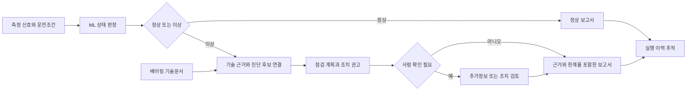
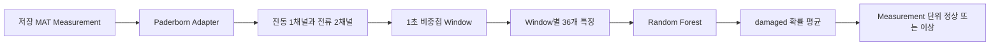
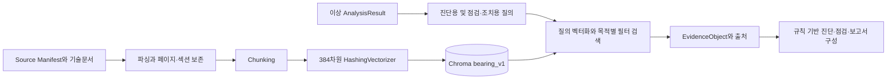
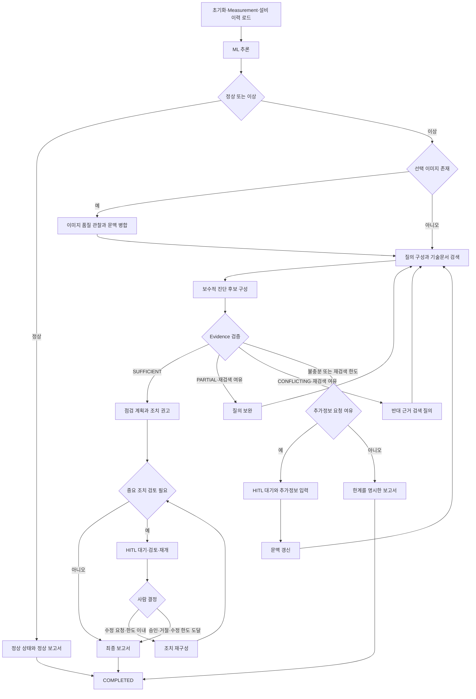
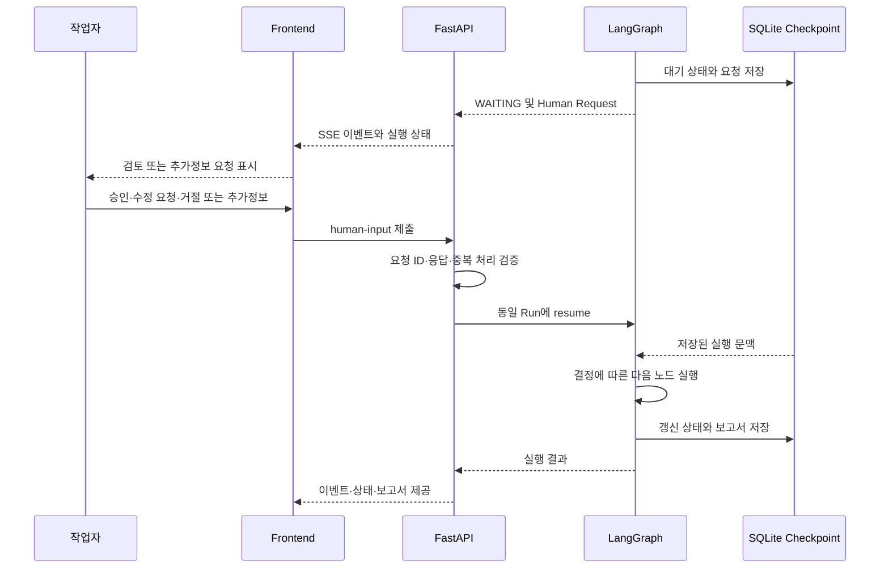
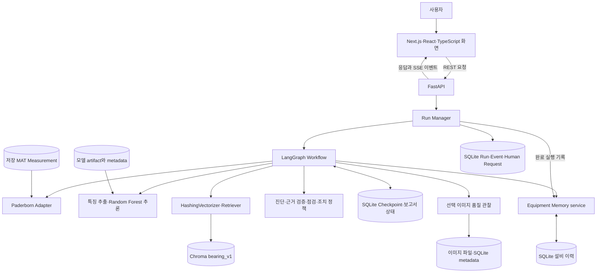
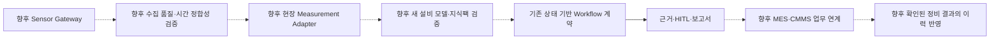

# AI Smart Factory Agent Office
## 프로젝트 기획서

**프로젝트 유형:** AI Native Final Project · 제조설비 진단 의사결정 지원 MVP  

> 저장된 베어링 측정 데이터를 분석하고, 이상이 감지된 경우 기술문서 근거를 연결하여 점검·조치 권고와 추적 가능한 보고서를 제공한다. 핵심 가치는 판정, 근거 확인, 사람의 검토, 이력 관리를 하나의 실행 흐름으로 통합하는 데 있다.

이 문서는 **초기 기획**, **최종 구현**, **향후 확장**을 구분한다. 최종 구현은 작성 기준일의 로컬 소스와 보관된 산출물을 기준으로 하며, 테스트를 새로 실행하지 않은 결과는 **기록된 검증 결과**로 표시한다. 이번 확인은 코드·파일 분석과 SQLite 읽기 전용 조회로 수행했다.

### 1. 프로젝트 개요

| 항목 | 내용 |
|---|---|
| 프로젝트명 | AI Smart Factory Agent Office |
| 목적 | 측정 데이터의 상태 판정부터 기술 근거, 점검 계획, 조치 권고, 검토 이력까지 연결하는 진단 지원 서비스 구현 |
| 추진 배경 | 센서 분석과 정비 문서가 분리된 업무에서는 이상 발견 이후의 해석과 후속 행동을 담당자가 다시 구성해야 함 |
| 핵심 문제 | 이상 여부만으로 원인을 확정하기 어렵고, 판단 근거와 검토 과정을 일관되게 추적하기 어려움 |
| 서비스 개념 | ML 분류 결과에 따라 LangGraph가 검색·진단·검증·사람 확인을 실행하고, Agent Office가 실제 진행 상태를 표시 |
| 주요 사용자 | 설비보전 담당자, 생산기술 담당자, 현장 관리자, 진단 결과 검토자 |
| 현재 입력 | Paderborn Bearing Dataset의 저장 MAT Measurement 240건을 선택·재생하는 Recorded Data 기반 입력 |
| 주요 결과 | 정상 보고서 또는 근거·진단 후보·점검 계획·조치 권고·한계를 포함한 Final Report |
| 기대 가치 | 진단 과정의 연결, 근거 추적, 후속 점검의 구조화, 실행 이력 재조회 |

현재 서비스는 실제 공장의 센서 수집·설비 제어 시스템이 아니다. ML은 정상/손상을 분류하고, 문서 검색은 관련 기술 근거를 제공하며, Agent는 다음 실행 단계를 관리한다. 최종 조치의 적절성은 사람이 검토한다. 시간·비용 절감 효과는 아직 측정하지 않았다.

### 2. 문제 정의

베어링 진단에서는 진동·전류의 신호 패턴, 회전속도 등 운전조건, 기술문서와 현장 관찰을 함께 해석해야 한다. 신호가 비정상이라는 판정과 특정 물리적 고장 원인의 확정은 서로 다른 판단이다. 본 프로젝트는 그 사이에 필요한 근거 검색과 점검 절차를 지원한다.

다음은 제품 설계의 출발점이 되는 **업무 가설**이다. 실제 공장 인터뷰나 현장 관찰로 검증된 사용자 조사 결과로 간주하지 않는다.

| 현장 문제 가설 | 기존 업무 방식의 한계 | 개선 필요성 | Agent 도입 목적 |
|---|---|---|---|
| 데이터 분석과 정비 문서가 분리됨 | 이상 판정 이후 문서를 별도로 찾아야 함 | 분석 결과와 관련 근거의 연결 | 이상 경로에서 목적별 기술문서 검색 수행 |
| 판단 근거를 다시 추적하기 어려움 | 문서명·페이지·적용 이유가 누락될 수 있음 | 입력과 출처의 일관된 보존 | Measurement·모델·Evidence·보고서를 Run ID로 연결 |
| 경험에 따른 판단 차이가 발생할 수 있음 | 같은 신호도 담당자별로 다른 점검을 수행 | 점검 항목과 불확실성의 명시 | 보수적인 진단 후보와 근거 연결 점검 계획 제공 |
| 진단 이후 업무 연결이 약함 | 이상 경보만 있고 다음 행동이 불명확 | 조치 검토와 추가정보 요청의 구조화 | 조건부 HITL과 권고조치 제공 |
| 과거 실행을 재구성하기 어려움 | 화면 종료 후 경과와 판단이 흩어짐 | 실행·검토·보고서 이력 보존 | Run History, Checkpoint, Equipment Memory 분리 관리 |

**도식 1. 문제에서 사용자 결과까지의 연결**  
분리된 정보가 하나의 검토 가능한 결과로 모이는 제품의 목적을 나타낸다.

### 3. 타깃 사용자

아래 사용자상은 MVP 검증을 위한 가설이다. 실제 사용자 테스트의 과업과 인터뷰를 통해 우선순위와 표현을 보완한다.

| 사용자 | 주요 업무 | 현재 문제 가설 | 사용 목적·대표 시나리오 | 기대 효과 |
|---|---|---|---|---|
| 설비보전 담당자 | 이상 확인, 현장 점검, 정비 검토 | 판정 후 무엇을 확인할지 별도로 정리해야 함 | 손상 Measurement 분석 후 근거와 점검 순서를 확인 | 점검 준비와 정보 탐색 부담 감소 가능성 |
| 생산기술 담당자 | 운전조건과 신호 분석, 원인 검토 | 분석 결과와 기술문서의 연결이 약함 | 신호 특징·모델 정보·문서 근거를 함께 검토 | 분석 과정의 설명과 재검토 용이성 |
| 현장 관리자 | 점검 우선순위와 조치 필요성 검토 | 진행 상태와 사람 확인 대상을 파악하기 어려움 | 실행 상태 확인, 중요 조치의 승인·수정 요청·거절 | 판단 책임과 검토 이력의 명확화 |
| 진단 결과 검토자 | 보고서와 근거의 타당성 확인 | 사용한 입력·모델·출처를 재구성해야 함 | Run History에서 보고서·Citation·사람 응답 확인 | 결과의 추적성과 한계 확인 |

대표 사용자 여정은 **Measurement 선택 → 진단 실행 → 상태와 근거 확인 → 필요한 사람 입력 → 보고서 검토 → 이력 재조회**이다. 이 단계들은 실제 화면과 API에 연결되어 있다. 다만 현장 관리자와 검토자를 구분한 위 표는 업무 역할 정의이며, 구현된 계정별 권한 체계를 의미하지 않는다.

### 4. 서비스 목표 및 범위

#### 4.1 제품 목표와 완료 기준

핵심 목표는 `Measurement 입력 → ML 상태 판정 → 이상 시 RAG 검색 → 근거 기반 진단 → 점검·조치 권고 → 필요 시 HITL → 최종 보고서`를 하나의 실행으로 연결하는 것이다.

| 목표 | 확인 가능한 완료 기준 |
|---|---|
| 정상과 이상에 맞는 실행 | 정상은 RAG·진단·점검·조치를 생략하고, 이상은 근거 검색으로 진입 |
| 근거 추적 | 보고서 Citation이 실제 검색된 Evidence의 문서·청크·페이지 또는 섹션과 연결 |
| 제한된 자동화 | 근거 부족은 추가정보 요청 또는 한계가 표시된 보고서로 처리; 중요 조치는 사람 확인 |
| 실행 복원 | 동일 Run ID의 상태·이벤트·보고서를 재조회하고, 대기 중 실행은 Checkpoint에서 재개 |
| 과정 가시성 | Backend 이벤트가 Agent Office의 역할별 상태와 진행 화면에 반영 |

#### 4.2 범위 구분

| 구분 | 범위 |
|---|---|
| **In Scope: 구현된 MVP** | 저장 Measurement 선택·Replay, 특징 추출과 Random Forest 추론, 이상 경로의 기술문서 검색, Evidence 기반 후보·검증·점검·조치·보고서, 조건부 HITL, Run/Event 저장, Checkpoint, Equipment Memory, SSE 진행 표시, 진단 이력·기술지식·모델·시스템 조회 화면 |
| **구현되었으나 검증 범위가 제한된 보조 기능** | 선택 이미지 업로드와 품질 관찰. 해상도·밝기·대비·사용 가능성을 확인하는 수준이며 베어링 고장 판독 기능은 아님 |
| **Out of Scope** | 실시간 설비 제어, PLC 정지 명령, 자동 정비 실행, 고장 발생 시점·잔여수명 예측, 실제 공장 센서 Streaming, 검증된 현장 고장 원인 확정 |
| **향후 확장** | Sensor Gateway, MES/CMMS 연계, 새 설비용 Adapter·모델·지식팩, 재학습과 일반화 평가, 의미 기반 검색 및 근거 검증 고도화 |

#### 4.3 초기 기획과 최종 구현의 관계

| 초기 기획 | 최종 구현 | 향후 판단 |
|---|---|---|
| ML/DL로 상태를 판정하고 후속 진단을 연결 | Random Forest 이진 분류 모델 1개 활성화 | 1D CNN 등은 비교 평가 이후 도입 검토 |
| LLM을 질의·진단·점검·보고서 구성에 활용 | 외부 LLM 없이 결정론적 QueryBuilder·reasoner·planner 사용 | LLM 도입 시 출처 충실도, 비용, 지연, 실패 처리 별도 검증 |
| Bearing ID 분리를 우선한 일반화 평가 | Measurement ID 단위 분리; 세 Bearing ID는 양쪽에 공유 | 신규 베어링 확보 후 Bearing 단위 holdout 필요 |
| 개발 단계에 맞춘 DB 확장 | SQLite 기반 Run/Event·Checkpoint·Memory 저장 | PostgreSQL 전환은 운영 요구가 확인된 이후 검토 |
| 고도화 항목으로 HITL·Memory·이미지 입력 고려 | HITL·Memory 구현, 이미지 품질 관찰 구현 | 실제 현장 관찰과 승인 정책을 포함한 검증 필요 |
| 다른 설비로 교체 가능한 모듈 구조 | Paderborn MVP와 독립 KAMP CNC Adapter·검색 PoC 존재 | 모델과 전체 Workflow의 범용성이 입증된 상태는 아님 |

### 5. AI 활용 전략

#### 5.1 Machine Learning: 신호에서 상태 판정까지

Paderborn 데이터는 저장된 실험 측정값이다. 현재 로컬 구성은 `K001`, `KA01`, `KI01` 각각 80건, 총 **240건**이며 정상 80건·손상 160건이다. 전체 데이터셋을 모두 사용한 평가가 아니다. UI Replay는 저장 신호를 재생하고, Backend는 선택한 Measurement를 읽어 분석한다.

활성 모델은 `bearing_rf_binary_v1`의 `RandomForestClassifier` v1.0이다. 시간·주파수 특징을 직접 확인할 수 있고, CPU 기반 기준 모델로 구성하기 적합하다는 선택 근거를 갖는다. 모델 복잡도를 늘리는 것보다 입력·분리·평가의 재현성을 우선한다.

| 구성 | 실제 구현 |
|---|---|
| 입력 채널 | `vibration_1`, `phase_current_1`, `phase_current_2` |
| Window | 64,000 Hz 기준 1초, 비중첩; 남은 불완전 구간은 제외 |
| 채널별 시간 특징 8개 | 평균, 표준편차, RMS, Peak, Peak-to-Peak, Crest Factor, Skewness, Kurtosis |
| 채널별 주파수 특징 4개 | Dominant Frequency, Spectral Centroid, Spectral Energy, Spectral Entropy |
| 전체 입력 | 3채널 × 12개 = **36개 Feature** |
| 모델 설정 | tree 300개, 최대 깊이 12, `min_samples_split=4`, `class_weight=balanced`, `random_state=42`, `n_jobs=-1` |
| Measurement 판정 | Window별 damaged 클래스 확률의 평균이 0.5 이상이면 `abnormal`, 아니면 `normal` |
| 출력 | `AnalysisResult`: Measurement·모델 식별자, 상태, 예측 클래스, confidence, 주요 신호 특징 |

**도식 2. ML 입력과 판정 단위**  
UI의 Replay와 별개로, 추론은 선택한 Measurement의 Window를 집계하여 한 건의 결과를 만든다.

학습·시험은 `measurement_id` 기준으로 층화 분리한다. Train/Test는 **180/60 Measurement**, **718/239 Window**이며 Measurement 교집합은 0이다. 같은 Measurement에서 생성한 Window가 양쪽으로 나뉘는 누수는 막지만, `K001`, `KA01`, `KI01`은 양쪽에 모두 존재한다.

**기록된 시험 Measurement F1=1.0은 위 60건에 한정된다.** 정상 20건·손상 40건의 혼동행렬은 `[[20, 0], [0, 40]]`이다. 새로운 베어링이나 현장의 일반화 성능을 뜻하지 않는다. confidence도 보정된 실제 고장 확률이 아니다. 특징 중요도는 모델의 분류 기여를 설명하며 물리적 인과관계를 증명하지 않는다.

근거: [모델 설정](../artifacts/ml/baseline_v1/metadata.json), [입력 사양](../artifacts/ml/baseline_v1/input_spec.json), [분리 결과](../artifacts/ml/baseline_v1/split.json), [평가 결과](../artifacts/ml/baseline_v1/metrics.json), [학습 코드](../backend/app/ml/training/baseline.py), [추론 코드](../backend/app/ml/inference/service.py).

#### 5.2 RAG 관련 구성: 기술문서 검색과 근거 기반 응답 구성

이 문서의 **RAG**는 기술문서를 검색하여 진단·보고서 구성에 근거로 전달하는 구조를 뜻한다. 현재 활성 경로는 **검색 증강과 결정론적 응답 구성**을 결합한다. 외부 LLM이 자유 문장을 생성하는 방식은 사용하지 않는다.

Knowledge Base는 Paderborn 공식 자료와 SKF 진단·고장 분석 자료를 포함한 **색인 문서 15개, 청크 183개**이다. Manifest의 source 항목 수와 색인 문서 수는 집계 단위가 다르다. 하나의 source에서 여러 문서가 파생될 수 있으므로 혼용하지 않는다.

| 단계 | 구현 방식과 선택 이유 |
|---|---|
| 출처 관리 | Manifest에 source ID, 발행기관, 공식 URL, 체크섬, 상태 등을 기록하여 자료의 식별과 변경 추적 지원 |
| 파싱·Chunking | PDF 페이지·HTML 섹션을 보존하고 같은 구조 단위를 묶음. 기본 최대 800개 공백 분리 단위와 100개 겹침으로 분할하며, 이는 LLM tokenizer의 정밀 token 수가 아님 |
| 벡터화 | `HashingVectorizer`: 단어 unigram/bigram, 소문자 변환, L2 정규화, `alternate_sign=False`, **384차원**. 외부 모델 다운로드 없이 재현 가능한 로컬 색인 구성 |
| 검색 | Chroma `bearing_v1`의 cosine distance 검색과 목적별 metadata filter 적용 |
| Evidence 구성 | 인접 중복 청크를 제거하고 문서·청크 ID, 제목, 발행기관, 페이지·섹션, 공식 URL을 `EvidenceObject`에 보존 |
| 응답 구성 | ML 결과와 Evidence를 규칙 기반 후보·점검·조치에 연결하고, 보고서 Citation을 Evidence metadata에서 구성 |

HashingVectorizer는 단어 패턴을 고정 차원으로 변환하는 통계적 표현이다. **의미 이해 기반 임베딩 모델이나 다국어 의미 검색 모델이 아니다.** 검색 점수는 `1 - cosine distance`를 기반으로 한 순위 점수이며 정확도·신뢰 확률·고장 확률로 해석하지 않는다.

**도식 3. 문서 색인과 이상 경로의 검색 연결**  
위쪽은 사전 색인, 아래쪽은 진단 실행 중 검색이다. 정상 경로는 이 검색 흐름에 진입하지 않는다.

Agent의 기본 이상 경로는 `DIAGNOSTIC_EVIDENCE`와 `INSPECTION_ACTION` 목적을 사용한다. Dataset 설명 검색과 평가 모드는 별도로 존재한다. 진단용 질의에 정답 상태나 손상 Fact Sheet·Measurement Log를 주입하지 않도록 경계를 둔다.

현재 reasoner는 일반적인 `bearing_condition_anomaly` 후보를 보수적으로 구성한다. 내부 손상의 위치나 구체적인 고장 메커니즘을 확정하지 않는다. Evidence verifier의 `SUFFICIENT`는 참조 ID와 진단·점검 목적의 근거 구성이 갖춰져 점검 계획으로 진행할 수 있다는 뜻이다. 문서가 해당 설비의 실제 고장을 입증했거나 모든 문장의 의미적 타당성을 검증했다는 뜻은 아니다.

근거: [Manifest](../knowledge/bearing_v1/manifests/source_manifest.json), [색인 결과](../artifacts/rag/bearing_v1/INGESTION_REPORT.md), [벡터화](../backend/app/rag/embedding/service.py), [검색](../backend/app/rag/retrieval/service.py), [질의 구성](../backend/app/rag/retrieval/query_builder.py), [진단·검증](../backend/app/agent/reasoning.py).

#### 5.3 LangGraph Agent: 상태에 따라 다음 행동 결정

하나의 LangGraph가 역할별 노드를 실행한다. Agent Office에 표시되는 센서·이상탐지·기술지식·진단·정비지원의 **5개 역할**은 독립적인 5개 LLM 에이전트가 아니다. Backend에는 **25개 등록 노드**가 있으며, UI는 주요 흐름을 사용자용 단계로 묶어 표시한다.

`AgentState`에는 Run·Measurement·설비 식별자, 분석 결과, 검색 질의와 Evidence, 진단 후보, 근거 상태, Retry 횟수, 점검·조치, 사람 응답, 이벤트, 보고서, 버전 정보가 들어간다. 원본 신호 배열은 상태에 직접 넣지 않는다. Adapter, ML inference, Retriever, Memory service는 각 노드에서 호출하는 실행 도구다.

**도식 4. 핵심 조건부 Workflow**  
실제 노드를 기능 단위로 묶은 도식이다. 오류는 해당 단계에서 `FAILED`로 종료할 수 있으며, 아래에는 정상 실행과 근거 보완 경로를 중심으로 표시했다.

기본 재검색 한도는 2회, 추가정보 입력 한도는 2회, 조치 수정 재진입 한도는 1회다. 설정과 상태에 따라 제한하며 무한 반복을 허용하지 않는다. 현재 수정 요청은 조치 생성 경로로 돌아가는 제어 기능이다. 자유 서술 피드백을 이해해 조치 내용을 실질적으로 개선하는 능력까지 검증한 것은 아니다.

근거: [Graph](../backend/app/agent/graph.py), [State](../backend/app/agent/state.py), [분기](../backend/app/agent/routing.py), [서비스 구성](../backend/app/agent/factory.py).

#### 5.4 HITL: 사람의 판단을 실행 흐름에 반영

HITL(Human-in-the-Loop)은 추가정보가 필요하거나 정책상 중요 조치가 발생했을 때 Workflow를 `WAITING`으로 전환하는 기능이다. `SHUTDOWN_CHECK`, `SCHEDULE_MAINTENANCE` 또는 높은 우선순위의 권고는 사람 확인 대상이다. `SHUTDOWN_CHECK`는 정지 검토 권고이며 정지 명령이 아니다.

| 사람 입력 | 구현된 동작 |
|---|---|
| 승인 `APPROVED` | 결정을 기록하고 보고서 생성으로 진행 |
| 수정 요청 `NEEDS_REVISION` | 허용 횟수 안에서 조치 생성과 승인 판정을 다시 수행; 한도 도달 시 미승인 상태를 한계에 표시 |
| 거절 `REJECTED` | 거절 사실을 기록하고 그 한계를 포함한 보고서 생성 |
| 추가정보 제출 | 작업자 관찰을 ML 결과와 분리하여 저장하고 검색 문맥 갱신 |

LangGraph `interrupt`와 SQLite Checkpoint가 대기 상태를 보존한다. `/api/v1/agent/runs/{run_id}/human-input`에 들어온 요청 ID와 응답을 검증한 뒤, `Command(resume=...)`로 같은 `thread_id=run_id`에서 재개한다. 완료된 Run의 조회는 새 진단 실행을 의미하지 않는다.

**도식 5. HITL의 중단·재개**  
작업자 응답은 동일 실행의 상태 전이로 처리되며, 설비로 제어 명령을 보내지 않는다.

`HITL_CONTROLLED` 시연은 실제 손상 Measurement와 ML·RAG 결과를 사용하되, 조치 생성 단계에서 권고를 높은 우선순위의 `SHUTDOWN_CHECK`로 바꿔 승인 흐름을 재현한다. 시연 조건은 UI와 Run metadata에 표시된다. 이는 실제 현장 위험 판정 정책의 적절성이나 정지 필요성을 입증하지 않는다.

근거: [HITL 노드](../backend/app/agent/nodes.py), [조치 정책](../backend/app/agent/policies/action_policy.py), [Checkpoint·resume](../backend/app/agent/service.py), [사람 응답 테스트](../backend/tests/test_human_resume.py).

#### 5.5 Memory: 실행 복원과 설비 이력의 구분

| 저장 영역 | 내용 | 사용 목적 |
|---|---|---|
| Run/Event DB | 실행 상태, 순서화 이벤트, 대기 요청, 처리된 사람 응답 | 이력 목록·진행 상태·검토 이력 조회 |
| LangGraph Checkpoint | 노드 실행 상태, 진단 문맥, 최종 보고서 등 | 중단 지점 재개와 실행 상세·보고서 복원 |
| Equipment Memory | 완료된 분석·진단·권고·작업자 관찰·명시적으로 제출한 정비 이력 | 후속 실행에서 같은 설비의 과거 문맥 제공 |
| 기술문서 저장소 | 문서 청크, 출처 metadata, 검색 벡터 | 기술적 근거 검색; 설비 실행 이력과 분리 |

완료된 실행은 설비·기록 유형·원본 Run에 기반한 식별자로 Memory에 저장되어 중복 누적을 방지한다. 설비별 이력 선택은 `equipment_id`를 기준으로 하고 가능한 경우 같은 운전조건을 우선한다. 과거 Agent 추론은 기술문서 근거나 확정된 고장 사실로 승격하지 않는다. 이력 조회만으로 Workflow를 다시 실행하거나 Memory를 추가하지 않는다.

Checkpoint와 Run/Event DB는 서로 보완한다. Run DB만으로 모든 상세 결과를 복원한다고 가정해서는 안 된다. 운영 시에는 관련 저장소를 함께 보존하고 복원 검증을 해야 한다.

근거: [Run 관리](../backend/app/agent/run_manager.py), [Memory service](../backend/app/memory/service.py), [Memory 선택](../backend/app/memory/selectors.py), [재조회 테스트](../backend/tests/test_checkpoint_resume.py).

### 6. 기술 아키텍처

아키텍처는 화면, API, Workflow, 분석·검색 도구, 저장소의 책임을 구분한다. 데이터 교체는 Adapter가, 모델 식별과 로딩은 파일 기반 Model Registry가 담당한다. 현재 Registry는 외부 MLOps 플랫폼이 아니라 모델 artifact와 metadata를 읽는 구현이다.

**도식 6. 현재 MVP의 구성과 저장 관계**  
화살표는 주요 호출·전달 관계를 나타낸다. Sensor Gateway와 MES/CMMS는 현재 아키텍처에 포함하지 않는다.

| 영역·기술 | 시스템 내 역할 | 선택 근거와 적용 범위 |
|---|---|---|
| Next.js·React·TypeScript | 통합 관제, 진단 이력, 기술지식, 모델, 시스템 화면 | 화면을 컴포넌트로 구성하고 API/Event 상태를 타입으로 관리 |
| FastAPI·Python·Pydantic | 입력 검증, 분석·실행·HITL·보고서 API | Python 분석 파이프라인과 연결하고 구조화된 데이터 계약 유지 |
| LangGraph | 조건분기, 제한된 Retry, HITL, Checkpoint | 실행 상태와 다음 행동을 명시적으로 관리하고 복원 지점 제공 |
| scikit-learn·RandomForestClassifier | 36개 특징의 정상/손상 분류 | 해석 가능한 특징 기반 기준 모델과 고정 설정 평가 지원 |
| HashingVectorizer·Chroma | 로컬 문서 벡터화·metadata 필터·유사도 검색 | 외부 API 없이 재현 가능한 검색과 출처 관리; 의미 검색에는 한계 |
| SQLite | 실행·이벤트·Checkpoint·설비 이력·이미지 metadata | 로컬 MVP에서 영속성과 재조회 구현; 다중 인스턴스 운영 적합성은 별도 검증 |
| Paderborn MAT Adapter | 실제 파일 파싱과 Measurement 계약 제공 | 원본 데이터 형식을 분석·Workflow에서 분리 |
| SSE | 순서가 있는 AgentEvent 전달 | 서버의 실행 경과를 화면에 전달하는 단방향 통신 요구에 대응 |

Frontend는 이벤트를 역할별 상태에 매핑하고 마지막 sequence 이후의 이벤트를 받아 복구한다. 재연결은 backoff를 적용해 최대 4회 시도한다. **SSE는 Agent 이벤트 스트리밍이며 공장 센서 스트리밍이 아니다.** 상태 조회, 재연결, 완료 보고서 조회를 함께 사용한다.

API의 대표 경계는 `/api/v1` 아래 Measurement·Analysis, `/agent/runs`, Run별 `/events/stream`, `/human-input`, `/report`이다. 화면은 저장소에 직접 접근하지 않는다. 의존성은 [Backend requirements](../backend/requirements.txt)와 [Frontend package](../frontend/package.json), 화면 동기화는 [실행 Hook](../frontend/src/features/agent-run/hooks/use-agent-run.ts)을 기준으로 한다.

### 7. 핵심 기능 및 사용자 시나리오

세 시나리오는 같은 실행·조회 구조를 사용한다. UI의 시연용 입력 이름과 ML의 예측 결과를 구분하며, 실행 경로는 Backend 판정과 상태에 의해 결정된다.

| 항목 | Scenario A: 정상 Bearing | Scenario B: 손상 Bearing | Scenario C: HITL 통제 시연 |
|---|---|---|---|
| 입력 | `paderborn:K001:N09_M07_F10:01` | `paderborn:KA01:N09_M07_F10:01` | `paderborn:KA01:N09_M07_F10:02` + `HITL_CONTROLLED` |
| 실행 조건 | ML `normal` | ML `abnormal`, 근거 충분, 중요 조치 승인 불필요 | 실제 ML·RAG 수행 후 통제된 중요 조치 조건 적용 |
| Workflow | 로드 → Memory → ML → 정상 보고서 | 로드 → Memory → ML → 검색 → 진단·검증 → 점검·조치 → 보고서 | B와 같은 분석 후 승인 요청 → `WAITING` → 사람 입력 → Checkpoint resume → 후속 경로 |
| 제공 결과 | 정상 판정과 입력·모델·한계 | Evidence, 보수적 후보, 점검·권고, Citation과 한계 | 분석 결과, 사람 요청·결정 이력, 결정이 반영된 보고서 |
| 저장·재조회 | Run/Event, Checkpoint, 완료 Memory; Run과 보고서 조회 | 동일 구조에 근거와 진단·권고 포함 | 동일 구조에 시연 metadata와 처리된 사람 응답 포함 |

**기록된 결과의 대조**

2026년 10월 1일 검증 보고서는 A/B/C 완료와 C의 `APPROVED` 사례를 기록한다. 이번 읽기 전용 확인에서는 로컬 Run/Event DB에 남아 있는 **2026년 10월 12일의 각 최신 입력별 실행**을 별도로 확인했다.

| 최신 저장 사례 | 상태 | Evidence | Event | 보고서 가용 표시 | 사람 결정 |
|---|---|---:|---:|---|---|
| A | `COMPLETED` | 0 | 19 | 있음 | 해당 없음 |
| B | `COMPLETED` | 9 | 37 | 있음 | 승인 요청 없음 |
| C | `COMPLETED` | 9 | 46 | 있음 | **`REJECTED`** |

따라서 **`COMPLETED`는 진단 Workflow의 완료이며 조치 승인·정비 수행·설비 복구를 뜻하지 않는다.** 최신 C는 거절을 기록하고 종료한 사례다. 위 표의 보고서 항목은 DB의 가용 표시를 확인한 것이며, 이번 작업에서 API를 호출해 보고서 복원을 새로 시험한 것은 아니다. A/B/C의 입력별 수치를 모든 실행의 고정값으로 일반화하지 않는다.

별도의 보관 E2E에는 통제된 재검색·추가정보 요청 경로와 합성 이미지를 사용한 경로도 있다. 합성 이미지는 Paderborn 신호와 동기화된 실제 시험체 사진이 아니다. 이미지 미첨부 A/B/C와 구분한다.

근거: [검증 보고서](supporting/TEST_RESULTS.md), [E2E 통합 기록](../artifacts/e2e/E2E_INTEGRATION_REPORT.md), [HITL 승인·거절 테스트](../backend/tests/test_human_resume.py), [수정 요청 테스트](../backend/tests/test_approval_routing.py). 최신 저장 사례는 로컬 `artifacts/api/runtime/agent_runs.sqlite3`의 읽기 전용 조회 결과이며 해당 Runtime DB는 공개 저장소에 포함되지 않는다.

### 8. 개발 추진 전략 및 일정

#### 8.1 개발 단계별 일정표

개발은 **착수 후 4주간의 MVP 구현 계획**으로 추진한다. 1주차에 범위와 공통 인터페이스를 확정하고, 2주차부터 ML·RAG·Backend·Frontend를 병렬로 개발한다. 3주차에는 정상·이상·HITL 경로를 통합하고, 4주차에는 검증·배포·사용자 피드백·최종 제출물을 마무리한다.

아래 기간은 **본 기획서의 4주 추진 계획안**이며 과거 개발 실적이나 완료 사실을 나타내지 않는다. 실제 착수일이 확정되면 상대 주차를 달력 날짜로 전환한다. 4주 내 수행 범위는 Paderborn 대표 데이터 기반 MVP로 한정하고, 역할별 병렬 작업이 가능하다는 전제로 계획한다.

| 단계 | 주요 작업 | 계획 기간 | 주요 산출물 |
|---|---|---|---|
| 프로젝트 기획 및 요구사항 정의 | 문제·사용자 가설, 핵심 시나리오, MVP와 제외 범위, 완료 기준 정의 | 1주차 · 1~7일차 | 프로젝트 기획서, 요구사항·우선순위 목록 |
| 시스템 아키텍처 설계 | Adapter·AnalysisResult·EvidenceObject·AgentState·Event 계약, API·저장소 경계 정의 | 1주차 · 1~7일차 | 아키텍처, 데이터 계약, API·저장 구조 명세 |
| Paderborn 데이터 분석 및 전처리 | MAT 구조·채널·운전조건 확인, 품질 점검, Window·Feature·데이터 분리 정책 수립 | 1주차 · 1~7일차 | Data Adapter, Profiling 결과, 전처리·분리 기준 |
| ML 모델 개발 및 평가 | 36개 Feature 기반 Random Forest 학습, 누수 검사, F1·Recall 평가, 추론 서비스 연결 | 2주차 · 8~14일차 | 모델 artifact·metadata, 평가 결과, 추론 모듈 |
| RAG Knowledge Base 구축 | 출처 확인, Manifest, Chunking, 벡터 색인, 목적별 검색·Citation·검색 평가 | 2주차 · 8~14일차 | Knowledge Base, Retriever, Evidence 계약, 검색 평가 결과 |
| LangGraph Agent Workflow 구현 | 정상·이상 분기, Tool 연결, 근거 검증·Retry, 점검·조치·보고서, HITL 구현 | 2~3주차 · 8~21일차 | 실행 Graph, 상태 전이·정책, 경로 테스트 |
| Backend API 및 데이터 저장 구조 구현 | 분석·Run·SSE·HITL·보고서 API, SQLite 저장, Checkpoint·Equipment Memory 연결 | 2~3주차 · 8~21일차 | API, 실행·이벤트·이력 저장소, 복원·중복 방지 테스트 |
| Frontend UI 개발 | Measurement 선택·Replay, Agent Office, 진행·근거·보고서·HITL·이력 화면 | 2~3주차 · 8~21일차 | 사용자 화면, API·Event 연동, 화면 상태 복원 |
| 시스템 통합 및 E2E 검증 | 실제 데이터·모델·검색 연결, 정상·손상·통제 HITL, 재연결·재시작·Citation 검사 | 3주차~4주차 초반 · 15~23일차 | 통합 MVP, E2E 결과, 결함·수정 기록 |
| 외부 배포 | 배포 환경·영속 저장소 적용, health·ready·SSE·HITL·보고서 smoke test | 4주차 초반 · 22~23일차 | 외부 시연 환경, 배포·복원 검증 결과 |
| 사용자 테스트 및 피드백 반영 | 최소 5명 과업 수행, 이해도·근거 확인·점검 유용성 평가, 주요 문제 수정 | 4주차 중·후반 · 24~28일차 | 실제 사용자 피드백, 개선 내역, 회귀 확인 |
| 최종 산출물 정리 | 기획서·기술설명서·완료보고서·README 정합성 검토, 발표자료·시연 준비 | 4주차 · 22~28일차 | 최종 제출 문서, 발표자료, 데모 시나리오·검증 근거 |

1주차의 공통 계약을 기준으로 모듈을 나누고, 2주차에는 개별 기능 검증과 최소 연결을 병행한다. 3주차에는 실제 ML·RAG 결과와 Backend 이벤트를 UI에 연결한다. 배포 환경 준비와 사용자 모집은 1주차부터 진행하여 4주차 검증을 위한 선행 조건을 확보한다.

#### 8.2 개발 일정 Gantt Chart

**4주 MVP 개발 추진 계획**  
막대는 단계별 예정 작업 구간, 마름모는 주차별 완료 목표다. ML·RAG·API·UI 개발을 병렬 배치한다. 가로축은 착수일을 1일차로 보는 상대 일정이며, `001일차`는 1일차를 뜻한다. 1주차는 1~7일차, 2주차는 8~14일차, 3주차는 15~21일차, 4주차는 22~28일차다.

```mermaid
gantt
    title AI Smart Factory Agent Office 4주 개발 계획
    dateFormat X
    axisFormat %j일차
    tickInterval 1week
    weekday thursday
    todayMarker off
    %% 0은 상대 일정의 원점이다. 실제 착수일이나 달력 날짜를 지정하지 않는다.
    %% 각 막대의 종료점은 마지막 작업일 다음 날의 경계다.
    section 기획 및 준비
    기획·요구사항 정의          :planning, 0, 7d
    시스템 아키텍처 설계       :architecture, 0, 7d
    Paderborn 분석·전처리      :dataPrep, 0, 7d
    section 핵심 기능 병렬 개발
    ML 모델 개발·평가         :mlModel, after dataPrep, 7d
    RAG Knowledge Base 구축   :knowledge, after architecture, 7d
    LangGraph·HITL 구현       :agentWorkflow, after architecture, 14d
    Backend API·저장·Memory   :backend, after architecture, 14d
    Frontend UI·이벤트 연동    :frontend, after architecture, 14d
    section 통합 및 최종 검증
    시스템 통합·E2E 검증      :integration, after mlModel knowledge, 9d
    외부 배포·운영 검증       :deployment, after agentWorkflow backend frontend, 2d
    사용자 테스트·피드백 반영  :userTest, after integration deployment, 5d
    최종 문서·발표·시연 준비   :deliverables, after backend frontend, 7d
    section 목표 마일스톤
    1주차 완료 목표           :milestone, gateOne, after planning architecture dataPrep, 0d
    2주차 완료 목표           :milestone, gateTwo, after mlModel knowledge, 0d
    3주차 완료 목표           :milestone, gateThree, after agentWorkflow backend frontend, 0d
    4주차 완료 목표           :milestone, gateFour, after userTest deliverables, 0d
```

차트는 총 28일의 계획을 나타낸다. 막대 종료점과 마일스톤은 해당 주차의 마지막 날이 끝나는 경계에 표시되므로, 4주차 완료 목표는 28일차 종료 경계에 위치한다. 주차는 주말을 포함한 7일 단위의 일정 구간이며 일별 투입 공수를 뜻하지 않는다.

#### 8.3 주요 마일스톤

| 목표 시점 | 마일스톤 | 주요 산출물 | 완료 판단 기준 |
|---|---|---|---|
| 1주차 종료 | 범위·인터페이스·데이터 기준 확정 | 요구사항, 아키텍처·API 계약, Profiling·분리 정책 | 핵심 시나리오와 제외 범위가 명확하고, 실제 Measurement를 읽어 모듈 개발을 시작할 수 있음 |
| 2주차 종료 | ML·RAG 개별 기능 검증 | 모델·평가 artifact, Knowledge 색인·검색 결과, API·UI 기본 골격 | ML 추론과 출처를 포함한 검색이 각각 동작하고, 고정된 계약으로 연결 가능 |
| 3주차 종료 | 핵심 E2E 연결 | 통합 MVP, 정상·손상·HITL 시나리오, 실행·보고서 저장 | 실제 ML·RAG 결과가 화면에 반영되고, 정상 경로 검색 생략과 HITL 중단·재개를 확인 |
| 4주차 종료 | 최종 검토 및 제출 준비 | E2E·배포 결과, 사용자 피드백·개선 기록, 최종 문서·발표·데모 | 핵심 결함을 해소하고 실제 수행한 검증·미완료 사항·제품 한계를 제출물에 일관되게 반영 |

외부 배포와 사용자 테스트는 4주차의 **달성 목표**다. 일정표에 배치했다는 이유로 완료로 간주하지 않으며, 결과와 완료 여부는 검증 기록으로 판단한다.

#### 8.4 일정 관리 및 변경사항

주차별 마일스톤에서 산출물과 연결 상태를 확인하고, 계획 대비 진행 상황·의존성·결함을 함께 점검한다. 담당 책임은 제품·통합, Data/ML, Knowledge/RAG, Workflow/API, UI/QA로 나누며, 공통 계약 변경은 영향 모듈과 재검증 범위를 확인한 뒤 반영한다.

| 일정 위험 | 관리 및 조정 방안 |
|---|---|
| 데이터 준비·모델 평가 지연 | 1주차에 데이터 접근과 분리 정책을 먼저 확인하고, 대표 Bearing·Random Forest 기준 모델에 집중 |
| ML·RAG·API·UI 연결 지연 | 1주차에 입출력 계약을 확정하고, 2주차부터 최소 연결을 확인하여 3주차 통합 위험 분산 |
| HITL·Checkpoint·Memory 복원 결함 | 3주차에 승인·수정·거절·재조회 검사를 우선 수행하고, 4주차 통합 검증에 수정 여유 확보 |
| 배포 환경·사용자 확보 지연 | 1주차부터 환경과 참가자를 준비하고, 3주차 종료 전 접근 가능 여부와 테스트 일정을 확인 |
| 4주차 결함·피드백 집중 | 핵심 흐름의 오류와 이해를 방해하는 문제를 우선 수정하고, 화면 장식·추가 기능은 후속 과제로 분리 |

4주 내 우선 확보할 결과는 **정상·이상 분기 → 근거 검색·진단 → 점검·조치 → 필요 시 HITL → 보고서·이력 재조회**의 완결성이다. 신규 설비 일반화, CNN 비교, Sensor Gateway·MES/CMMS 연계, KAMP CNC의 서비스 통합은 후속 확장으로 관리한다. 일정 변경 시 사유·변경 범위·목표 주차·검증 영향을 기록하며, 완료 기준을 충족하지 못한 작업은 실제 상태와 잔여 과제를 명시한다.

### 9. 검증 및 품질관리 계획

#### 9.1 계획과 수행 결과의 구분

검증은 모듈 정확성, Workflow 연결, 사용자 이해 가능성으로 나눈다. 테스트 함수의 존재는 최신 실행 성공의 증거가 아니다. 기존 검증 자료는 설계 참고 근거로 활용하고, 본 계획의 최종 검증은 4주차에 수행하여 실행일·대상 코드 버전·결과를 기록한다. 이번 문서 작업에서는 테스트를 재실행하지 않았다.

| 검증 영역 | 기획상 검증 목표 | 기존 검증 자료 또는 예정 과업 | 해석 한계·완료 판단 기준 |
|---|---|---|---|
| ML | F1·Recall·분리 누수·일반화 평가 | 시험 Measurement 60건 F1=1.0; 분리 목록 교집합 0 | Bearing ID 공유. 신규 베어링·현장·확률 보정 미검증 |
| RAG Retrieval | 예상 출처 검색, 필터, 빈 결과, 출처 매핑 | 24질의 중 답변 가능 23·불가능 1; Hit@5 약 0.9130, MRR 약 0.8623 | 지표 분모는 답변 가능 23질의. 의미적 정답률이 아님 |
| Agent Workflow | 정상·이상·부분·불충분·상충·Retry·오류 경로 | 통제 Retry/HITL을 포함한 보관 E2E와 경로 테스트 존재 | 통제 경로 성공은 현장에서 해당 조건이 정확히 감지된다는 뜻이 아님 |
| Backend | Schema·API·ML/RAG 연결·저장·오류 | 전체 pytest 실행, 실패 원인 분석 및 수정 후 회귀 검증 | 4주차 실행일·Git Commit·테스트 범위·통과/실패/제외 수와 원본 로그를 함께 기록 |
| Frontend | API 처리, reducer, 복원, 검색어 변환 | 2026-10-01 **28 passed**, TypeScript 검사·Production Build 통과 기록 | 일부 작업 트리 변경이 있어 현재 화면 회귀 결과로 단정 불가 |
| HITL | 승인·거절·수정·추가정보·중복 응답·resume | 관련 테스트와 승인/거절 저장 사례 확인 | 실제 조직의 승인 권한·현장 정책 적합성은 별도 검증 |
| Memory·Checkpoint | 설비 격리, 중복 방지, 새 서비스의 상태 복원 | 테스트와 재조회 기록 존재 | 운영 복구·백업·동시 사용 조건은 별도 검증 |
| E2E | 실제 Measurement·모델·검색·보고서 연결 | A/B/C 기록, 통제 Retry·HITL, 재연결·재시작·Citation 검사 기록 | 합성 이미지와 실제 시험체 이미지 구분 필요 |
| 배포 환경 | 외부 접근, health·ready·SSE·HITL·보고서 복원 | 4주차 초반 `factory.aipath.kr` 시연 환경의 정상·이상·통제 HITL 경로 검증 및 접속 기록 확보 | 로컬 앱의 Cloudflare 외부 연결과 클라우드 서버 배포를 구분하고, 제출 직전 평가자 접근성 재확인 |
| 사용자 테스트 | 최소 5명의 과업 완료, 이해도, 근거·점검의 유용성 확인 | 4주차 중·후반 과업 수행·질문·응답 기록, 피드백 분석 및 우선순위별 개선 | 참여자 수·실시일·과업 결과를 기록하고, 개선 요청과 실제 반영·재검증 내역을 구분 |

RAG 평가에서는 답변 가능 질의 중 `dataset_signals`, `paderborn_damage_taxonomy`가 Hit@5에 실패했다. 답변 불가능한 `unanswerable_plc_recipe`에도 검색 결과가 반환되었다. 따라서 빈 검색 결과가 없다는 사실을 품질 성공으로 평가하지 않으며, 향후 도메인 밖 요청과 근거 없는 주장에 대한 기권 기준을 강화해야 한다. 지표 계산은 [평가 코드](../backend/app/rag/evaluation/runner.py), 수치는 [RAG 평가 artifact](../artifacts/final/rag_evaluation.json)를 따른다.

#### 9.2 품질관리와 출시 판단

1. **데이터·모델:** 입력 채널과 Feature 순서, 모델·데이터 버전, Measurement 분리를 함께 검사한다. 일반화 주장은 Bearing 단위 평가 이후 판단한다.
2. **근거·보고서:** 검색된 ID만 인용하고 PDF 페이지·HTML 섹션의 실제 metadata를 보존한다. 검색 결과 존재와 물리적 고장 확정을 구분한다.
3. **실행·사람 확인:** 정상 경로 RAG 생략, Retry 한도, 입력 검증, 동일 Run resume, 거절 기록과 미승인 표시를 확인한다.
4. **복원·화면:** 새로고침·연결 끊김·프로세스 재시작 후 상태와 보고서를 확인하고, 이력 조회가 새 실행이나 Memory 추가를 일으키지 않는지 검사한다.
5. **출시:** 외부 환경 검증과 실제 사용자 테스트를 별도 완료 조건으로 관리한다. 4주차에 기능 검증·외부 접근성·사용자 피드백 반영 결과를 모아 출시 가능 여부를 판단한다. 과거 Release Gate는 당시 기록으로 보존하고 최신 검증 결과와 구분한다.

계획된 사용자 테스트는 Measurement 선택, 상태 이해, 근거 확인, 점검 계획 이해, HITL 응답, 보고서 조회를 과업으로 한다. 과업 완료 여부·오류·수행 시간과 1~5점 평가·정성 의견을 실제로 기록한다. 정량 목표치는 실제 기준선 측정 후 정하며, 임의의 절감률이나 만족도 목표 달성값을 만들지 않는다.

참고 자료: [전체 테스트 기록](supporting/TEST_RESULTS.md), [사용자 테스트 계획](../artifacts/user_test/test_protocol.md), [기존 참여 현황 기록](../artifacts/final/user_test_summary.json), [기존 Release Gate](../artifacts/final/release_gate.json). 기존 기록은 참고 자료이며 본 계획의 수행 결과가 아니다. Backend 통과 수는 과거 문서의 163건과 이후 Git 문서 정정의 162건을 새 실행 결과로 인용하지 않으며, 최종 검증 시 원본 로그로 확정한다.

### 10. 기대 효과

| 기대 효과 | 현재 구현이 제공하는 기반 | 효과를 확인할 후속 방법 |
|---|---|---|
| 진단 과정 통합 | Measurement부터 보고서까지 하나의 Run으로 연결 | 사용자가 별도 도구 없이 핵심 과업을 완료하는지 관찰 |
| 근거 기반 의사결정 지원 | 진단 후보·점검·조치와 Evidence·Citation 제공 | 검토자가 근거와 한계를 정확히 찾아 설명하는지 평가 |
| 반복 검색 부담 감소 가능성 | 이상 결과를 바탕으로 목적별 문서 검색 | 기존 수작업과 문서 탐색 시간·검색 횟수 비교 |
| 점검·조치 절차 구조화 | 점검 계획, 권고조치, 조건부 사람 검토 | 현장 전문가의 절차 적합성 검토 |
| 이력과 보고서 추적 | Run/Event·Checkpoint·설비 이력 저장 | 재조회·보고서 복원·검토 이력 확인 과업 평가 |
| 제조 도메인 확장 가능성 | Adapter·AnalysisResult·Evidence 계약, 독립 CNC PoC | 신규 설비별 데이터·모델·지식팩·Workflow 통합 평가 |

현재 확인된 것은 이 효과를 지원하는 기능과 기록이다. 작업시간·정비비·다운타임 절감, 고장 예방 성과, 현장 사용자 만족도는 아직 입증하지 않았다.

### 11. 한계 및 향후 발전 방향

#### 11.1 현재 한계

| 한계 | 제품 관점의 의미 | 다음 검증 방향 |
|---|---|---|
| Recorded Data 기반 MVP | 실제 센서 수집의 누락·지연·잡음을 검증하지 못함 | Sensor Gateway와 수집 품질 시험 |
| 대표 베어링 3개에 한정된 평가 | 높은 내부 지표를 다른 설비로 일반화할 수 없음 | 신규 Bearing·운전조건·설비·시점 분리 평가 |
| 정상/손상 이진 분류 | 고장 위치·원인·발생 시점을 예측하지 않음 | 명확한 라벨과 관찰 근거가 확보된 별도 문제 정의 |
| HashingVectorizer 검색 | 동의어·문맥·한국어 질의의 의미 이해에 한계 | 의미 기반 검색 후보와 실패·기권 평가 비교 |
| 규칙 기반 진단·검증 | 일반적 후보와 목적별 근거 확인 중심 | 전문가 검토, 주장별 근거 충실도와 상충 검증 강화 |
| HITL 통제 시연 | 승인·거절·재개는 확인했으나 현장 위험 정책은 미검증 | 실제 책임자·승인 권한·조치 정책 검토 |
| 이미지 품질 관찰 | 사진으로 내부 베어링 고장을 판독하지 못함 | 실제 시험체와 동기화한 별도 이미지 평가 |
| 사용자·외부 운영 검증 부족 | 서비스 효과와 운영 준비도를 확정하기 어려움 | 실제 사용자 테스트, 외부 환경·영속 저장 복원 검증 |

#### 11.2 KAMP CNC 확장 PoC

`poc/kamp_cnc`는 기존 Bearing 서비스와 분리된 **데이터 계약·Adapter·문서 검색 확장성 사례**다. CNC 모델을 학습하거나 기존 모델을 CNC에 적용한 결과가 아니다.

| 항목 | 기록된 PoC 결과와 의미 |
|---|---|
| 데이터 | 1,085행 × 43열, 공정 Feature 40개; PASS 986·FAIL 99 |
| Adapter | 1,085행 모두 개별 Observation으로 변환, Feature 불일치 0, 검증 실패 0 |
| 라벨 | `passorfail=0`은 양품 PASS, `1`은 불량 FAIL. `dataset_ground_truth`, `prediction=false`로 구분 |
| 검색 | 공식 KAMP Guidebook 1개에서 49청크 구성. 독립 512차원 signed SHA-256 hashing과 cosine similarity 사용 |
| 검증 기록 | Adapter·RAG 합계 29개 테스트 통과, 실제 FAIL Observation 검색 3건과 기권 검사 3건 기록 |
| 독립성 | Bearing의 HashingVectorizer·Chroma와 별도 구현. 기존 서비스의 모델·DB·Workflow에 통합되지 않음 |

동일 `SerialNo`와 시각을 공유하면서 PASS/FAIL이 다른 99쌍이 존재한다. Feature 값은 서로 다르지만 물리적·통계적 독립성과 생성 경위는 확인되지 않았다. Adapter는 이를 임의 병합하거나 라벨을 수정하지 않는다. CNC 모델 학습·F1·정확도·현장 일반화는 **미검증**이며, 라벨 처리와 데이터 분리 원칙이 정리되기 전 성능을 주장하지 않는다. PASS는 제품 품질 라벨이지 설비 무고장의 증거가 아니다.

근거: [PoC 개요](../poc/kamp_cnc/README.md), [Adapter 호환성](../poc/kamp_cnc/results/compatibility_report.md), [검색 검증](../poc/kamp_cnc/results/rag_evidence_report.md), [동일 식별자 쌍 분석](../poc/kamp_cnc/results/paired_serial_audit.md), [29개 테스트 기록](../poc/kamp_cnc/results/rag_test_results.txt).

#### 11.3 현장 확장 로드맵

**도식 7. 향후 현장 입력·업무 연계의 검증 경계**  
점선은 향후 연계다. 기존 계약을 재사용하더라도 새 설비의 데이터·모델·근거 검증을 통과해야 한다.

확장 순서는 현장 데이터 계약과 품질 확인, 설비별 모델 재학습·일반화 검증, 지식팩 적합성 검토, 실제 승인 정책 적용, 제한된 현장 파일럿으로 정한다. MES/CMMS 연계는 검토된 점검·정비 업무의 전달과 결과 기록을 목표로 하며 자동 설비 제어를 포함하지 않는다.

---

### 부록. 근거 확인 범위와 제출 전 확인 사항

| 확인 구분 | 이번 문서 작성에서 수행한 확인 |
|---|---|
| 기획 의도 | 문제·사용자 가치, 단일 Workflow, 데이터·모델·지식 분리, 정상/이상 분기, E2E 우선순위를 최종 구현과 대조 |
| ML | 실제 MAT 240개 집계, Feature 목록 36개, 직렬화된 모델의 tree·설정 확인, split 목록 교집합과 metrics 대조 |
| RAG | Manifest·chunking·query·retrieval 코드 대조, Chroma SQLite 읽기 전용 조회로 15문서·183벡터·384차원 확인 |
| Agent·HITL | 등록 노드 25개 정적 집계, 정책·분기·interrupt/resume·보고서 코드와 테스트 대조 |
| 저장·화면 | Run 조회·Checkpoint·Memory 저장 경계와 SSE·화면 복원 코드 확인, 최신 A/B/C 저장 기록 확인 |
| 확장·일정 | CNC 코드·테스트·검증 보고서, Git History, 날짜가 있는 artifact, 배포 스크립트 대조 |

문서 형식은 로컬에서 표의 열 수·코드 블록·상대 링크를 점검하고, Mermaid 8개(Flowchart 6개, Sequence Diagram 1개, Gantt Chart 1개)의 구문과 계획 일정의 일치를 확인한다. GitHub의 실제 표시 결과는 제출 전에 별도로 확인한다.

**수정·배제한 해석:** 현장 정확도 100%, 전체 Paderborn 데이터셋 평가, 의미 이해 기반 Hashing 임베딩, 외부 LLM 자유 생성 진단, 독립 LLM 에이전트 5개, 정상 경로 RAG 실행, HITL 완료와 조치 승인의 동일시, 센서 Streaming과 SSE의 혼동, CNC 고장 예측 성능, 사용자 효과·개발 기간·외부 배포 완료의 추정.

**계획상 검증 및 후속 과제:** 4주차에는 자동화 테스트·외부 환경·최소 5명 사용자 테스트를 검증하고, 제출 전 Markdown·Mermaid 표시와 근거 자료의 공개 범위를 점검한다. 신규 베어링 일반화, 실제 이미지·현장 승인 정책, CNC 쌍 데이터 생성 경위는 후속 검증 과제로 관리한다. 모델·Runtime DB·문서 원본 등 Git 제외 자산은 공개 저장소만으로 모두 재현되지 않을 수 있다.

자료의 출처·이용조건과 재배포 범위는 [자산 출처 목록](supporting/SOURCES_AND_AI_USAGE.md) 및 [Knowledge Source Manifest](../knowledge/bearing_v1/manifests/SOURCE_MANIFEST.md)를 따른다. 원본 데이터와 기술문서가 프로젝트 자체 제작물인 것처럼 표현하지 않는다.
