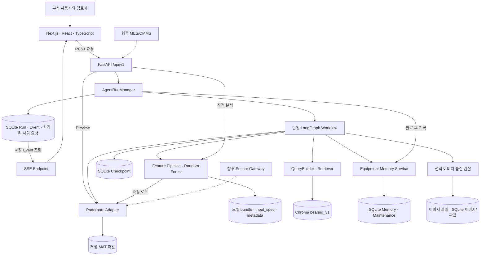
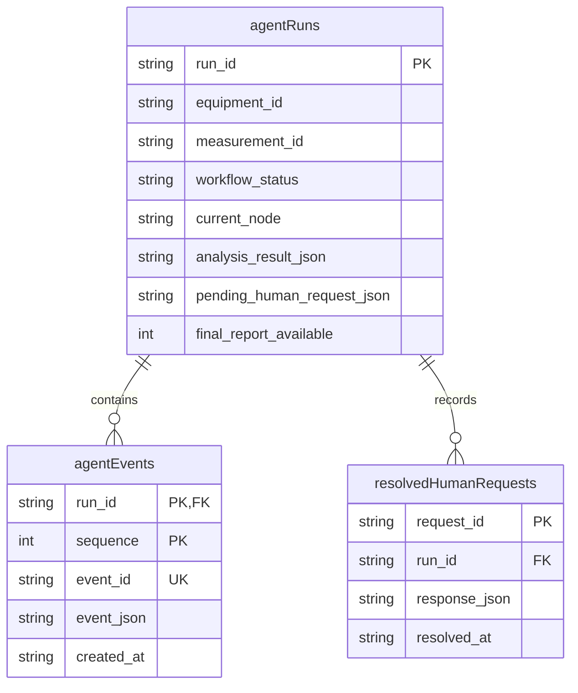
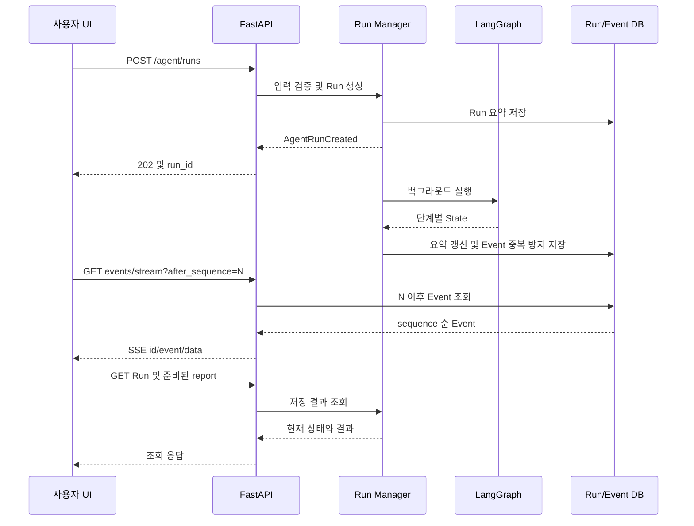
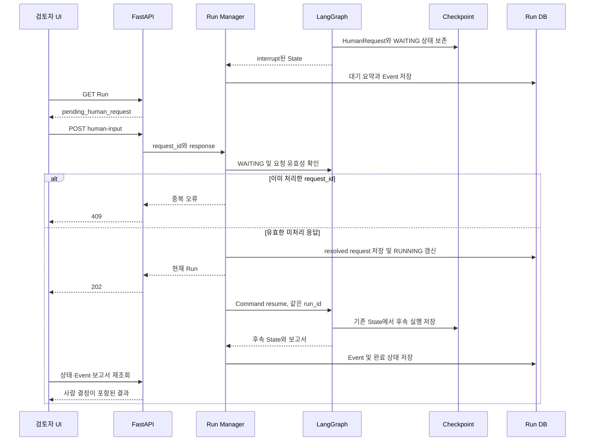
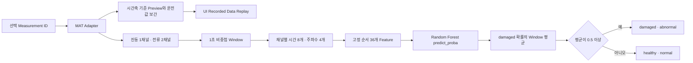
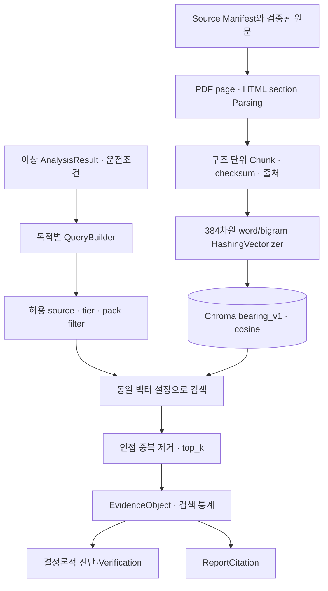
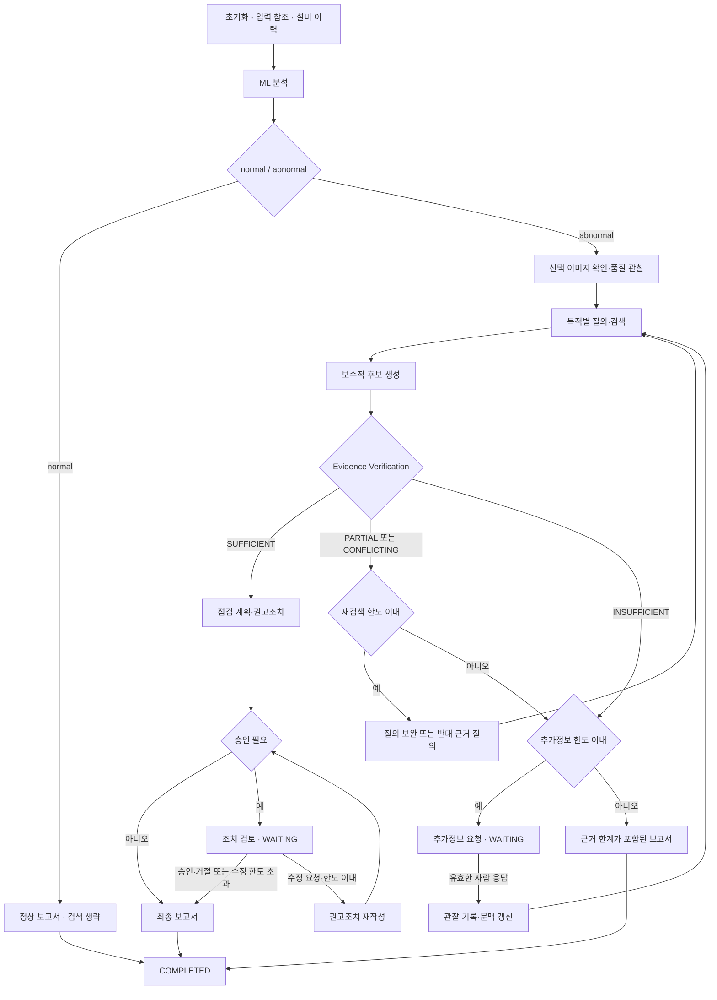
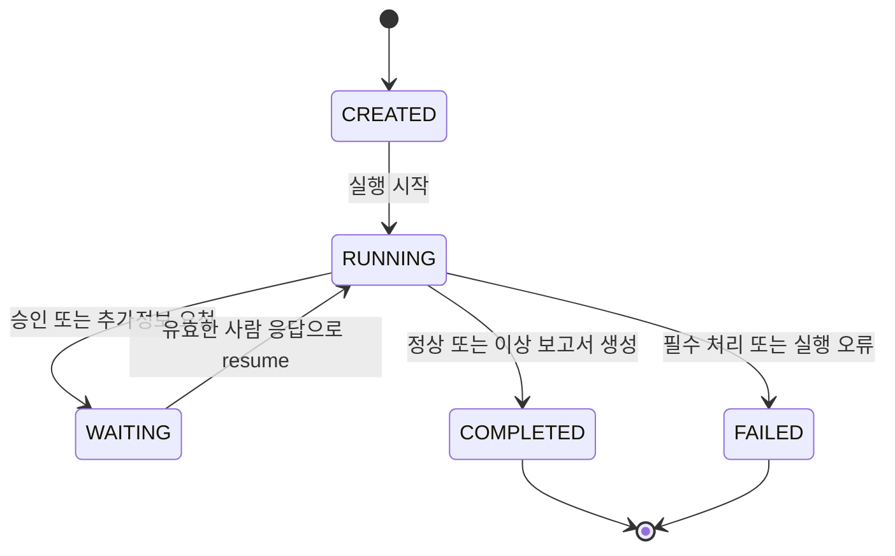
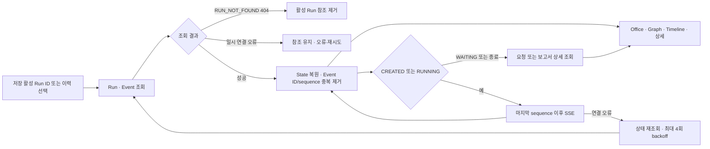

# AI Smart Factory Agent Office
## 기능 요구 명세서 (SRS)

## 1. 문서 개요

### 1.1 목적과 적용 범위

본 문서는 저장된 Paderborn 베어링 Measurement를 분석하고 기술문서 근거·점검·조치 권고·사람 검토·보고서·이력을 연결하는 MVP의 요구사항을 정의한다. 각 요구사항은 입력, 동작 조건, 출력, 예외와 인수 기준을 갖는다. 신규 기능 개발 지시나 개발 완료 판정 문서가 아니다. 추진 배경과 4주 계획은 [프로젝트 기획서](01_프로젝트_기획서.md)를 참조한다.

적용 기준은 현재 로컬 작업 트리의 코드와 보관된 산출물이다. 기존 Frontend 미커밋 변경도 현재 코드로 대조했으나, 이 변경의 동작 성공을 확인한 것은 아니다. 설계 의도는 초기 문서, 구현 계약은 코드, 실행 검증은 기록된 테스트·Artifact를 근거로 구분한다. 본 명세 작성 중 서비스·테스트·학습·색인·DB 변경은 실행하지 않았다.

### 1.2 용어와 책임 경계

| 용어 | 이 문서에서의 의미 |
|---|---|
| Measurement | 하나의 저장 MAT 측정 기록. 측정 ID·운전조건·신호·시간축을 가지며 실시간 입력이 아님 |
| AnalysisResult | ML의 정상/이상 판정 계약. 고장 원인 확정이나 보정된 고장 확률이 아님 |
| Evidence / Citation | 검색된 기술문서 단위 / 보고서에서 해당 단위를 참조하는 출처 정보 |
| Run / AgentState | 하나의 진단 실행 식별자 / LangGraph에서 갱신하는 직렬화 가능한 실행 상태 |
| HITL | 승인·거절·수정 요청 또는 추가정보를 받는 사람 검토. 완료가 승인·정비 수행을 뜻하지 않음 |
| Checkpoint | 중단·재개와 결과 재조회를 위한 Graph 상태 저장 |
| Equipment Memory | 설비별 측정·추론·관찰·명시적 정비 이력. 기술문서 검색 DB와 별개 |
| SSE | Backend의 AgentEvent 전달 방식. 원시 센서 수집 Streaming이 아님 |
| Recorded Data Replay | 저장 Preview의 시간 순 표시. 서버의 전체 Measurement 분석과 분리 |
| POC | 독립된 범위의 확장성 실험. 전체 제품 통합·운영 보증이 아님 |

### 1.3 식별·우선순위·상태 규칙

기능 ID는 `FR-영역-일련번호`, 비기능 ID는 `NFR-품질속성-일련번호`로 부여한다. 기존 ID는 의미가 바뀌지 않는 한 유지한다. 인수 기준은 해당 ID 안의 `AC1`, `AC2`, `AC3`으로 식별한다. P0는 핵심 진단·계약·안전 경계, P1은 운영·보조 사용성·품질, P2는 독립 확장 PoC다. 우선순위는 실제 완료 순서가 아니다.

| 구현 상태 | 적용 기준 |
|---|---|
| PLANNED | 요구·계획만 정의되었으며 구현 또는 사용자 시험 수행은 완료되지 않음 |
| PARTIAL | 요구 동작 중 구현된 부분과 미구현 부분을 코드 근거로 식별할 수 있음. 미시험만으로 이 상태를 부여하지 않음 |
| IMPLEMENTED | 명시한 구현 범위에 대응하는 코드가 확인됨. 실행 성공·운영 적합성을 뜻하지 않음 |
| POC | 독립 실험 구현. 제품 통합과 구분 |

| 검증 상태 | 적용 기준 |
|---|---|
| NOT VERIFIED | 해당 요구의 실행 증거가 없거나 현재 판정에 사용할 수 없음. 테스트 코드·정적 대조만으로 승격하지 않음 |
| PARTIALLY VERIFIED | 일부 AC 또는 제한된 과거 환경의 관측 기록을 확인함. 본문의 검증 범위에 한정하며 현재 코드의 전체 충족을 뜻하지 않음 |
| VERIFIED | 대상 코드 버전·환경·입력이 식별된 실제 실행 증거가 모든 필수 AC를 충족함. 현재 문서에는 해당 판정 없음 |

| 검증 실행 결과 | 적용 기준 |
|---|---|
| PASS | 식별된 실행에서 해당 AC의 기대 결과와 관측 결과가 일치함 |
| FAIL | 실행했으며 관측 결과가 AC를 충족하지 않음 |
| BLOCKED | 실행을 시도했으나 의존성 등 기록된 차단 원인으로 판정하지 못함 |
| NOT RUN | 해당 평가 대상 버전·환경의 AC 검증 실행 기록이 없음. 미실행은 실패나 차단과 다름 |

구현·검증·실행 결과는 독립적으로 관리한다. **테스트 코드는 검사 방법이며 성공 증거가 아니다.** 본문·RTM의 검증 상태는 보관 근거의 범위를 나타내고, 실행 결과는 현재 작업 트리 대상 인수 검증을 나타낸다. 과거 실행 Commit이 미기재된 Artifact를 현재 HEAD에 귀속하지 않는다. 이번 작업에서는 실행 검증을 하지 않아 현재 AC 결과는 모두 `NOT RUN`이다. `PARTIALLY VERIFIED`의 과거 사례도 현재 전체 인수 완료를 의미하지 않는다.

### 1.4 설계·검증 출처

| 자료 | 활용 범위 |
|---|---|
| [01_PROJECT_OVERVIEW](plan/01_PROJECT_OVERVIEW.md), [02_SYSTEM_ARCHITECTURE](plan/02_SYSTEM_ARCHITECTURE.md) | 서비스 목적·초기 계층·MVP 경계 |
| [03_DATA_ML_DL_DESIGN](plan/03_DATA_ML_DL_DESIGN.md), [04_RAG_DESIGN](plan/04_RAG_DESIGN.md) | 데이터·평가·검색의 초기 계약과 확장 의도 |
| [05_LANGGRAPH_AGENT_DESIGN](plan/05_LANGGRAPH_AGENT_DESIGN.md), [06_AGENT_OFFICE_UI](plan/06_AGENT_OFFICE_UI.md) | 상태형 Workflow·역할별 UI·복원 의도 |
| [07_API_DB_SPEC](plan/07_API_DB_SPEC.md), [08_EVALUATION_TEST_PLAN](plan/08_EVALUATION_TEST_PLAN.md) | 초기 API/DB 초안 및 검증 시나리오. 현재 경로·테이블은 코드 우선 |
| [09_TEAM_ROLES](plan/09_TEAM_ROLES.md), [10_DEVELOPMENT_GUIDE](plan/10_DEVELOPMENT_GUIDE.md) | 모듈 책임·단계별 개발 원칙. 인력 배정이나 현행 구현 증명으로 사용하지 않음 |
| [보관 E2E 보고서](../artifacts/e2e/E2E_INTEGRATION_REPORT.md), [경로 기록](../artifacts/e2e/route_validation.json), [재연결·재시작 기록](../artifacts/e2e/refresh_reconnect.json) | 2026-09-19 KST 생성 보고서와 관련 사례. Retry/HITL은 통제 조건, 이미지는 합성 입력. 원본 실행 Commit은 미기재 |
| [검증 보고서](competition/TEST_RESULTS.md) | 로컬 문서의 2026-10-01 검증 서술. 전체 테스트 수를 개별 요구사항의 통과 근거로 전용하지 않음 |
| [KAMP PoC](../poc/kamp_cnc/README.md), [PoC 테스트 로그](../poc/kamp_cnc/results/rag_test_results.txt) | 독립 Adapter·검색 범위의 실행 기록. 로그 자체에 실행일·Commit이 없어 현재 전체 제품 성적으로 일반화하지 않음 |

## 2. 시스템 개요

### 2.1 사용자와 시스템 경계

| 사용자 | 주요 기능 | 권한 해석 |
|---|---|---|
| 설비보전·생산기술 담당자 | 저장 Measurement 선택, 분석, 근거·점검 확인, 관찰·정비 기록 입력 | 업무 역할이며 구현된 로그인·RBAC 역할이 아님 |
| 현장 관리자·진단 검토자 | 중요 조치 검토, 승인·거절·수정, 보고서·이력 재조회 | HITL actor는 입력 문자열이며 인증된 신원을 보증하지 않음 |
| Data/ML·Knowledge 담당자 | 오프라인 데이터·모델·색인 관리, 평가 | 운영 스크립트/모듈 사용. 일반 사용자 업로드·재학습 API와 구분 |
| 운영·QA 담당자 | 준비 상태, E2E, 저장·복원·오류 확인 | 전체 운영 관리 콘솔이 구현되었다는 뜻이 아님 |

현재 MVP는 Paderborn Adapter, Random Forest, 결정론적 검색·진단·계획, 단일 LangGraph, FastAPI, Next.js UI와 로컬 저장소로 구성한다. 외부 연결은 로컬 앱을 Cloudflare를 통해 노출하는 구성과 구분하여 설명한다. 현재 서비스 가용성은 이 명세에서 검증하지 않는다.

| 범위 | 포함 또는 제외 |
|---|---|
| 핵심 MVP | 저장 데이터 분석, 이상 시 근거 검색, 조건부 HITL, 보고서, 실행 이력, SSE 동기화 |
| 보조 기능 | 이미지 품질 관찰, Equipment Memory, 명시적 정비 기록, 지식·모델·시스템 조회 |
| 독립 PoC | KAMP CNC의 Observation 변환·Guidebook 검색. Bearing 서비스와 분리 |
| 향후 확장 | 새 Bearing 일반화, 다른 모델/의미 검색, Sensor Gateway·MES/CMMS, 실제 승인 권한·운영 정책 |
| 현재 제외 | PLC 제어, 자동 설비 정지·정비, 실제 센서 Streaming, 이미지 내부 고장 판독, CNC ML·전체 Agent 통합 |

### 2.2 기능 영역과 요구사항 구성

41개 기능 요구사항과 10개 비기능 요구사항을 정의한다. 상세의 AC는 검증 시나리오이며, 실행 성공 여부는 각 요구사항의 검증 상태를 따른다. 현재 코드가 제공하지 않는 전체 Measurement 목록 REST API, Knowledge 문서 등록 API, 계정별 권한 및 중단 작업의 자동 재실행은 구현 범위로 포함하지 않는다.

## 3. 기능 요구사항

### 3.1 데이터 입력 및 Measurement

#### FR-DATA-001 · Measurement 색인 및 선택 대상 식별

| 항목 | 명세 |
|---|---|
| 목적·사용자 | 분석 사용자·Data 담당자가 입력을 식별하도록 한다. |
| 상세 요구사항 | Adapter는 MAT 파일을 색인하고 목록·단건 metadata를 제공해야 한다. 목록 색인은 원신호 배열을 담지 않는다. UI는 현재 명시된 대표 입력 3개를 제공한다. 전체 목록을 공개 REST API로 제공하는 기능은 현재 범위에 포함하지 않는다. |
| 입력 | Paderborn 데이터 루트; 선택 Measurement ID |
| 처리 조건 | 로컬 데이터가 준비되고 Adapter가 초기화됨 |
| 출력 | MeasurementSummary 목록; 선택한 measurement_id |
| 예외 처리 | 데이터 루트 또는 ID가 유효하지 않으면 데이터 계층의 오류를 반환한다. 임의 파일 경로를 사용자 입력으로 해석하지 않는다. |
| 우선순위 / 구현 상태 | P0 / **IMPLEMENTED** |
| Acceptance Criteria | **AC1** 동일 MAT는 동일한 measurement_id로 식별된다.; **AC2** 목록 요소에 원시 signal 배열이 없다.; **AC3** UI의 A/B/C 선택과 실제 ID가 대응한다. |
| 구현 근거 | [paderborn.py](../backend/app/data/adapters/paderborn.py) · [page.tsx](../frontend/src/app/page.tsx) |
| 테스트 코드 | [test_paderborn_discovery.py](../backend/tests/test_paderborn_discovery.py) · [test_paderborn_measurement_id.py](../backend/tests/test_paderborn_measurement_id.py) |
| 실행 Artifact | 해당 AC의 실행 자료 미확인 |
| 검증 상태 | **NOT VERIFIED** |
| 검증 범위 | 테스트 코드 대조, 재실행 없음 |
| 현재 실행 결과 | **NOT RUN** |

#### FR-DATA-002 · MAT 로드와 운전조건 보존

| 항목 | 명세 |
|---|---|
| 목적·사용자 | ML·진단 모듈이 공통 데이터 계약을 사용하도록 한다. |
| 상세 요구사항 | 선택한 MAT를 StandardMeasurement로 읽고 신호별 시간축·sampling metadata와 운전조건을 보존해야 한다. 정답 라벨은 데이터·평가용 metadata로 구분하고 진단 정답으로 사용하지 않는다. |
| 입력 | measurement_id |
| 처리 조건 | Adapter 색인에서 ID가 확인됨 |
| 출력 | summary, signals, metadata; OperatingCondition |
| 예외 처리 | 파일 파싱·필수 신호·시간축 오류를 검출한다. 확인되지 않은 온도·운전조건 값을 생성하지 않는다. |
| 우선순위 / 구현 상태 | P0 / **IMPLEMENTED** |
| Acceptance Criteria | **AC1** 동일 MAT의 각 신호를 로드했을 때 값 배열과 해당 시간축의 길이가 같고, 각 표본을 그 시간축의 같은 인덱스에 대응시킬 수 있다.; **AC2** rpm·load_torque_nm·radial_force_n은 확인된 조건에서만 제공한다.; **AC3** Agent의 measurement_ref에 정답 고장 사실을 복사하지 않는다. |
| 구현 근거 | [paderborn.py](../backend/app/data/adapters/paderborn.py) · [models.py](../backend/app/data/models.py) · [nodes.py](../backend/app/agent/nodes.py) |
| 테스트 코드 | [test_paderborn_load.py](../backend/tests/test_paderborn_load.py) · [test_agent_ground_truth_leakage.py](../backend/tests/test_agent_ground_truth_leakage.py) |
| 실행 Artifact | 해당 AC의 실행 자료 미확인 |
| 검증 상태 | **NOT VERIFIED** |
| 검증 범위 | 테스트 코드 대조, 재실행 없음 |
| 현재 실행 결과 | **NOT RUN** |

#### FR-DATA-003 · Recorded Data Preview 및 Replay

| 항목 | 명세 |
|---|---|
| 목적·사용자 | 분석 사용자가 측정 당시 파형과 운전값을 확인하도록 한다. |
| 상세 요구사항 | Preview API는 저장 신호에서 제한된 점을 추출하고, speed·torque·force는 진동 Preview의 시간축에 보간해야 한다. UI Replay는 해당 점을 시간 순서로 표시하며 별도 진단 버튼으로 분석을 시작해야 한다. |
| 입력 | measurement_id, max_points(기본 160, 32~512) |
| 처리 조건 | 측정 파일이 존재하고 Preview 요청이 유효함 |
| 출력 | MeasurementPreview; 파형·운전값 Replay |
| 예외 처리 | 없는 Measurement는 404; 범위를 벗어난 max_points는 422; UI는 Preview 오류를 표시하고 분석 시작을 제한한다. |
| 우선순위 / 구현 상태 | P0 / **IMPLEMENTED** |
| Acceptance Criteria | **AC1** 반환 points 수가 max_points를 초과하지 않는다.; **AC2** 서로 다른 시간축을 가진 채널을 Preview에 입력하면 운전값은 선택된 진동 시간좌표에 보간한 값과 일치하며, 각 채널의 같은 배열 인덱스 값을 그대로 대응시키지 않는다.; **AC3** Preview를 재생하는 화면에는 Recorded Data Replay 표시가 있으며, 표시된 표본은 선택 Measurement의 Preview 응답에 대응한다. |
| 구현 근거 | [analysis.py](../backend/app/api/v1/analysis.py) · [Waveform.tsx](../frontend/src/components/Waveform.tsx) · [page.tsx](../frontend/src/app/page.tsx) |
| 테스트 코드 | [test_analysis_api.py](../backend/tests/test_analysis_api.py) · [test_analysis_api_integration.py](../backend/tests/test_analysis_api_integration.py) |
| 실행 Artifact | 해당 AC의 실행 자료 미확인 |
| 검증 상태 | **NOT VERIFIED** |
| 검증 범위 | API 관련 테스트 존재; 현재 Replay 화면·보간의 독립 실행 기록 미확인 |
| 현재 실행 결과 | **NOT RUN** |

#### FR-DATA-004 · 입력 유효성 및 데이터 오류 처리

| 항목 | 명세 |
|---|---|
| 목적·사용자 | 분석 사용자와 API 호출자가 잘못된 입력을 구분하도록 한다. |
| 상세 요구사항 | 요청 Schema와 Adapter 검증을 분리하여 빈 ID·미등록 ID·잘못된 데이터 구조를 거부해야 한다. Agent 실행 중 필수 입력 오류는 실패 상태로 종료해야 한다. |
| 입력 | 분석 또는 Run 생성 요청; MAT 데이터 |
| 처리 조건 | 요청 수신 또는 데이터 로드 시점 |
| 출력 | 검증된 입력 또는 식별 가능한 오류 |
| 예외 처리 | Schema 오류 422, 단건 미등록 Measurement 404, Run 생성의 대상 불일치는 422 INVALID_RUN_REQUEST. 실행 중 데이터 오류는 FAILED로 기록한다. |
| 우선순위 / 구현 상태 | P0 / **IMPLEMENTED** |
| Acceptance Criteria | **AC1** 존재하지 않는 ID로 정상 분석 결과를 만들지 않는다.; **AC2** equipment_id와 Measurement의 설비가 다르면 Run 생성을 거부한다.; **AC3** 오류 시 node와 error_type을 추적할 수 있다. |
| 구현 근거 | [main.py](../backend/app/main.py) · [run_manager.py](../backend/app/agent/run_manager.py) · [nodes.py](../backend/app/agent/nodes.py) |
| 테스트 코드 | [test_analysis_errors.py](../backend/tests/test_analysis_errors.py) · [test_create_agent_run.py](../backend/tests/test_create_agent_run.py) · [test_workflow_error.py](../backend/tests/test_workflow_error.py) |
| 실행 Artifact | 해당 AC의 실행 자료 미확인 |
| 검증 상태 | **NOT VERIFIED** |
| 검증 범위 | 테스트 코드 대조, 재실행 없음 |
| 현재 실행 결과 | **NOT RUN** |

### 3.2 ML 분석

#### FR-ML-001 · Window 분할 및 Feature 계약

| 항목 | 명세 |
|---|---|
| 목적·사용자 | ML 모듈이 학습·추론에서 같은 입력을 사용하도록 한다. |
| 상세 요구사항 | 활성 input_spec에 따라 3채널을 1초 비중첩 Window로 분할하고 채널별 12개, 총 36개 Feature를 정해진 순서로 생성해야 한다. 마지막 불완전 Window는 제외한다. |
| 입력 | StandardMeasurement, input_spec |
| 처리 조건 | 필수 채널과 nominal sampling rate가 유효함 |
| 출력 | WindowFeatureRecord 및 Feature 행렬 |
| 예외 처리 | 채널 누락·sampling rate 불일치·짧은 채널·비유한 Feature·빈 Feature 표는 오류로 처리한다. |
| 우선순위 / 구현 상태 | P0 / **IMPLEMENTED** |
| Acceptance Criteria | **AC1** 36개 Feature 이름과 순서가 모델 feature_names와 일치한다.; **AC2** 1초 미만 잔여 구간을 임의 padding하지 않는다.; **AC3** 식별자·정답 라벨은 36개 모델 입력 열에 포함되지 않는다. |
| 구현 근거 | [dataset.py](../backend/app/ml/dataset.py) · [windowing.py](../backend/app/ml/windowing.py) · [pipeline.py](../backend/app/ml/features/pipeline.py) |
| 테스트 코드 | [test_windowing.py](../backend/tests/test_windowing.py) · [test_ml_dataset.py](../backend/tests/test_ml_dataset.py) · [test_time_domain_features.py](../backend/tests/test_time_domain_features.py) · [test_frequency_features.py](../backend/tests/test_frequency_features.py) |
| 실행 Artifact | 해당 AC의 실행 자료 미확인 |
| 검증 상태 | **NOT VERIFIED** |
| 검증 범위 | 테스트 코드 대조, 재실행 없음 |
| 현재 실행 결과 | **NOT RUN** |

#### FR-ML-002 · 모델 등록·로딩·버전 식별

| 항목 | 명세 |
|---|---|
| 목적·사용자 | 분석 호출자와 운영자가 사용 모델을 추적하도록 한다. |
| 상세 요구사항 | 명시한 model_id 또는 활성 모델을 registry에서 선택하고 model.joblib·input_spec·metadata의 식별자와 Feature 버전을 대조하여 로드해야 한다. 로드한 모델은 서비스 내에서 재사용한다. |
| 입력 | 선택 model_id 또는 활성 설정; 모델 artifact |
| 처리 조건 | 추론 서비스 요청 |
| 출력 | MLInferenceService; model_id·model_version·feature_version |
| 예외 처리 | 미등록/누락 모델은 MODEL_NOT_FOUND, 로드 실패는 MODEL_LOAD_FAILED, Feature 계약 불일치는 MODEL_FEATURE_MISMATCH로 구분한다. |
| 우선순위 / 구현 상태 | P0 / **IMPLEMENTED** |
| Acceptance Criteria | **AC1** 요청 model_id가 없으면 활성 모델을 사용한다.; **AC2** metadata와 bundle의 ID·Feature 목록·버전 불일치를 거부한다.; **AC3** 분석 결과 metadata에 모델·Feature 버전을 남긴다. |
| 구현 근거 | [file_registry.py](../backend/app/ml/registry/file_registry.py) · [service.py](../backend/app/ml/inference/service.py) · [analysis.py](../backend/app/services/analysis.py) |
| 테스트 코드 | [test_model_registry.py](../backend/tests/test_model_registry.py) · [test_ml_registry.py](../backend/tests/test_ml_registry.py) · [test_inference_service.py](../backend/tests/test_inference_service.py) |
| 실행 Artifact | 해당 AC의 실행 자료 미확인 |
| 검증 상태 | **NOT VERIFIED** |
| 검증 범위 | 테스트 코드 대조, 재실행 없음 |
| 현재 실행 결과 | **NOT RUN** |

#### FR-ML-003 · Random Forest 추론 및 상태 판정

| 항목 | 명세 |
|---|---|
| 목적·사용자 | 진단 Workflow가 측정 단위 정상/이상 결과를 받도록 한다. |
| 상세 요구사항 | Window별 damaged 클래스 확률을 평균하고 0.5 이상이면 damaged/abnormal, 미만이면 healthy/normal로 반환해야 한다. confidence는 선택된 클래스의 평균 확률에 대응하며 실제 고장 확률로 해석하지 않는다. |
| 입력 | Feature 행렬, 활성 Random Forest |
| 처리 조건 | Feature 계약 검증 완료 |
| 출력 | AnalysisResult: 식별자·상태·클래스·confidence·신호 특징·metadata |
| 예외 처리 | predict_proba 실패는 INFERENCE_FAILED; damaged 클래스 부재 또는 Feature 순서 불일치는 계약 오류로 처리한다. |
| 우선순위 / 구현 상태 | P0 / **IMPLEMENTED** |
| Acceptance Criteria | **AC1** 판정 임계값의 경계는 0.5 이상이다.; **AC2** normal과 abnormal이 AnalysisStatus 값으로 반환된다.; **AC3** confidence는 [0,1]이고 anomaly_score는 현재 모델에서 null이다. |
| 구현 근거 | [service.py](../backend/app/ml/inference/service.py) · [common.py](../backend/app/domain/schemas/common.py) |
| 테스트 코드 | [test_ml_inference.py](../backend/tests/test_ml_inference.py) · [test_analysis_result_mapping.py](../backend/tests/test_analysis_result_mapping.py) |
| 실행 Artifact | [metrics.json](../artifacts/ml/baseline_v1/metrics.json) · [normal report.json](../artifacts/e2e/normal_run/report.json) · [abnormal report.json](../artifacts/e2e/abnormal_run/report.json) |
| 검증 상태 | **PARTIALLY VERIFIED** |
| 검증 범위 | 저장 평가 artifact 존재; 현재 코드 전체 인수 기준 재검증 없음 |
| 현재 실행 결과 | **NOT RUN** |

#### FR-ML-004 · 오프라인 학습·평가 및 분리 추적

| 항목 | 명세 |
|---|---|
| 목적·사용자 | ML 담당자가 모델 평가 범위를 재현하도록 한다. |
| 상세 요구사항 | Measurement 단위로 Train/Test를 분리하고 같은 Measurement의 Window가 양쪽에 섞이지 않도록 검사해야 한다. 분리 목록·Feature 목록·모델 metadata·Window 및 Measurement 평가를 저장해야 한다. |
| 입력 | 라벨이 확인된 로컬 대표 subset; 학습 설정 |
| 처리 조건 | 오프라인 학습·평가를 명시적으로 실행함 |
| 출력 | 모델 bundle, input_spec, split, metadata, metrics |
| 예외 처리 | 라벨·Feature·분리 조건이 유효하지 않으면 학습 성공으로 기록하지 않는다. 새 Bearing 성능은 별도 평가 전 미검증으로 둔다. |
| 우선순위 / 구현 상태 | P1 / **IMPLEMENTED** |
| Acceptance Criteria | **AC1** Train/Test Measurement 교집합이 0이다.; **AC2** 같은 Bearing ID 공유 여부를 평가 한계에 표시한다.; **AC3** 평가 보고서에 시험 Measurement 수·분리 단위·공유 Bearing ID·지표·적용 범위를 명시한다. 현재 F1=1.0은 시험 Measurement 60건의 기록으로 한정하고, 별도 신규 Bearing 평가가 없으면 신규 Bearing 일반화 성능을 NOT VERIFIED로 표시한다. |
| 구현 근거 | [baseline.py](../backend/app/ml/training/baseline.py) · [split.py](../backend/app/ml/training/split.py) · [evaluation.py](../backend/app/ml/training/evaluation.py) |
| 테스트 코드 | [test_ml_split.py](../backend/tests/test_ml_split.py) · [test_ml_training.py](../backend/tests/test_ml_training.py) |
| 실행 Artifact | [split.json](../artifacts/ml/baseline_v1/split.json) · [metrics.json](../artifacts/ml/baseline_v1/metrics.json) |
| 검증 상태 | **PARTIALLY VERIFIED** |
| 검증 범위 | 학습·분리·평가 artifact; 신규 Bearing 일반화 NOT VERIFIED |
| 현재 실행 결과 | **NOT RUN** |

### 3.3 RAG 및 기술문서 검색

#### FR-RAG-001 · Knowledge Source 및 오프라인 수집 관리

| 항목 | 명세 |
|---|---|
| 목적·사용자 | Knowledge 담당자가 문서 출처와 색인 범위를 관리하도록 한다. |
| 상세 요구사항 | Source Manifest에 source ID·발행기관·공식 URL·로컬 파일·체크섬·이용조건·상태를 관리하고 승인된 source를 문서로 확장해야 한다. PDF 페이지·HTML 섹션을 보존하여 parsing한다. |
| 입력 | source_manifest.json 및 확보한 문서 |
| 처리 조건 | 오프라인 ingestion 실행; source와 파일 검증 |
| 출력 | KnowledgeDocument, ParsedBlock, ingestion 결과 |
| 예외 처리 | 경로가 프로젝트 루트를 벗어나거나 파일·체크섬 등 검증에 실패한 자료는 정상 색인 성공으로 처리하지 않는다. 공개 문서 업로드 API는 현재 제공하지 않는다. |
| 우선순위 / 구현 상태 | P1 / **IMPLEMENTED** |
| Acceptance Criteria | **AC1** 동일 색인 실행의 Manifest와 수집 보고서를 대조할 때 source 수와 파생 document 수를 각 필드의 집계 단위로 별도 표시하며, 두 수량을 동일 개념으로 표기하지 않는다.; **AC2** 문서별 출처·버전·checksum을 추적할 수 있다.; **AC3** PDF page 또는 HTML section을 Chunk에 전달한다. |
| 구현 근거 | [manifest.py](../backend/app/rag/ingestion/manifest.py) · [pipeline.py](../backend/app/rag/ingestion/pipeline.py) · [pdf_parser.py](../backend/app/rag/ingestion/parsers/pdf_parser.py) · [html_parser.py](../backend/app/rag/ingestion/parsers/html_parser.py) |
| 테스트 코드 | [test_manifest.py](../backend/tests/test_manifest.py) · [test_rag_parsers.py](../backend/tests/test_rag_parsers.py) |
| 실행 Artifact | [ingestion_report.json](../artifacts/rag/bearing_v1/ingestion_report.json) |
| 검증 상태 | **PARTIALLY VERIFIED** |
| 검증 범위 | ingestion artifact; 오류 조합의 최신 실행 미확인 |
| 현재 실행 결과 | **NOT RUN** |

#### FR-RAG-002 · Chunk·벡터 색인 생성

| 항목 | 명세 |
|---|---|
| 목적·사용자 | 검색 모듈이 재현 가능한 문서 단위를 사용하도록 한다. |
| 상세 요구사항 | 동일 페이지·섹션의 구조 블록을 묶고 기본 최대 800개 공백 분리 단위, 겹침 100개로 Chunk를 생성해야 한다. 동일 HashingVectorizer 설정으로 384차원 벡터를 만들어 bearing_v1 Chroma collection에 저장한다. |
| 입력 | KnowledgeDocument 및 ParsedBlock |
| 처리 조건 | 유효한 문서·Chunk 설정 |
| 출력 | KnowledgeChunk, stable chunk_id, 384차원 벡터 |
| 예외 처리 | 빈 문서·중복 ID·잘못된 크기·빈 벡터 입력·비유한 벡터를 거부한다. 벡터화의 내부 재시도는 최대 2회 시도이다. |
| 우선순위 / 구현 상태 | P0 / **IMPLEMENTED** |
| Acceptance Criteria | **AC1** Chunk의 page/section·문서 ID·출처를 보존한다.; **AC2** word unigram/bigram, L2, alternate_sign=False 설정을 일치시킨다.; **AC3** 같은 page/section 안의 공백으로 구분한 900개 단어를 기본 설정으로 분할하면 800개·200개 단어의 두 Chunk가 생성되고 인접 Chunk의 중복은 100개 단어다. 설정과 설명은 이를 공백 단위의 근사 개수로 명시하며 LLM tokenizer 계수로 표기하지 않는다. |
| 구현 근거 | [chunking.py](../backend/app/rag/ingestion/chunking.py) · [service.py](../backend/app/rag/embedding/service.py) · [chroma.py](../backend/app/rag/vector_store/chroma.py) |
| 테스트 코드 | [test_chunking.py](../backend/tests/test_chunking.py) · [test_vector_store.py](../backend/tests/test_vector_store.py) · [test_rag_ingestion_integration.py](../backend/tests/test_rag_ingestion_integration.py) |
| 실행 Artifact | 해당 AC의 실행 자료 미확인 |
| 검증 상태 | **NOT VERIFIED** |
| 검증 범위 | 테스트 코드 대조, 재실행 없음 |
| 현재 실행 결과 | **NOT RUN** |

#### FR-RAG-003 · 목적별 검색 및 Metadata Filter

| 항목 | 명세 |
|---|---|
| 목적·사용자 | Workflow와 Knowledge 화면이 허용된 범위의 근거를 검색하도록 한다. |
| 상세 요구사항 | QueryBuilder는 검색 목적과 모드에 따라 source 허용 범위를 지정해야 한다. 요청 filter가 Knowledge Pack·component 경계를 넓히지 못하도록 검증하고 Chroma cosine 검색 후 인접 중복 Chunk를 제거한다. |
| 입력 | RetrievalContext 또는 query; purpose, mode, top_k, filters |
| 처리 조건 | top_k 1~20, 기본 5; query 길이 1~4000 |
| 출력 | RetrievalResult(query, evidence, stats) |
| 예외 처리 | 허용되지 않은 filter·목적 경계 위반은 오류. 진단 모드에 정답 Fact Sheet와 Measurement Log를 주입하지 않는다. |
| 우선순위 / 구현 상태 | P0 / **IMPLEMENTED** |
| Acceptance Criteria | **AC1** 반환 Evidence 수가 top_k를 초과하지 않는다.; **AC2** purpose별 source·source tier 제한이 실제 검색 조건에 반영된다.; **AC3** 동일 문서에서 Chunk 인덱스 차이가 1 이하이고 단어 집합 중복 비율이 0.75 이상인 후보가 함께 검색되면, 중복 제거 후 해당 후보 쌍을 동시에 반환하지 않는다. |
| 구현 근거 | [query_builder.py](../backend/app/rag/retrieval/query_builder.py) · [filters.py](../backend/app/rag/retrieval/filters.py) · [service.py](../backend/app/rag/retrieval/service.py) |
| 테스트 코드 | [test_query_builder.py](../backend/tests/test_query_builder.py) · [test_metadata_filter.py](../backend/tests/test_metadata_filter.py) · [test_rag_retrieval_integration.py](../backend/tests/test_rag_retrieval_integration.py) |
| 실행 Artifact | 해당 AC의 실행 자료 미확인 |
| 검증 상태 | **NOT VERIFIED** |
| 검증 범위 | 테스트 코드 대조, 재실행 없음 |
| 현재 실행 결과 | **NOT RUN** |

#### FR-RAG-004 · Evidence 및 Citation 연결

| 항목 | 명세 |
|---|---|
| 목적·사용자 | 검토자가 진단에 사용된 출처를 역추적하도록 한다. |
| 상세 요구사항 | 검색 결과를 EvidenceObject로 변환하고 보고서 Citation은 실제 Evidence의 식별자와 출처 metadata에서 생성해야 한다. 검색 점수는 1-cosine distance를 [-1,1]로 제한한 순위 값으로 표시한다. |
| 입력 | 검색 Chunk·metadata·distance; Run의 rag_evidence |
| 처리 조건 | 검색 완료 또는 보고서 생성 |
| 출력 | EvidenceObject, ReportCitation |
| 예외 처리 | 존재하지 않는 Evidence ID를 후보·점검·조치의 근거로 참조하면 거부한다. 없는 page/section을 만들어 넣지 않는다. |
| 우선순위 / 구현 상태 | P0 / **IMPLEMENTED** |
| Acceptance Criteria | **AC1** Citation의 evidence_id·document_id·chunk_id가 실제 검색 결과에 대응한다.; **AC2** 제목·발행기관·공식 URL 및 가능한 page/section을 보존한다.; **AC3** 검색 결과를 표시하는 API·UI 설명에서 retrieval_score는 검색 점수로 식별되며 고장 확률이나 검색 정확도라는 라벨을 사용하지 않는다. |
| 구현 근거 | [service.py](../backend/app/rag/retrieval/service.py) · [schemas.py](../backend/app/agent/schemas.py) · [nodes.py](../backend/app/agent/nodes.py) |
| 테스트 코드 | [test_evidence_mapping.py](../backend/tests/test_evidence_mapping.py) · [test_report_citations.py](../backend/tests/test_report_citations.py) |
| 실행 Artifact | [audit_results.json](../artifacts/e2e/audit_results.json) |
| 검증 상태 | **PARTIALLY VERIFIED** |
| 검증 범위 | 과거 Citation 추적 audit; 현재 전체 계약 재실행 없음 |
| 현재 실행 결과 | **NOT RUN** |

#### FR-RAG-005 · 빈 검색과 검색 장애 구분

| 항목 | 명세 |
|---|---|
| 목적·사용자 | Workflow가 근거 부족과 시스템 장애를 다르게 처리하도록 한다. |
| 상세 요구사항 | 검색 결과가 없으면 빈 Evidence 목록으로 전달하고 Evidence Verification에서 부족 상태를 판단해야 한다. 검색 예외는 Agent의 실패 경로로 전달한다. 결과가 있다는 이유만으로 답변의 타당성을 보장하지 않는다. |
| 입력 | 검색 결과 또는 retrieval 예외 |
| 처리 조건 | 이상 경로 검색 또는 Knowledge 검색 |
| 출력 | 빈/비어 있지 않은 RetrievalResult; INSUFFICIENT 또는 FAILED |
| 예외 처리 | 빈 결과에 임의 근거를 채우지 않는다. Bearing Retriever에는 범용 의미 기반 기권 보장이 없으며 별도 품질 평가 대상으로 관리한다. |
| 우선순위 / 구현 상태 | P0 / **IMPLEMENTED** |
| Acceptance Criteria | **AC1** 빈 결과는 evidence=[]와 returned=0으로 구분 가능하다.; **AC2** 검색 예외가 정상 근거로 변환되지 않는다.; **AC3** 후보 또는 근거가 없는 입력으로 INSUFFICIENT가 나오면 FR-AGENT-005에 따라 추가정보 한도 이내에는 사람 입력을 요청하고, 소진 시 근거 한계를 포함한 보고서로 진행한다. |
| 구현 근거 | [service.py](../backend/app/rag/retrieval/service.py) · [nodes.py](../backend/app/agent/nodes.py) · [reasoning.py](../backend/app/agent/reasoning.py) |
| 테스트 코드 | [test_retriever.py](../backend/tests/test_retriever.py) · [test_retrieval_node.py](../backend/tests/test_retrieval_node.py) |
| 실행 Artifact | [rag_evaluation.json](../artifacts/final/rag_evaluation.json) |
| 검증 상태 | **NOT VERIFIED** |
| 검증 범위 | 테스트 코드 대조, 재실행 없음 |
| 현재 실행 결과 | **NOT RUN** |

### 3.4 Agent Workflow

#### FR-AGENT-001 · Run 초기화와 Tool 실행 계약

| 항목 | 명세 |
|---|---|
| 목적·사용자 | 분석 사용자가 추적 가능한 단일 진단을 시작하도록 한다. |
| 상세 요구사항 | Run 생성 시 UUID 기반 run_id, Measurement·설비 참조, 카운터·목록·버전 정보를 초기화해야 한다. Run Manager는 백그라운드에서 실제 Graph를 실행하고 분석·검색·Memory·Vision 의존성을 호출한다. |
| 입력 | AgentRunCreate(equipment_id, measurement_id, 선택 image IDs·demo_scenario) |
| 처리 조건 | Measurement/설비 및 이미지 참조 검증 완료 |
| 출력 | 202 AgentRunCreated; AgentState 및 순서 있는 이벤트 |
| 예외 처리 | 동일 Run ID를 덮어쓰지 않는다. 입력 검증 실패와 백그라운드 실행 실패를 구분한다. |
| 우선순위 / 구현 상태 | P0 / **IMPLEMENTED** |
| Acceptance Criteria | **AC1** 초기 State에 원신호 배열을 보관하지 않는다.; **AC2** Run ID로 State·Event·Checkpoint를 연결한다.; **AC3** 정상·이상·HITL 대표 실행의 노드 기록을 graph.py와 대조할 때 모든 노드가 등록되어 있고, 각 연속 이동이 해당 입력·State의 Edge 또는 조건부 분기와 일치한다. |
| 구현 근거 | [run_manager.py](../backend/app/agent/run_manager.py) · [service.py](../backend/app/agent/service.py) · [state.py](../backend/app/agent/state.py) · [factory.py](../backend/app/agent/factory.py) |
| 테스트 코드 | [test_create_agent_run.py](../backend/tests/test_create_agent_run.py) · [test_agent_state.py](../backend/tests/test_agent_state.py) |
| 실행 Artifact | 해당 AC의 실행 자료 미확인 |
| 검증 상태 | **NOT VERIFIED** |
| 검증 범위 | 테스트 코드 대조, 재실행 없음 |
| 현재 실행 결과 | **NOT RUN** |

#### FR-AGENT-002 · 정상 경로 단축

| 항목 | 명세 |
|---|---|
| 목적·사용자 | 분석 사용자가 불필요한 검색 없이 정상 판정을 확인하도록 한다. |
| 상세 요구사항 | ML 상태가 normal이면 save_normal_state와 generate_normal_report로 진행하고 RAG·진단 후보·점검·권고조치 단계를 생략해야 한다. |
| 입력 | normal AnalysisResult |
| 처리 조건 | run_detection 성공 후 check_abnormal |
| 출력 | 정상 FinalReport; COMPLETED |
| 예외 처리 | ML 실패를 normal로 처리하지 않는다. 정상 판정은 무고장 보증이 아니다. |
| 우선순위 / 구현 상태 | P0 / **IMPLEMENTED** |
| Acceptance Criteria | **AC1** 정상 실행 노드에 retrieve_knowledge가 없다.; **AC2** 보고서의 Evidence Citation·진단 후보·점검·조치 목록이 비어 있다.; **AC3** 보고서를 생성하고 COMPLETED로 종료한다. |
| 구현 근거 | [graph.py](../backend/app/agent/graph.py) · [routing.py](../backend/app/agent/routing.py) · [nodes.py](../backend/app/agent/nodes.py) |
| 테스트 코드 | [test_graph_routing.py](../backend/tests/test_graph_routing.py) |
| 실행 Artifact | [route_validation.json](../artifacts/e2e/route_validation.json) · [report.json](../artifacts/e2e/normal_run/report.json) · [run.json](../artifacts/e2e/normal_run/run.json) |
| 검증 상태 | **PARTIALLY VERIFIED** |
| 검증 범위 | 보관 E2E normal 사례에 한정; 현재 재실행 아님 |
| 현재 실행 결과 | **NOT RUN** |

#### FR-AGENT-003 · 이상 경로와 선택 이미지 분기

| 항목 | 명세 |
|---|---|
| 목적·사용자 | 분석 사용자가 이상 판정 이후 기술 근거를 확인하도록 한다. |
| 상세 요구사항 | abnormal이면 선택 이미지 여부를 확인하고, 첨부된 경우 품질 관찰 문맥을 병합한 뒤 목적별 RAG 질의·검색·진단·검증을 수행해야 한다. 이미지가 없으면 RAG로 직접 진행한다. |
| 입력 | abnormal AnalysisResult, 선택 inspection_image_ids |
| 처리 조건 | ML 분석 성공 |
| 출력 | Evidence·후보·검증 결과; 이미지 사용 시 visual_observations |
| 예외 처리 | 이미지는 선택 입력이며 품질 관찰 실패는 사용 불가 결과와 한계를 남긴다. 필수 ML/RAG 실패와 구분한다. |
| 우선순위 / 구현 상태 | P0 / **IMPLEMENTED** |
| Acceptance Criteria | **AC1** 이미지 미첨부 실행에서 분석 이미지 노드를 건너뛴다.; **AC2** 정상 경로에는 이미지 분석을 추가하지 않는다.; **AC3** DIAGNOSTIC_EVIDENCE와 INSPECTION_ACTION 질의를 생성한다. |
| 구현 근거 | [graph.py](../backend/app/agent/graph.py) · [nodes.py](../backend/app/agent/nodes.py) |
| 테스트 코드 | [test_image_optional_route.py](../backend/tests/test_image_optional_route.py) · [test_agent_e2e.py](../backend/tests/test_agent_e2e.py) |
| 실행 Artifact | [route_validation.json](../artifacts/e2e/route_validation.json) |
| 검증 상태 | **PARTIALLY VERIFIED** |
| 검증 범위 | 보관 이상·합성 이미지 E2E; 미첨부 등 전체 조합 재실행 없음 |
| 현재 실행 결과 | **NOT RUN** |

#### FR-AGENT-004 · 보수적 진단 및 Evidence Verification

| 항목 | 명세 |
|---|---|
| 목적·사용자 | 검토자가 근거의 적용 범위와 부족 부분을 구분하도록 한다. |
| 상세 요구사항 | 결정론적 reasoner는 ML 판정과 검색 근거를 연결한 후보·불확실성을 생성해야 한다. verifier는 참조 ID·후보 유무·반대 근거·검색 목적의 충족 여부를 검사하여 네 상태 중 하나를 반환한다. |
| 입력 | AnalysisResult, Evidence, 선택 Memory·Visual 문맥 |
| 처리 조건 | 이상 검색 완료 |
| 출력 | DiagnosisCandidate[]; VerificationResult |
| 예외 처리 | 잘못된 Evidence 참조는 오류. SUFFICIENT는 점검 계획 진행에 충분하다는 의미이며 물리적 원인 확정이 아니다. |
| 우선순위 / 구현 상태 | P0 / **IMPLEMENTED** |
| Acceptance Criteria | **AC1** 후보·근거가 없으면 INSUFFICIENT이다.; **AC2** 반대 근거 참조가 있으면 CONFLICTING이다.; **AC3** 후보·근거가 존재하고 참조 ID가 유효하며 반대 근거가 없는 조건에서, DIAGNOSTIC_EVIDENCE 또는 INSPECTION_ACTION이 누락되면 PARTIAL과 누락 목적을 반환하고 둘 다 있으면 SUFFICIENT를 반환한다. |
| 구현 근거 | [reasoning.py](../backend/app/agent/reasoning.py) · [schemas.py](../backend/app/agent/schemas.py) |
| 테스트 코드 | [test_diagnosis_schema.py](../backend/tests/test_diagnosis_schema.py) · [test_verification_routing.py](../backend/tests/test_verification_routing.py) |
| 실행 Artifact | 해당 AC의 실행 자료 미확인 |
| 검증 상태 | **NOT VERIFIED** |
| 검증 범위 | 테스트 코드 대조, 재실행 없음 |
| 현재 실행 결과 | **NOT RUN** |

#### FR-AGENT-005 · 재검색·추가정보의 유한 반복

| 항목 | 명세 |
|---|---|
| 목적·사용자 | 사용자와 운영자가 무한 반복 없이 결과 또는 검토 요청을 받도록 한다. |
| 상세 요구사항 | PARTIAL은 질의를 보완하고 CONFLICTING은 반대 근거 질의를 작성하여 재검색해야 한다. 기본 재검색 한도 2회에 도달하거나 INSUFFICIENT이면 추가정보를 요청한다. 추가정보 기본 한도 2회도 소진되면 한계를 명시한 보고서를 생성한다. |
| 입력 | evidence_status, retry 및 human-information 카운터 |
| 처리 조건 | verify_evidence 이후 |
| 출력 | 보완 질의, HumanRequest 또는 제한 보고서 |
| 예외 처리 | SUFFICIENT이면 바로 점검 계획으로 진행한다. 재검색·사람 입력·조치 수정의 카운터를 혼용하지 않는다. |
| 우선순위 / 구현 상태 | P0 / **IMPLEMENTED** |
| Acceptance Criteria | **AC1** PARTIAL/CONFLICTING에서 재검색 카운터를 증가시킨다.; **AC2** INSUFFICIENT는 불필요한 재검색 없이 추가정보 경로로 분기한다.; **AC3** 한도 소진 후 무한 재검색하지 않으며 미충족 근거를 보고서에 남긴다. |
| 구현 근거 | [routing.py](../backend/app/agent/routing.py) · [nodes.py](../backend/app/agent/nodes.py) · [config.py](../backend/app/core/config.py) |
| 테스트 코드 | [test_retry_limit.py](../backend/tests/test_retry_limit.py) · [test_verification_routing.py](../backend/tests/test_verification_routing.py) |
| 실행 Artifact | [route_validation.json](../artifacts/e2e/route_validation.json) |
| 검증 상태 | **PARTIALLY VERIFIED** |
| 검증 범위 | 통제 Retry 사례; 모든 한도 경계 재실행 없음 |
| 현재 실행 결과 | **NOT RUN** |

#### FR-AGENT-006 · 점검 계획·조치 권고 및 정책

| 항목 | 명세 |
|---|---|
| 목적·사용자 | 설비보전 담당자가 검토할 점검 순서와 조치를 받도록 한다. |
| 상세 요구사항 | 충분한 근거에 대해 순서·이유·후보/근거 참조를 갖는 InspectionStep과 제한된 ActionType의 권고를 생성해야 한다. SHUTDOWN_CHECK·SCHEDULE_MAINTENANCE 또는 high 우선순위는 사람 승인을 요구한다. |
| 입력 | 후보, Evidence, InspectionStep |
| 처리 조건 | SUFFICIENT 이후 계획·권고 생성 |
| 출력 | InspectionStep[], RecommendedAction[] |
| 예외 처리 | 알 수 없는 근거·정책상 금지 문구·중요 조치의 근거 누락을 거부한다. 권고를 PLC 명령이나 정비 실행으로 변환하지 않는다. |
| 우선순위 / 구현 상태 | P0 / **IMPLEMENTED** |
| Acceptance Criteria | **AC1** 점검의 후보·근거 ID가 현재 Run에 존재한다.; **AC2** 중요 조치에는 supporting_evidence_ids와 requires_human_approval=true가 있다.; **AC3** HITL_CONTROLLED 실행에서 ML·RAG 실행 기록 이후 시연용 중요 조치를 생성하며, 반환된 시연 정보에 통제 조건을 표시한다. |
| 구현 근거 | [actions.py](../backend/app/agent/actions.py) · [action_policy.py](../backend/app/agent/policies/action_policy.py) · [nodes.py](../backend/app/agent/nodes.py) |
| 테스트 코드 | [test_action_policy.py](../backend/tests/test_action_policy.py) · [test_inspection_plan_schema.py](../backend/tests/test_inspection_plan_schema.py) · [test_safety_guardrails.py](../backend/tests/test_safety_guardrails.py) |
| 실행 Artifact | 해당 AC의 실행 자료 미확인 |
| 검증 상태 | **NOT VERIFIED** |
| 검증 범위 | 테스트 코드 대조, 재실행 없음 |
| 현재 실행 결과 | **NOT RUN** |

#### FR-AGENT-007 · 최종 보고서 구성

| 항목 | 명세 |
|---|---|
| 목적·사용자 | 검토자가 결과·근거·사람 결정·한계를 함께 재검토하도록 한다. |
| 상세 요구사항 | 보고서는 Run·설비·Measurement, 분석 요약, 후보, 점검·권고, Evidence 상태, 사람 상호작용, Citation, 사용 Memory·Visual 참조, 버전과 한계를 포함해야 한다. 정상 보고서는 해당 없는 목록을 비운다. |
| 입력 | AgentState |
| 처리 조건 | 정상 경로 또는 이상 경로의 보고서 생성 시점 |
| 출력 | FinalReport; report_generated 및 workflow_completed 이벤트 |
| 예외 처리 | 근거 부족·상충·거절·수정 요청을 보고서 한계에 남긴다. COMPLETED는 승인·정비 완료가 아니다. |
| 우선순위 / 구현 상태 | P0 / **IMPLEMENTED** |
| Acceptance Criteria | **AC1** Citation이 실제 Evidence로 연결된다.; **AC2** REJECTED이면 거절 사실을, NEEDS_REVISION이면 미승인 사실을 표시한다.; **AC3** version_trace에 모델·Knowledge Manifest·Workflow 버전이 있다. |
| 구현 근거 | [schemas.py](../backend/app/agent/schemas.py) · [nodes.py](../backend/app/agent/nodes.py) |
| 테스트 코드 | [test_report_citations.py](../backend/tests/test_report_citations.py) · [test_approval_routing.py](../backend/tests/test_approval_routing.py) |
| 실행 Artifact | [report.json](../artifacts/e2e/abnormal_run/report.json) |
| 검증 상태 | **PARTIALLY VERIFIED** |
| 검증 범위 | 저장 보고서; 모든 사람 결정 조합 재실행 없음 |
| 현재 실행 결과 | **NOT RUN** |

#### FR-AGENT-008 · 실행 실패 상태 및 이벤트

| 항목 | 명세 |
|---|---|
| 목적·사용자 | 사용자와 운영자가 실패 위치를 확인하도록 한다. |
| 상세 요구사항 | 필수 데이터·ML·검색·진단·계획 오류는 FAILED 상태와 오류 식별자로 기록해야 한다. Run Manager는 백그라운드에서 전파된 예외도 포착하여 저장된 Run과 오류 이벤트에 반영해야 한다. |
| 입력 | 노드 예외 또는 실행 예외 |
| 처리 조건 | Run 실행 중 |
| 출력 | FAILED Run, errors 또는 error_code, workflow_error Event |
| 예외 처리 | 실패를 정상 결과나 승인으로 바꾸지 않는다. 로그의 내부 진단 정보와 공개 API 오류를 구분한다. |
| 우선순위 / 구현 상태 | P0 / **IMPLEMENTED** |
| Acceptance Criteria | **AC1** 오류 노드 또는 실행 실패 유형을 확인할 수 있다.; **AC2** FAILED 이후 정상 완료 이벤트를 임의 생성하지 않는다.; **AC3** UI는 FAILED와 연결 끊김을 서로 다른 상태로 취급한다. |
| 구현 근거 | [nodes.py](../backend/app/agent/nodes.py) · [run_manager.py](../backend/app/agent/run_manager.py) · [events.py](../backend/app/agent/events.py) |
| 테스트 코드 | [test_workflow_error.py](../backend/tests/test_workflow_error.py) · [test_agent_events.py](../backend/tests/test_agent_events.py) |
| 실행 Artifact | 해당 AC의 실행 자료 미확인 |
| 검증 상태 | **NOT VERIFIED** |
| 검증 범위 | 테스트 코드 대조, 재실행 없음 |
| 현재 실행 결과 | **NOT RUN** |

### 3.5 HITL

#### FR-HITL-001 · 사람 확인 요청과 WAITING

| 항목 | 명세 |
|---|---|
| 목적·사용자 | 검토자에게 필요한 결정·추가정보를 명시하도록 한다. |
| 상세 요구사항 | 승인 필요 또는 근거 부족 조건에서 request_id·run_id·유형·질문·요청 필드·이유를 담은 HumanRequest를 만들고 WAITING으로 전환하여 interrupt해야 한다. |
| 입력 | 중요 권고조치 또는 근거 부족 상태 |
| 처리 조건 | 승인 정책 충족 또는 추가정보 분기 |
| 출력 | pending_human_request; WAITING; Checkpoint |
| 예외 처리 | 사람 응답 없이 승인된 것으로 진행하지 않는다. 대기 자체를 실패로 처리하지 않는다. |
| 우선순위 / 구현 상태 | P0 / **IMPLEMENTED** |
| Acceptance Criteria | **AC1** APPROVAL과 ADDITIONAL_INFORMATION을 구분한다.; **AC2** 현재 Run 조회로 pending_human_request를 확인한다.; **AC3** WAITING인 Run의 SSE를 구독하면 after_sequence 이후 저장 이벤트를 순서대로 전송하고, 남은 이벤트가 없을 때 해당 연결을 종료한다. |
| 구현 근거 | [nodes.py](../backend/app/agent/nodes.py) · [service.py](../backend/app/agent/service.py) · [agent.py](../backend/app/api/v1/agent.py) |
| 테스트 코드 | [test_human_request.py](../backend/tests/test_human_request.py) · [test_human_input_api.py](../backend/tests/test_human_input_api.py) |
| 실행 Artifact | 해당 AC의 실행 자료 미확인 |
| 검증 상태 | **NOT VERIFIED** |
| 검증 범위 | 테스트 코드 대조, 재실행 없음 |
| 현재 실행 결과 | **NOT RUN** |

#### FR-HITL-002 · 승인·거절·수정 요청

| 항목 | 명세 |
|---|---|
| 목적·사용자 | 검토자가 권고조치에 대한 결정을 기록하도록 한다. |
| 상세 요구사항 | APPROVAL 요청은 APPROVED·REJECTED·NEEDS_REVISION만 받아야 한다. 승인·거절은 결정이 반영된 보고서로 진행하고, 수정 요청은 기본 1회의 권고 재작성 기회를 제공해야 한다. |
| 입력 | HumanInputSubmission.response.decision; 선택 comment·actor |
| 처리 조건 | 현재 Run이 WAITING이고 request_id 일치 |
| 출력 | HumanInteraction; 재작성된 권고 또는 FinalReport |
| 예외 처리 | 잘못된 decision을 거부한다. 수정 한도 이후에는 추가 재작성 대신 미승인 한계를 보고한다. actor 문자열을 인증된 신원으로 간주하지 않는다. |
| 우선순위 / 구현 상태 | P0 / **IMPLEMENTED** |
| Acceptance Criteria | **AC1** 세 decision을 각각 구분하여 저장한다.; **AC2** 거절로 종료되어도 Run은 COMPLETED일 수 있으며 승인으로 표시하지 않는다.; **AC3** NEEDS_REVISION 입력 시 State의 action_revision_count와 max_action_revision_rounds로 재작성 여부를 판정하고, 보고서의 사람 상호작용 기록에서 최신 decision을 확인한다. 수정 한도 소진 시 추가 재작성 없이 미승인 사실을 보존한다. |
| 구현 근거 | [service.py](../backend/app/agent/service.py) · [routing.py](../backend/app/agent/routing.py) · [nodes.py](../backend/app/agent/nodes.py) |
| 테스트 코드 | [test_human_resume.py](../backend/tests/test_human_resume.py) · [test_approval_routing.py](../backend/tests/test_approval_routing.py) |
| 실행 Artifact | 해당 AC의 실행 자료 미확인 |
| 검증 상태 | **NOT VERIFIED** |
| 검증 범위 | 테스트 코드 대조, 재실행 없음 |
| 현재 실행 결과 | **NOT RUN** |

#### FR-HITL-003 · 추가정보 입력과 문맥 갱신

| 항목 | 명세 |
|---|---|
| 목적·사용자 | 현장 입력자가 요청된 관찰 정보를 제공하도록 한다. |
| 상세 요구사항 | ADDITIONAL_INFORMATION 응답은 requested_fields의 비어 있지 않은 값을 확인하고 관찰 이력에 기록한 뒤 문맥을 갱신하여 RAG부터 다시 진행해야 한다. |
| 입력 | request_id, response, 선택 comment·actor |
| 처리 조건 | WAITING이며 추가정보 요청이 존재함 |
| 출력 | human_observations·human_interactions; 갱신된 retrieval 문맥 |
| 예외 처리 | 누락·빈 요청 필드 및 10,000자를 넘는 직렬화 response를 거부한다. 사람 입력을 데이터셋 정답이나 검증된 고장 사실로 승격하지 않는다. |
| 우선순위 / 구현 상태 | P0 / **IMPLEMENTED** |
| Acceptance Criteria | **AC1** 요청 필드 누락 시 resume하지 않는다.; **AC2** 추가정보 round 카운터를 증가시킨다.; **AC3** 같은 run_id에서 update_context 이후 검색 흐름을 이어간다. |
| 구현 근거 | [service.py](../backend/app/agent/service.py) · [nodes.py](../backend/app/agent/nodes.py) |
| 테스트 코드 | [test_human_resume.py](../backend/tests/test_human_resume.py) |
| 실행 Artifact | [route_validation.json](../artifacts/e2e/route_validation.json) |
| 검증 상태 | **PARTIALLY VERIFIED** |
| 검증 범위 | 통제 추가정보 E2E; 잘못된 응답 경계는 코드 대조 |
| 현재 실행 결과 | **NOT RUN** |

#### FR-HITL-004 · 중복 응답 방지 및 동일 Run 재개

| 항목 | 명세 |
|---|---|
| 목적·사용자 | 검토자와 API 호출자의 재전송이 중복 처리를 만들지 않도록 한다. |
| 상세 요구사항 | Run Manager는 pending request 검증 후 request_id를 resolved_human_requests에 고유하게 기록하고 Command(resume=...)로 같은 thread_id의 Graph를 재개해야 한다. |
| 입력 | run_id, HumanInputSubmission |
| 처리 조건 | 해당 Run·요청 존재; WAITING; 미처리 request_id |
| 출력 | 202 AgentRunView; 기존 Run의 후속 이벤트 |
| 예외 처리 | 없는 Run/요청은 404, 이미 처리한 요청은 409 HUMAN_REQUEST_ALREADY_RESOLVED, 유효하지 않은 상태·응답은 409 INVALID_RUN_STATE. 모든 오류가 같은 코드인 것은 아니다. |
| 우선순위 / 구현 상태 | P0 / **IMPLEMENTED** |
| Acceptance Criteria | **AC1** 이미 처리한 request_id를 같은 Run에 다시 제출하면 409를 반환하며 새로운 run_id를 만들거나 Run 행 수를 늘리지 않는다.; **AC2** 동일 request_id는 저장소 고유성으로 중복 거부한다.; **AC3** 재개 후 기존 이벤트 순서를 이어가고 사람 응답을 보고서에 연결한다. |
| 구현 근거 | [run_manager.py](../backend/app/agent/run_manager.py) · [service.py](../backend/app/agent/service.py) · [agent.py](../backend/app/api/v1/agent.py) |
| 테스트 코드 | [test_human_input_api.py](../backend/tests/test_human_input_api.py) · [test_checkpoint_resume.py](../backend/tests/test_checkpoint_resume.py) |
| 실행 Artifact | 해당 AC의 실행 자료 미확인 |
| 검증 상태 | **NOT VERIFIED** |
| 검증 범위 | 테스트 코드 대조, 재실행 없음 |
| 현재 실행 결과 | **NOT RUN** |

### 3.6 Memory 및 이력

#### FR-MEM-001 · Run 및 Event 이력 조회

| 항목 | 명세 |
|---|---|
| 목적·사용자 | 검토자가 과거 실행을 재실행 없이 확인하도록 한다. |
| 상세 요구사항 | Run Manager는 Run 요약과 순서 있는 Event를 SQLite에 저장하고 상태·Measurement·설비·ML 판정 필터와 페이지 단위 Run 목록을 제공해야 한다. |
| 입력 | Run 상태; 목록 filter; run_id; after_sequence |
| 처리 조건 | Run 실행 저장 또는 이력 조회 요청 |
| 출력 | AgentRunList·AgentRunView·AgentEventList |
| 예외 처리 | 미등록 Run은 404; 잘못된 페이지 값은 422. 조회를 이유로 ML/RAG를 다시 실행하거나 Memory를 추가하지 않는다. |
| 우선순위 / 구현 상태 | P0 / **IMPLEMENTED** |
| Acceptance Criteria | **AC1** page_size는 기본 20, 최대 100이다.; **AC2** 같은 event_id 및 (run_id, sequence)의 중복 저장을 억제한다.; **AC3** 완료 Run의 목록·상태·보고서를 재조회하기 전후 agent_runs와 Equipment Memory의 레코드 수가 같고, 새 Graph 실행이 시작되지 않는다. |
| 구현 근거 | [run_manager.py](../backend/app/agent/run_manager.py) · [agent.py](../backend/app/api/v1/agent.py) |
| 테스트 코드 | [test_agent_run_list.py](../backend/tests/test_agent_run_list.py) · [test_agent_event_stream.py](../backend/tests/test_agent_event_stream.py) |
| 실행 Artifact | [refresh_reconnect.json](../artifacts/e2e/refresh_reconnect.json) |
| 검증 상태 | **NOT VERIFIED** |
| 검증 범위 | 과거 Run/Event 재조회·suffix 기록은 있으나 page_size·저장 중복 거부·재조회 전후 행 수의 AC 직접 판정 자료는 미확인. |
| 현재 실행 결과 | **NOT RUN** |

#### FR-MEM-002 · Checkpoint와 보고서 복원

| 항목 | 명세 |
|---|---|
| 목적·사용자 | 검토자와 운영자가 저장된 상태·보고서를 복원하도록 한다. |
| 상세 요구사항 | SqliteSaver는 run_id를 thread_id로 State를 저장해야 한다. 보고서·Evidence 조회는 저장된 Checkpoint의 State를 사용해야 하며 Run 요약 DB만으로 보고서 원문이 보존된다고 가정하지 않는다. |
| 입력 | run_id; 보존된 Run DB와 Checkpoint DB |
| 처리 조건 | 새 서비스 인스턴스 또는 조회·HITL 재개 |
| 출력 | 기존 State·Evidence·FinalReport |
| 예외 처리 | 없는 Run은 404; 보고서 State가 없으면 409 REPORT_NOT_READY. 프로세스 재시작만으로 중단된 모든 RUNNING 작업을 자동 재개한다고 보장하지 않는다. |
| 우선순위 / 구현 상태 | P0 / **IMPLEMENTED** |
| Acceptance Criteria | **AC1** 정상 저장된 Run/Event DB와 Checkpoint DB를 유지한 채 서비스 인스턴스를 재생성하면 같은 run_id의 State와 완료 보고서를 다시 읽을 수 있다.; **AC2** 완료 보고서 조회가 Graph를 새로 시작하지 않는다.; **AC3** WAITING 재개는 일반 조회가 아니라 유효한 사람 입력으로 수행한다. |
| 구현 근거 | [service.py](../backend/app/agent/service.py) · [run_manager.py](../backend/app/agent/run_manager.py) |
| 테스트 코드 | [test_checkpoint_resume.py](../backend/tests/test_checkpoint_resume.py) · [test_report_api.py](../backend/tests/test_report_api.py) |
| 실행 Artifact | [refresh_reconnect.json](../artifacts/e2e/refresh_reconnect.json) |
| 검증 상태 | **PARTIALLY VERIFIED** |
| 검증 범위 | 저장 결과 재조회; 강제 종료·자동 실행 복구는 NOT VERIFIED |
| 현재 실행 결과 | **NOT RUN** |

#### FR-MEM-003 · Equipment Memory 분리 및 중복 방지

| 항목 | 명세 |
|---|---|
| 목적·사용자 | 진단 모듈이 같은 설비의 과거 문맥을 사용하도록 한다. |
| 상세 요구사항 | 완료 Run의 측정·분석·추론·권고·사람 관찰을 출처 유형과 상태로 구분하여 Memory에 기록해야 한다. 조회 시 설비를 격리하고 운전조건이 같은 기록을 우선 선택하며 사용한 memory_id를 남긴다. |
| 입력 | COMPLETED AgentState; equipment_id·운전조건 |
| 처리 조건 | 분석 결과가 있는 완료 Run 저장 또는 다음 Run 시작 |
| 출력 | EquipmentMemoryRecord·EquipmentMemoryContext |
| 예외 처리 | 미완료 Run은 완료 Memory로 기록하지 않는다. 완료 후 Memory 저장 실패는 로그를 남기며 이미 생성된 보고서 완료를 자동 취소하지 않는다. |
| 우선순위 / 구현 상태 | P1 / **IMPLEMENTED** |
| Acceptance Criteria | **AC1** 같은 출처 기록을 반복 저장해도 UNIQUE 조건으로 중복되지 않는다.; **AC2** 다른 equipment_id의 이력이 섞이지 않는다.; **AC3** Memory가 있는 Run에서 이력은 MemoryContext의 출처·기록 유형으로 식별되고 기술문서 Evidence/Citation으로 변환되지 않는다. 추론(inferred) 기록과 확인된 사실(confirmed)의 구분이 유지된다. |
| 구현 근거 | [service.py](../backend/app/memory/service.py) · [repository.py](../backend/app/memory/repository.py) · [selectors.py](../backend/app/memory/selectors.py) · [run_manager.py](../backend/app/agent/run_manager.py) |
| 테스트 코드 | [test_memory_dedup.py](../backend/tests/test_memory_dedup.py) · [test_memory_equipment_isolation.py](../backend/tests/test_memory_equipment_isolation.py) · [test_rag_memory_separation.py](../backend/tests/test_rag_memory_separation.py) |
| 실행 Artifact | 해당 AC의 실행 자료 미확인 |
| 검증 상태 | **NOT VERIFIED** |
| 검증 범위 | 테스트 코드 대조, 재실행 없음 |
| 현재 실행 결과 | **NOT RUN** |

#### FR-MEM-004 · 명시적 정비 기록과 설비 이력

| 항목 | 명세 |
|---|---|
| 목적·사용자 | 설비보전 담당자가 제공한 정비 기록을 추론과 구분하도록 한다. |
| 상세 요구사항 | maintenance API는 호출자가 명시한 수행일·정비 내용 등을 저장하고 설비 이력 조회는 측정·분석·정비와 운전조건을 함께 제공해야 한다. Agent 권고만으로 정비 완료 기록을 만들지 않는다. |
| 입력 | MaintenanceRecordCreate; equipment_id; history limit |
| 처리 조건 | 명시적 등록 또는 이력 조회 |
| 출력 | MaintenanceRecord, MemoryHistory, 특징 추이 |
| 예외 처리 | Schema 위반은 거부한다. API 입력의 confirmed는 기록 유형이며 외부 현장 증빙·인증된 작성자까지 보증하지 않는다. |
| 우선순위 / 구현 상태 | P1 / **IMPLEMENTED** |
| Acceptance Criteria | **AC1** 권고와 명시적 maintenance 기록이 별도 출처로 저장된다.; **AC2** 서로 다른 operating_condition의 분석 이력을 조회하면 trend.points에 각 운전조건이 유지되고, trend.note에 운전조건을 고려해야 하며 특징값만으로 열화를 추론하지 않는다는 한계가 표시된다.; **AC3** history limit은 기본 100, 최대 500이다. |
| 구현 근거 | [equipment.py](../backend/app/api/v1/equipment.py) · [service.py](../backend/app/memory/service.py) · [schemas.py](../backend/app/memory/schemas.py) |
| 테스트 코드 | [test_memory_api.py](../backend/tests/test_memory_api.py) · [test_memory_repository.py](../backend/tests/test_memory_repository.py) |
| 실행 Artifact | 해당 AC의 실행 자료 미확인 |
| 검증 상태 | **NOT VERIFIED** |
| 검증 범위 | 테스트 코드 대조, 재실행 없음 |
| 현재 실행 결과 | **NOT RUN** |

### 3.7 Frontend 및 사용자 인터페이스

#### FR-UI-001 · Dashboard와 입력·실행 제어

| 항목 | 명세 |
|---|---|
| 목적·사용자 | 분석 사용자가 저장 데이터 선택과 진단 실행을 구분하도록 한다. |
| 상세 요구사항 | Dashboard는 대표 Measurement, 파형·운전조건, 실행 상태·ML 요약을 표시해야 한다. 입력 변경 시 기존 실행 표시를 정리하고 유효한 Preview·Backend 연결이 확인된 경우 진단 시작을 허용한다. |
| 입력 | Measurement 선택; Preview; health·Run 상태 |
| 처리 조건 | 메인 화면 사용 |
| 출력 | 선택 입력·Replay·진단 시작 및 상태 표시 |
| 예외 처리 | 연결 불가·Preview 실패·실행 준비 중·RUNNING·WAITING이면 시작 버튼 조건을 적용한다. 연결 오류를 ML 판정 실패로 표시하지 않는다. |
| 우선순위 / 구현 상태 | P0 / **IMPLEMENTED** |
| Acceptance Criteria | **AC1** 초기 미선택 상태를 임의의 정상 상태로 표현하지 않는다.; **AC2** A/B/C 이름과 ML 결과를 분리한다.; **AC3** HITL 시연 조건이 입력/상세 정보에 노출된다. |
| 구현 근거 | [page.tsx](../frontend/src/app/page.tsx) · [Waveform.tsx](../frontend/src/components/Waveform.tsx) · [event-mapper.ts](../frontend/src/features/agent-run/event-mapper.ts) |
| 테스트 코드 | [reducer.test.ts](../frontend/src/features/agent-run/reducer.test.ts) |
| 실행 Artifact | 해당 AC의 실행 자료 미확인 |
| 검증 상태 | **NOT VERIFIED** |
| 검증 범위 | 작업 트리 UI 변경 포함; 현재 화면 수동·브라우저 검증 없음; API·단위 테스트는 브라우저 인수 완료 근거가 아니며 실제 브라우저 기록 없음 |
| 현재 실행 결과 | **NOT RUN** |

#### FR-UI-002 · Agent Office 및 진행 시각화

| 항목 | 명세 |
|---|---|
| 목적·사용자 | 분석 사용자가 Backend 진행을 역할별로 이해하도록 한다. |
| 상세 요구사항 | Sensor·Detection·RAG·Diagnosis·Maintenance 역할 표시와 Graph·Timeline은 Backend Run/Event에서 파생해야 한다. 다섯 역할을 독립 LLM 실행 다섯 개로 표시하지 않는다. |
| 입력 | AgentEvent, AgentRunView |
| 처리 조건 | Run 조회 또는 SSE 수신 |
| 출력 | 역할 상태·현재 작업·Graph 노드 상태·Timeline |
| 예외 처리 | 모르는 이벤트를 근거 없는 완료로 표시하지 않는다. 통신 상태와 Workflow 상태를 분리하고 동일 이벤트의 중복 반영을 억제한다. |
| 우선순위 / 구현 상태 | P0 / **IMPLEMENTED** |
| Acceptance Criteria | **AC1** event_id 또는 sequence 중복 이벤트가 Timeline에 반복 추가되지 않는다.; **AC2** Timeline은 sequence 순이며 최근 최대 500개 표시 정책을 적용한다.; **AC3** 정상·이상 Run의 현재 node를 화면에 표시할 때 UI 역할·단계 묶음은 event-mapper의 매핑과 일치하며, Backend 25개 노드를 25개 독립 Agent로 표시하지 않는다. |
| 구현 근거 | [AgentOffice.tsx](../frontend/src/components/AgentOffice.tsx) · [LangGraphView.tsx](../frontend/src/components/LangGraphView.tsx) · [reducer.ts](../frontend/src/features/agent-run/reducer.ts) · [event-mapper.ts](../frontend/src/features/agent-run/event-mapper.ts) |
| 테스트 코드 | [reducer.test.ts](../frontend/src/features/agent-run/reducer.test.ts) |
| 실행 Artifact | 해당 AC의 실행 자료 미확인 |
| 검증 상태 | **NOT VERIFIED** |
| 검증 범위 | 테스트 코드 대조, 재실행 없음; API·단위 테스트는 브라우저 인수 완료 근거가 아니며 실제 브라우저 기록 없음 |
| 현재 실행 결과 | **NOT RUN** |

#### FR-UI-003 · 근거·사람 입력·보고서 화면

| 항목 | 명세 |
|---|---|
| 목적·사용자 | 검토자가 근거를 확인하고 필요한 응답을 제출하도록 한다. |
| 상세 요구사항 | 상세 화면은 Evidence·진단 후보·점검·조치·보고서를 구분하고 WAITING 요청에 맞는 승인 선택 또는 추가정보 입력을 제공해야 한다. 완료 보고서는 사용한 출처와 한계를 함께 보여야 한다. |
| 입력 | Evidence, HumanRequest, FinalReport |
| 처리 조건 | 실행 상세 열람; 대기 요청 응답 |
| 출력 | 상세 탭·HumanInputModal·제출 결과 |
| 예외 처리 | 보고서 준비 전 또는 요청 처리 오류를 표시하고 임의 성공으로 닫지 않는다. 승인·거절·미승인을 구분한다. |
| 우선순위 / 구현 상태 | P0 / **IMPLEMENTED** |
| Acceptance Criteria | **AC1** 사람 입력에 현재 request_id를 사용한다.; **AC2** 승인 요청과 추가정보 요청의 입력 양식이 구분된다.; **AC3** Citation·한계·통제 시연 정보를 확인할 수 있다. |
| 구현 근거 | [DetailTabs.tsx](../frontend/src/components/DetailTabs.tsx) · [HumanInputModal.tsx](../frontend/src/components/HumanInputModal.tsx) · [use-agent-run.ts](../frontend/src/features/agent-run/hooks/use-agent-run.ts) |
| 테스트 코드 | [test_human_input_api.py](../backend/tests/test_human_input_api.py) · [test_report_api.py](../backend/tests/test_report_api.py) |
| 실행 Artifact | 해당 AC의 실행 자료 미확인 |
| 검증 상태 | **NOT VERIFIED** |
| 검증 범위 | API 테스트 연계; 현재 화면 인수 시험 기록 미확인; API·단위 테스트는 브라우저 인수 완료 근거가 아니며 실제 브라우저 기록 없음 |
| 현재 실행 결과 | **NOT RUN** |

#### FR-UI-004 · 진단 이력 탐색 및 복원

| 항목 | 명세 |
|---|---|
| 목적·사용자 | 검토자가 이전 Run과 보고서를 다시 확인하도록 한다. |
| 상세 요구사항 | /history는 필터·페이지 기반 Run 목록을, /history/[runId]는 저장된 상태·Event·Evidence·보고서를 표시해야 한다. 상세 열람으로 새 진단을 시작하지 않는다. |
| 입력 | 목록 filter·page; run_id |
| 처리 조건 | 이력 화면 이동 |
| 출력 | 이력 목록 및 상세 화면 |
| 예외 처리 | 없는 Run과 서버 연결 오류를 구분한다. 저장한 활성 Run ID는 RUN_NOT_FOUND 404일 때만 제거하고 일시적 네트워크 오류에는 유지한다. |
| 우선순위 / 구현 상태 | P0 / **IMPLEMENTED** |
| Acceptance Criteria | **AC1** 필터가 Run 목록 API에 전달된다.; **AC2** 완료 Run 열람이 새 ML/RAG 실행을 만들지 않는다.; **AC3** 유효한 저장 Run을 새로고침 후 복원할 수 있다. |
| 구현 근거 | [page.tsx](../frontend/src/app/history/page.tsx) · [HistoryRunDetail.tsx](../frontend/src/components/HistoryRunDetail.tsx) · [active-run-recovery.ts](../frontend/src/features/agent-run/active-run-recovery.ts) |
| 테스트 코드 | [test_agent_run_list.py](../backend/tests/test_agent_run_list.py) · [active-run-recovery.test.ts](../frontend/src/features/agent-run/active-run-recovery.test.ts) |
| 실행 Artifact | 해당 AC의 실행 자료 미확인 |
| 검증 상태 | **NOT VERIFIED** |
| 검증 범위 | 테스트 코드 대조, 재실행 없음; API·단위 테스트는 브라우저 인수 완료 근거가 아니며 실제 브라우저 기록 없음 |
| 현재 실행 결과 | **NOT RUN** |

#### FR-UI-005 · Knowledge·Model·System 조회

| 항목 | 명세 |
|---|---|
| 목적·사용자 | 검토자와 운영자가 사용 지식·모델·의존성 상태를 확인하도록 한다. |
| 상세 요구사항 | Knowledge 화면은 색인 문서·Chunk·검색 결과를, Model 화면은 활성 모델·Feature·평가 범위를, System 화면은 구성요소별 READY/DEGRADED/UNAVAILABLE/UNKNOWN을 표시해야 한다. |
| 입력 | 목록/상세/검색 요청; 모델·시스템 응답 |
| 처리 조건 | 각 조회 화면 접근 |
| 출력 | 지식·모델·의존성 조회 UI |
| 예외 처리 | 미준비·누락·조회 오류를 정상으로 표시하지 않는다. 검색어 보조 변환을 범용 의미 번역 또는 Transformer 검색으로 설명하지 않는다. |
| 우선순위 / 구현 상태 | P1 / **IMPLEMENTED** |
| Acceptance Criteria | **AC1** 모델 평가의 Bearing 공유 한계를 표시한다.; **AC2** Knowledge 문서 상세의 Chunk 페이지를 조회한다.; **AC3** System 조회가 구성요소 미준비를 반환한 화면은 그 구성요소의 준비 상태를 표시하며, 이를 선택 Measurement의 ML abnormal 판정이나 실제 설비 고장 결과로 표시하지 않는다. |
| 구현 근거 | [KnowledgeWorkspace.tsx](../frontend/src/components/KnowledgeWorkspace.tsx) · [ModelWorkspace.tsx](../frontend/src/components/ModelWorkspace.tsx) · [SystemWorkspace.tsx](../frontend/src/components/SystemWorkspace.tsx) · [query-translator.ts](../frontend/src/features/knowledge/query-translator.ts) |
| 테스트 코드 | [test_knowledge_catalog_api.py](../backend/tests/test_knowledge_catalog_api.py) · [test_model_catalog_api.py](../backend/tests/test_model_catalog_api.py) · [test_system_status_api.py](../backend/tests/test_system_status_api.py) · [query-translator.test.ts](../frontend/src/features/knowledge/query-translator.test.ts) |
| 실행 Artifact | 해당 AC의 실행 자료 미확인 |
| 검증 상태 | **NOT VERIFIED** |
| 검증 범위 | 테스트 코드 대조, 재실행 없음; API·단위 테스트는 브라우저 인수 완료 근거가 아니며 실제 브라우저 기록 없음 |
| 현재 실행 결과 | **NOT RUN** |

### 3.8 API 및 시스템 연동

#### FR-API-001 · REST 계약 및 요청·오류 Schema

| 항목 | 명세 |
|---|---|
| 목적·사용자 | Frontend와 API 호출자가 버전 있는 인터페이스를 사용하도록 한다. |
| 상세 요구사항 | /api/v1 아래 실제 등록 경로와 Pydantic Schema를 사용해야 한다. StrictSchema의 미정의 필드를 거부하고 Run 생성·사람 입력의 비동기 202와 단건 조회 응답을 구분한다. |
| 입력 | REST 요청·JSON 또는 이미지 raw body |
| 처리 조건 | 각 경로 호출 |
| 출력 | 정의된 Response 또는 오류 응답 |
| 예외 처리 | APIError와 요청 Schema 오류는 error.code/message/details 형식을 사용한다. knowledge/search의 ValueError는 현재 HTTPException의 detail 응답이므로 모든 오류가 통일됐다고 보장하지 않는다. |
| 우선순위 / 구현 상태 | P0 / **IMPLEMENTED** |
| Acceptance Criteria | **AC1** 5.3절의 각 API에 명시된 정상 요청을 적용했을 때 HTTP 상태 코드와 응답 필드가 해당 Router·응답 Schema의 계약과 일치한다. 공통 오류 형식의 예외는 5.3절에 구분한다.; **AC2** 미등록 Run 404, 미준비 보고서 409, Schema 위반 422를 구분한다.; **AC3** API 계약 검토에서 로그인·인증 및 RBAC와 Idempotency-Key 기반 Run 생성 중복 방지를 미구현으로 명시한다. OpenAPI·Router·Run 생성 코드를 대조하여 이 기능을 제공하는 보안 계약·권한 검사·키 기반 중복 처리 계약이 있는 것으로 기술하지 않았는지 확인한다. |
| 구현 근거 | [router.py](../backend/app/api/v1/router.py) · [main.py](../backend/app/main.py) · [common.py](../backend/app/domain/schemas/common.py) · [knowledge.py](../backend/app/api/v1/knowledge.py) |
| 테스트 코드 | [test_schemas.py](../backend/tests/test_schemas.py) · [test_analysis_api.py](../backend/tests/test_analysis_api.py) · [api.test.ts](../frontend/src/lib/api.test.ts) |
| 실행 Artifact | 해당 AC의 실행 자료 미확인 |
| 검증 상태 | **NOT VERIFIED** |
| 검증 범위 | 테스트 코드 대조, 재실행 없음 |
| 현재 실행 결과 | **NOT RUN** |

#### FR-API-002 · 순서 있는 SSE 전달

| 항목 | 명세 |
|---|---|
| 목적·사용자 | Frontend가 진행 이벤트를 누락 이후부터 조회하도록 한다. |
| 상세 요구사항 | SSE는 run_id별 저장 Event를 after_sequence보다 큰 순서로 전송하고 id=sequence, event=event_type, data=AgentEvent JSON을 사용해야 한다. WAITING·COMPLETED·FAILED에서는 잔여 전달 후 연결을 닫는다. |
| 입력 | run_id, after_sequence(기본 0) |
| 처리 조건 | 유효한 Run의 스트림 요청 |
| 출력 | text/event-stream; 필요 시 heartbeat 주석 |
| 예외 처리 | 없는 Run은 스트림 시작 전 404. 클라이언트 단절 시 전송 루프를 종료한다. Last-Event-ID 헤더 자동 복구를 구현했다고 가정하지 않는다. |
| 우선순위 / 구현 상태 | P0 / **IMPLEMENTED** |
| Acceptance Criteria | **AC1** 재접속 시 after_sequence 이후 Event만 전송한다.; **AC2** heartbeat는 Agent 업무 이벤트와 구분된다.; **AC3** SSE는 센서 원신호가 아니라 Workflow 이벤트를 전달한다. |
| 구현 근거 | [agent.py](../backend/app/api/v1/agent.py) · [run_manager.py](../backend/app/agent/run_manager.py) · [common.py](../backend/app/domain/schemas/common.py) |
| 테스트 코드 | [test_agent_event_stream.py](../backend/tests/test_agent_event_stream.py) |
| 실행 Artifact | [refresh_reconnect.json](../artifacts/e2e/refresh_reconnect.json) |
| 검증 상태 | **PARTIALLY VERIFIED** |
| 검증 범위 | 보관 suffix 재연결 검사; 외부 프록시 장기 부하 미검증 |
| 현재 실행 결과 | **NOT RUN** |

#### FR-API-003 · Frontend 상태 동기화와 제한 재연결

| 항목 | 명세 |
|---|---|
| 목적·사용자 | 분석 사용자가 연결 단절 후 기존 실행을 이어서 확인하도록 한다. |
| 상세 요구사항 | Hook은 Run·Event를 복원하고 마지막 sequence 이후 SSE에 연결해야 한다. 연결 오류 후 상태를 재조회하고 실행 중이면 최대 4회 backoff 재연결을 시도한다. 종료·대기 상태에서는 필요한 상세 조회로 전환한다. |
| 입력 | 저장 run_id, Event, REST 조회 결과 |
| 처리 조건 | 새로고침·연결 오류·사람 응답 후 |
| 출력 | 복원된 UI 상태·상세 결과·연결 상태 |
| 예외 처리 | 잘못된 이벤트를 오류로 표시한다. 재연결 한도 후 사용자가 재시도할 수 있도록 하며 연결 끊김을 Run FAILED로 임의 저장하지 않는다. |
| 우선순위 / 구현 상태 | P0 / **IMPLEMENTED** |
| Acceptance Criteria | **AC1** 중복 Event 수신에도 동일 Timeline 상태를 유지한다.; **AC2** 사람 입력 이후 같은 Run의 새 이벤트를 구독한다.; **AC3** 404 RUN_NOT_FOUND만 저장 활성 ID 제거 조건으로 사용한다. |
| 구현 근거 | [use-agent-run.ts](../frontend/src/features/agent-run/hooks/use-agent-run.ts) · [reducer.ts](../frontend/src/features/agent-run/reducer.ts) · [active-run-recovery.ts](../frontend/src/features/agent-run/active-run-recovery.ts) |
| 테스트 코드 | [reducer.test.ts](../frontend/src/features/agent-run/reducer.test.ts) · [active-run-recovery.test.ts](../frontend/src/features/agent-run/active-run-recovery.test.ts) |
| 실행 Artifact | [refresh_reconnect.json](../artifacts/e2e/refresh_reconnect.json) |
| 검증 상태 | **NOT VERIFIED** |
| 검증 범위 | 과거 refresh_reconnect는 Backend 저장 결과·suffix 조회 기록이며 현재 브라우저 reducer·재구독·활성 ID 복원의 실행 증거가 아니다. |
| 현재 실행 결과 | **NOT RUN** |

### 3.9 선택 이미지 입력

#### FR-VISION-001 · 선택 이미지 업로드 및 참조 저장

| 항목 | 명세 |
|---|---|
| 목적·사용자 | 분석 사용자·추가정보 입력자가 현장 이미지를 첨부하도록 한다. |
| 상세 요구사항 | JPEG·PNG·WebP의 signature·선언 MIME·decode 결과를 검증하고 UUID 파일명으로 저장해야 한다. 생성 요청의 image IDs는 최대 3개이며 같은 설비의 이미지로 검증하여 Run에 연결한다. |
| 입력 | raw image bytes, Content-Type, X-Filename, equipment_id; 선택 run_id |
| 처리 조건 | staging 또는 CREATED/WAITING Run 업로드 |
| 출력 | image_id·공개 metadata·image_url; 내부 파일 참조 |
| 예외 처리 | 기본 8 MiB 초과, 변 길이 16 미만 또는 4096 초과, MIME 불일치를 거부한다. staging 오류는 422; Run 업로드의 상태/ValueError는 현재 409로 매핑된다. |
| 우선순위 / 구현 상태 | P1 / **IMPLEMENTED** |
| Acceptance Criteria | **AC1** 원본 이름의 경로 성분으로 저장 위치를 결정하지 않는다.; **AC2** 공개 image 응답에 file_ref를 노출하지 않는다.; **AC3** 다른 설비의 이미지 또는 부적절한 Run 상태 연결을 거부한다. |
| 구현 근거 | [validation.py](../backend/app/vision/validation.py) · [service.py](../backend/app/vision/service.py) · [repository.py](../backend/app/vision/repository.py) · [agent.py](../backend/app/api/v1/agent.py) |
| 테스트 코드 | [test_image_validation.py](../backend/tests/test_image_validation.py) · [test_multimodal_api.py](../backend/tests/test_multimodal_api.py) |
| 실행 Artifact | 해당 AC의 실행 자료 미확인 |
| 검증 상태 | **NOT VERIFIED** |
| 검증 범위 | 테스트 코드 대조, 재실행 없음 |
| 현재 실행 결과 | **NOT RUN** |

#### FR-VISION-002 · 이미지 품질 관찰과 제한된 문맥 사용

| 항목 | 명세 |
|---|---|
| 목적·사용자 | 검토자가 이미지 사용 가능성과 한계를 확인하도록 한다. |
| 상세 요구사항 | 로컬 observer는 밝기·대비·edge variance·해상도를 계산하여 품질과 한계를 반환해야 한다. 품질 관찰을 내부 베어링 고장 판독으로 사용하지 않으며 image_quality 항목을 고장 후보 지지 근거로 넣지 않는다. |
| 입력 | 저장 InspectionImageRecord |
| 처리 조건 | 이상 경로에서 이미지가 선택됨 |
| 출력 | VisualObservation; USABLE/LOW_QUALITY/UNUSABLE |
| 예외 처리 | 비활성·analyzer 예외는 UNUSABLE 및 analysis_error로 기록하여 센서·기술 근거 흐름을 계속할 수 있어야 한다. 저장소 자체의 모든 장애 복구를 보장하는 것은 아니다. |
| 우선순위 / 구현 상태 | P1 / **IMPLEMENTED** |
| Acceptance Criteria | **AC1** 같은 image_id의 관찰 결과를 재사용한다.; **AC2** 품질이 낮으면 한계를 명시한다.; **AC3** image_quality는 supporting_visual_observation_ids에서 제외된다. |
| 구현 근거 | [analyzer.py](../backend/app/vision/analyzer.py) · [service.py](../backend/app/vision/service.py) · [reasoning.py](../backend/app/agent/reasoning.py) |
| 테스트 코드 | [test_vision_adapter.py](../backend/tests/test_vision_adapter.py) · [test_vision_fallback.py](../backend/tests/test_vision_fallback.py) |
| 실행 Artifact | [route_validation.json](../artifacts/e2e/route_validation.json) · [report.json](../artifacts/e2e/abnormal_run/report.json) |
| 검증 상태 | **PARTIALLY VERIFIED** |
| 검증 범위 | 합성 이미지 E2E; 실제 시험체 이미지 성능 NOT VERIFIED |
| 현재 실행 결과 | **NOT RUN** |

### 3.10 KAMP CNC 확장 PoC

#### FR-POC-001 · KAMP CNC Observation 계약

| 항목 | 명세 |
|---|---|
| 목적·사용자 | 확장 검토자가 새로운 데이터 Adapter의 호환성을 확인하도록 한다. |
| 상세 요구사항 | 독립 Adapter는 CSV 행의 40개 공정 Feature와 시각·식별자·품질 라벨·provenance를 CNCObservation으로 변환해야 한다. passorfail=0은 PASS, 1은 FAIL이며 dataset_ground_truth와 prediction=false로 구분한다. |
| 입력 | KAMP CNC CSV 행 |
| 처리 조건 | 독립 PoC 스크립트 실행 |
| 출력 | CNCObservation; data_quality·provenance |
| 예외 처리 | 누락 Feature·비수치·잘못된 라벨·시각은 거부한다. 동일 SerialNo/시각의 상반 라벨 쌍을 임의 합치거나 정답을 수정하지 않는다. |
| 우선순위 / 구현 상태 | P2 / **POC** |
| Acceptance Criteria | **AC1** 40개 Feature를 손실 없이 보존한다.; **AC2** 동일 입력의 sample 식별이 결정론적이다.; **AC3** PASS/FAIL을 ML 예측 또는 설비 무고장/고장 판정으로 사용하지 않는다. |
| 구현 근거 | [kamp_cnc_adapter.py](../poc/kamp_cnc/adapter/kamp_cnc_adapter.py) · [cnc_observation.py](../poc/kamp_cnc/contracts/cnc_observation.py) |
| 테스트 코드 | [test_adapter.py](../poc/kamp_cnc/tests/test_adapter.py) |
| 실행 Artifact | [adapter_compatibility.json](../poc/kamp_cnc/results/adapter_compatibility.json) · [rag_test_results.txt](../poc/kamp_cnc/results/rag_test_results.txt) |
| 검증 상태 | **PARTIALLY VERIFIED** |
| 검증 범위 | 독립 Adapter 테스트 로그; Bearing 통합 검증 아님 |
| 현재 실행 결과 | **NOT RUN** |

#### FR-POC-002 · KAMP CNC 독립 검색 및 기권

| 항목 | 명세 |
|---|---|
| 목적·사용자 | 확장 검토자가 CNC Guidebook 근거 연결을 검토하도록 한다. |
| 상세 요구사항 | Guidebook의 페이지·섹션과 출처를 보존하고 독립 512차원 signed SHA-256 hashing/cosine 검색으로 근거를 반환해야 한다. 정책상 범위 밖 요청과 특정 고장 확정·자동제어 요청은 기권 또는 범위 밖으로 처리한다. |
| 입력 | Guidebook; Observation 기반 query 또는 검색어 |
| 처리 조건 | 독립 kamp_cnc_v1 pack 준비 |
| 출력 | EVIDENCE_FOUND, INSUFFICIENT_EVIDENCE 또는 OUT_OF_SCOPE |
| 예외 처리 | 임계값 미달이면 근거를 비우고 사유를 반환한다. 특정 키워드 정책이 모든 부적절한 표현을 이해·차단한다고 일반화하지 않는다. |
| 우선순위 / 구현 상태 | P2 / **POC** |
| Acceptance Criteria | **AC1** 인용 문장이 실제 Guidebook 페이지에 존재한다.; **AC2** 공정 라벨을 진단 결론으로 재서술하지 않는다.; **AC3** Bearing Chroma·ML·LangGraph·Runtime DB에 통합하지 않는다. |
| 구현 근거 | [retriever.py](../poc/kamp_cnc/rag/retriever.py) · [query_builder.py](../poc/kamp_cnc/rag/query_builder.py) · [hashing_index.py](../poc/kamp_cnc/knowledge/retrieval/hashing_index.py) |
| 테스트 코드 | [test_rag.py](../poc/kamp_cnc/tests/test_rag.py) |
| 실행 Artifact | [rag_evidence_report.md](../poc/kamp_cnc/results/rag_evidence_report.md) · [rag_test_results.txt](../poc/kamp_cnc/results/rag_test_results.txt) |
| 검증 상태 | **PARTIALLY VERIFIED** |
| 검증 범위 | 독립 검색 테스트 로그; CNC ML/전체 Agent는 범위 밖 |
| 현재 실행 결과 | **NOT RUN** |

## 4. 비기능 요구사항

성능·가용률·동시 사용자·복구시간에 임의 수치 목표를 설정하지 않는다. 과거 단일 실행 자료는 계측 가능성의 근거이며 운영 SLA를 충족했다는 증거가 아니다.

NFR 검증 시 대상 Commit 또는 작업 트리 차이, OS·런타임·자산 버전, 입력·동시성·반복 횟수, 관측 시각과 원본 결과를 기록한다. 다음 절차는 향후 인수 검증 방법이며 이번 문서 검토에서 실행한 시험이 아니다. 기능 경계는 AC 기대값으로 판정하고, 성능 한도·가용률·RPO/RTO·사용성 목표는 임의로 정하지 않는다. 실측 기준선과 사용 시나리오를 바탕으로 목표·판정자를 합의한 기록이 생기기 전에는 해당 목표 달성 판정을 유보한다.

### NFR-PERF-001 · 성능 측정 가능성

| 항목 | 명세 |
|---|---|
| 요구사항 | 분석·검색·노드 처리시간을 구분하여 측정하고 동일 입력·환경 조건에서 성능을 비교할 수 있어야 한다. |
| 적용 범위 | ML·RAG·Agent·API |
| 측정·검증 방법 | 동일 Measurement 반복 실행 시 모델 warm/cold, 입력 수, 하드웨어·동시성·버전을 기록하고 시간 분포를 비교한다. |
| Acceptance Criteria | **AC1** 동일 Measurement·검색 시나리오의 실행 자료에 ML timing_ms, RetrievalStats.latency_ms, node_timings가 기록되며, 각 값의 단위와 대응 입력·노드를 식별할 수 있다.; **AC2** 성능 보고서의 응답시간·처리량·동시 사용자 수 주장은 환경·입력·반복 횟수와 원본 측정 기록에 연결되고, 기록이 없는 지표는 미측정으로 표시한다.; **AC3** 성능 수용 판정 시 실측 기준선·사용 시나리오·합의한 지표와 한도의 근거가 있어야 한다. 목표 합의 기록이 없으면 목표 미확정으로 표시하고 SLO 달성을 판정하지 않는다. |
| 우선순위 / 구현 상태 | P1 / **IMPLEMENTED** |
| 현재 구현 근거 | [service.py](../backend/app/ml/inference/service.py) · [service.py](../backend/app/rag/retrieval/service.py) · [nodes.py](../backend/app/agent/nodes.py) |
| 테스트 코드 | 없음 — 수동 검토·측정 절차 적용 |
| 실행 Artifact | [e2e_metrics.json](../artifacts/e2e/e2e_metrics.json) |
| 검증 상태 | **PARTIALLY VERIFIED** |
| 검증 범위 | 단일 로컬 E2E 계측; 부하·SLO NOT VERIFIED |
| 현재 실행 결과 | **NOT RUN** |

### NFR-RELIABILITY-001 · 실패 식별과 유한 반복

| 항목 | 명세 |
|---|---|
| 요구사항 | 필수 처리 실패와 근거 부족·선택 이미지 사용 불가를 구분하고 반복 검색·사람 입력 경로에 한도를 적용해야 한다. |
| 적용 범위 | Agent·선택 Vision |
| 측정·검증 방법 | 필수 Tool 예외, 빈 검색, 통제 PARTIAL/CONFLICTING, Vision 예외를 주입하여 종료 상태와 카운터를 확인한다. |
| Acceptance Criteria | **AC1** 필수 처리 실패를 COMPLETED로 위장하지 않는다.; **AC2** 설정한 한도 이후 재검색·추가정보를 무한 반복하지 않는다.; **AC3** 선택 이미지 분석 예외는 UNUSABLE로 기록하고 문맥 한계를 보존한다. |
| 우선순위 / 구현 상태 | P0 / **IMPLEMENTED** |
| 현재 구현 근거 | [routing.py](../backend/app/agent/routing.py) · [run_manager.py](../backend/app/agent/run_manager.py) · [service.py](../backend/app/vision/service.py) |
| 테스트 코드 | [test_workflow_error.py](../backend/tests/test_workflow_error.py) · [test_retry_limit.py](../backend/tests/test_retry_limit.py) · [test_vision_fallback.py](../backend/tests/test_vision_fallback.py) |
| 실행 Artifact | 해당 AC의 실행 자료 미확인 |
| 검증 상태 | **NOT VERIFIED** |
| 검증 범위 | 정적 근거만 확인 |
| 현재 실행 결과 | **NOT RUN** |

### NFR-SECURITY-001 · 입력 및 공개 정보 경계

| 항목 | 명세 |
|---|---|
| 요구사항 | 정의된 요청 계약·업로드 형식·경로 경계를 검사하고 공개 상태·이미지 응답에 내부 파일 참조와 비밀 설정을 노출하지 않아야 한다. |
| 적용 범위 | REST Schema·이미지 업로드·ready/system 조회 |
| 측정·검증 방법 | 미정의 필드, 조작 파일명, MIME 불일치, 상태 응답의 내부 경로·비밀값을 검사한다. |
| Acceptance Criteria | **AC1** StrictSchema 위반 및 유효하지 않은 이미지가 거부된다.; **AC2** 공개 image metadata에서 file_ref를 제외한다.; **AC3** ready/system 응답에 내부 절대 경로·비밀 설정이 나타나지 않는다. |
| 우선순위 / 구현 상태 | P0 / **IMPLEMENTED** |
| 현재 구현 근거 | [common.py](../backend/app/domain/schemas/common.py) · [validation.py](../backend/app/vision/validation.py) · [agent.py](../backend/app/api/v1/agent.py) · [readiness.py](../backend/app/core/readiness.py) · [status.py](../backend/app/system/status.py) |
| 테스트 코드 | [test_schemas.py](../backend/tests/test_schemas.py) · [test_image_validation.py](../backend/tests/test_image_validation.py) · [test_multimodal_api.py](../backend/tests/test_multimodal_api.py) · [test_health.py](../backend/tests/test_health.py) · [test_system_status_api.py](../backend/tests/test_system_status_api.py) |
| 실행 Artifact | 해당 AC의 실행 자료 미확인 |
| 검증 상태 | **NOT VERIFIED** |
| 보안 경계 | 입력 Schema·업로드 유효성·공개 응답의 경로 숨김만 구현 범위다. 로그인·인증·RBAC는 미구현이며 HITL actor는 인증된 신원이 아니다. 외부 연결은 권한 통제·운영 보안 적합성을 보장하지 않는다. |
| 검증 범위 | 관련 테스트 코드 존재; 인증/RBAC·침투·공개 운영 보안은 보장하지 않음 |
| 현재 실행 결과 | **NOT RUN** |

### NFR-AVAILABILITY-001 · 가용성 확인과 외부 시연 접근성

| 항목 | 명세 |
|---|---|
| 요구사항 | liveness·의존성 readiness·외부 접근을 구분하여 검사하고 시연 시점의 health·ready·SSE·HITL·보고서 접근 결과를 기록해야 한다. |
| 적용 범위 | 로컬 서비스와 외부 연결 환경 |
| 측정·검증 방법 | 로컬 API와 외부 URL에서 각각 시나리오를 실행하고 관측 시각·환경·접속 경로를 기록한다. |
| Acceptance Criteria | **AC1** 필수 자산이 없는 시험 환경에서 health 응답은 liveness로만 해석하고 ready 응답을 별도로 기록한다. health의 ok만으로 모델·검색 준비 완료를 판정하지 않는다.; **AC2** ready 미충족은 503과 준비 상태로 식별한다.; **AC3** 외부 시연 가용성 평가표에는 접속 URL·관측 시각·환경과 health·ready·SSE·HITL 재개·보고서 조회 결과를 각각 기록한다. 현재 외부 실행 자료가 없으면 해당 항목은 NOT VERIFIED로 표시하고, 과거 Tunnel 기록만으로 가용률·상시 운영·클라우드 서버 운영을 충족 처리하지 않는다. |
| 우선순위 / 구현 상태 | P1 / **IMPLEMENTED** |
| 현재 구현 근거 | [health.py](../backend/app/api/v1/health.py) · [readiness.py](../backend/app/core/readiness.py) · [start_custom_domain_production.sh](../scripts/start_custom_domain_production.sh) |
| 테스트 코드 | [test_health.py](../backend/tests/test_health.py) |
| 실행 Artifact | [deployment_smoke_test.json](../artifacts/final/deployment_smoke_test.json) |
| 검증 상태 | **NOT VERIFIED** |
| 구현 범위 | IMPLEMENTED는 health/readiness 진단 기능과 연결 구성에 한정한다. 외부 운영 결과·SLA 충족 여부는 구현 상태가 아닌 검증 상태에서 관리한다. |
| 검증 범위 | health/readiness와 외부 연결 구성 코드는 확인됨. LOCAL_SMOKE_ONLY 기록은 로컬 과거 서술이며 현재 외부 health·ready·SSE·HITL·보고서 동작 및 가용률은 NOT VERIFIED. |
| 현재 실행 결과 | **NOT RUN** |

### NFR-RECOVERY-001 · 저장 상태 복원 경계

| 항목 | 명세 |
|---|---|
| 요구사항 | Run/Event·Checkpoint·Memory를 구분해 보존하고 재조회 및 WAITING 재개가 새 진단이나 중복 이력을 만들지 않아야 한다. |
| 적용 범위 | SQLite 저장소와 서비스 재생성 |
| 측정·검증 방법 | 정상 종료 후 새 인스턴스에서 Run·Event·보고서를 조회하고, WAITING 상태에서 같은 request_id를 재전송한다. 강제 종료는 별도 시험한다. |
| Acceptance Criteria | **AC1** 저장된 보고서를 재실행 없이 조회한다.; **AC2** 중복 사람 응답을 거부한다.; **AC3** 복원 절차 검토 시 Run/Event DB와 Checkpoint DB의 역할 및 Memory·Vision 저장소의 보존 범위를 구분한다. Run DB만으로 보고서 복원을 보장한다는 설명이 없어야 하며, RUNNING 강제 종료·저장소 간 부분 실패의 결과는 실제 시험 자료가 없으면 NOT VERIFIED로 남긴다. |
| 우선순위 / 구현 상태 | P0 / **IMPLEMENTED** |
| 현재 구현 근거 | [service.py](../backend/app/agent/service.py) · [run_manager.py](../backend/app/agent/run_manager.py) · [repository.py](../backend/app/memory/repository.py) |
| 테스트 코드 | [test_checkpoint_resume.py](../backend/tests/test_checkpoint_resume.py) · [test_human_input_api.py](../backend/tests/test_human_input_api.py) |
| 실행 Artifact | [refresh_reconnect.json](../artifacts/e2e/refresh_reconnect.json) |
| 검증 상태 | **PARTIALLY VERIFIED** |
| 검증 범위 | 재조회/재시작 사례; 장애 시점별 원자성·RPO/RTO NOT VERIFIED |
| 현재 실행 결과 | **NOT RUN** |

### NFR-MAINTAINABILITY-001 · 계약 기반 모듈 교체

| 항목 | 명세 |
|---|---|
| 요구사항 | 데이터·추론·검색·진단·UI의 경계를 계약으로 분리하고 변경 시 관련 요구사항·Schema·테스트·RTM을 함께 갱신할 수 있어야 한다. |
| 적용 범위 | 공통 Schema, Adapter, factory 및 UI API 계층 |
| 측정·검증 방법 | 모듈 의존성·공통 Schema·fixture 대체 가능성을 정적 검토하고 영향 테스트를 선택한다. |
| Acceptance Criteria | **AC1** Frontend가 MAT·Chroma·SQLite에 직접 접근하지 않는다.; **AC2** Adapter 또는 reasoner 대체 fixture를 적용하는 검토에서 입력·출력 계약, 주입 지점과 영향받는 테스트를 식별하고, 기존 공통 Schema를 만족하는지 대조한다.; **AC3** 새 설비 적용 범위를 검토할 때 Adapter·입력 Feature·모델·지식팩·Workflow 계약의 호환 여부를 각각 기록한다. 확인하지 않은 항목은 미검증으로 표시하며 모델·지식팩 교체만으로 전체 호환을 판정하지 않는다. |
| 우선순위 / 구현 상태 | P1 / **IMPLEMENTED** |
| 현재 구현 근거 | [base.py](../backend/app/data/adapters/base.py) · [factory.py](../backend/app/agent/factory.py) · [common.py](../backend/app/domain/schemas/common.py) · [api.ts](../frontend/src/lib/api.ts) |
| 테스트 코드 | [test_adapter_interface.py](../backend/tests/test_adapter_interface.py) · [agent_helpers.py](../backend/tests/agent_helpers.py) |
| 실행 Artifact | 해당 AC의 실행 자료 미확인 |
| 검증 상태 | **NOT VERIFIED** |
| 검증 범위 | 모듈 경계·대체 fixture 확인; 범용 플러그인 호환성 미검증 |
| 현재 실행 결과 | **NOT RUN** |

### NFR-OBSERVABILITY-001 · 실행 관측과 상관관계

| 항목 | 명세 |
|---|---|
| 요구사항 | Run별 Event·현재 노드·오류·버전과 처리시간을 통해 실행 경로를 추적할 수 있어야 한다. |
| 적용 범위 | Agent State·Event 저장·분석/검색 계측·API 요청 식별 |
| 측정·검증 방법 | 저장 Event와 State, X-Request-ID, 분석/검색 계측을 대조한다. |
| Acceptance Criteria | **AC1** AgentEvent에 run_id·event_id·sequence·node·event_type·시간대 있는 created_at이 있다.; **AC2** 같은 Run의 저장 Event를 sequence 순서로 조회하고 State의 node_timings와 대조했을 때 실행 노드와 시간 자료를 연결할 수 있다. 생략된 노드와 시간 자료 누락을 구분한다.; **AC3** 기본 logging Formatter를 검토할 때 date·level·logger name·message의 출력 설정을 확인하고, extra 필드는 Formatter에 포함되거나 출력 증거가 있을 때만 텍스트 로그의 관측 항목으로 기재한다. |
| 우선순위 / 구현 상태 | P1 / **IMPLEMENTED** |
| 현재 구현 근거 | [events.py](../backend/app/agent/events.py) · [state.py](../backend/app/agent/state.py) · [main.py](../backend/app/main.py) · [logging.py](../backend/app/core/logging.py) |
| 테스트 코드 | [test_agent_events.py](../backend/tests/test_agent_events.py) |
| 실행 Artifact | [trace.json](../artifacts/e2e/abnormal_run/trace.json) · [events.json](../artifacts/e2e/abnormal_run/events.json) |
| 검증 상태 | **PARTIALLY VERIFIED** |
| 검증 범위 | 저장 trace; 중앙 로그·metrics dashboard·경보 체계는 미검증 |
| 현재 실행 결과 | **NOT RUN** |

### NFR-TRACEABILITY-001 · 결과·출처·버전 추적

| 항목 | 명세 |
|---|---|
| 요구사항 | 보고서에서 사용한 입력·모델·Knowledge 버전·Evidence·사람 결정을 식별할 수 있어야 한다. |
| 적용 범위 | FinalReport 및 관련 Evidence·Run |
| 측정·검증 방법 | Citation의 ID를 실제 Evidence/Chunk와 대조하고 version_trace·HumanInteraction 필드를 검사한다. |
| Acceptance Criteria | **AC1** document_id·chunk_id·제목·발행기관·가능한 page/section을 확인한다.; **AC2** Citation이 실제 검색 Evidence에 연결된다.; **AC3** 사용 Memory와 기술문서 근거를 구분한다. |
| 우선순위 / 구현 상태 | P0 / **IMPLEMENTED** |
| 현재 구현 근거 | [schemas.py](../backend/app/agent/schemas.py) · [nodes.py](../backend/app/agent/nodes.py) · [service.py](../backend/app/rag/retrieval/service.py) |
| 테스트 코드 | [test_report_citations.py](../backend/tests/test_report_citations.py) |
| 실행 Artifact | [audit_results.json](../artifacts/e2e/audit_results.json) |
| 검증 상태 | **PARTIALLY VERIFIED** |
| 검증 범위 | 보관 Citation audit; 현재 모든 보고서 전수 검증 아님 |
| 현재 실행 결과 | **NOT RUN** |

### NFR-PORTABILITY-001 · 실행 자산과 환경 재현성

| 항목 | 명세 |
|---|---|
| 요구사항 | 실행 환경·설정·데이터·모델·지식 색인 의존성을 명시하고 준비 상태를 검사해야 한다. |
| 적용 범위 | 로컬 MVP 설치와 외부 연결 구성 |
| 측정·검증 방법 | requirements·package/lock·설정·자산 위치를 확인한 뒤 별도 준비 환경에서 시작·ready 검사를 수행한다. |
| Acceptance Criteria | **AC1** 상대 경로를 사용하는 설정값은 backend 기준 절대 경로로 해석되고, 명시한 절대 경로는 같은 위치를 유지한다.; **AC2** 필수 자산 누락을 ready 검사에서 확인한다.; **AC3** 설치 절차에서 원본 데이터·모델·색인·Runtime DB의 필요 여부와 준비 방법을 구분하고, 저장소에 없는 자산은 별도 준비 대상으로 표시한다. 저장소 복제만으로 모든 실행 자산을 확보했다는 판정은 하지 않는다. |
| 우선순위 / 구현 상태 | P1 / **IMPLEMENTED** |
| 현재 구현 근거 | [config.py](../backend/app/core/config.py) · [readiness.py](../backend/app/core/readiness.py) · [requirements.txt](../backend/requirements.txt) · [package.json](../frontend/package.json) |
| 테스트 코드 | [test_health.py](../backend/tests/test_health.py) |
| 실행 Artifact | [setup_verification.json](../artifacts/e2e/setup_verification.json) |
| 검증 상태 | **PARTIALLY VERIFIED** |
| 검증 범위 | 준비된 로컬 환경; 새 장비 설치·다른 OS·클라우드 운영 NOT VERIFIED |
| 현재 실행 결과 | **NOT RUN** |

### NFR-USABILITY-001 · 과업 기반 사용성 검증

| 항목 | 명세 |
|---|---|
| 요구사항 | 사용자가 입력 선택·진단 상태·근거·사람 확인·보고서 재조회를 이해하고 수행할 수 있도록 화면을 검증해야 한다. |
| 적용 범위 | MVP 사용자 흐름 |
| 측정·검증 방법 | 기획서의 최소 5명 테스트 계획에 따라 과업 완료·오류·이해도·정성 의견을 기록한다. |
| Acceptance Criteria | **AC1** 과업·질문·응답 및 참여자 수·실시일을 기록한다.; **AC2** 사용자 시험에서 정상/이상 판정·조치 승인·Workflow 완료의 의미를 구분하는 질문과 답변 원문을 기록하고, 정답 기준에 따라 이해·혼동을 분류한다. 실제 응답이 없으면 이해도는 미검증으로 남긴다.; **AC3** 실제 사용자 시험이 수행되면 개선 요청·반영 내역·재검증 결과를 별도 기록으로 연결한다. 만족도·시간 절감·효율 수치에는 원본 응답 또는 측정 기록이 있어야 하며, 없으면 미측정으로 표시한다. |
| 우선순위 / 구현 상태 | P1 / **PLANNED** |
| UI·계획 참고 (사용자 시험 구현·수행 근거 아님) | [HumanInputModal.tsx](../frontend/src/components/HumanInputModal.tsx) · [DetailTabs.tsx](../frontend/src/components/DetailTabs.tsx) · [01_프로젝트_기획서.md](01_프로젝트_기획서.md) |
| 테스트 코드 | 없음 — 수동 검토·측정 절차 적용 |
| 설문 근거 | [사용자 피드백 기록](03_사용자_피드백_기록.md): 2026년 10월 8일~12일 Google Forms 익명 유효 응답 6건. 식별정보를 수집하지 않아 중복 여부와 고유 참여자 5명 이상 여부는 확인 불가 |
| 실행 Artifact | 설문 응답·분석 기록은 확인됨. 본 AC 전체의 검증 자료는 미확인 |
| 검증 계획 | [test_protocol.md](../artifacts/user_test/test_protocol.md) |
| 검증 상태 | **PARTIALLY VERIFIED** |
| 검증 범위 | 응답 6건의 수집·분석 근거만 확인; 참여자 6명으로 환산하거나 계획상 최소 5명 달성으로 판정하지 않음. 의미 구분 질문·정답 기준 및 개선 후 재검증은 별도 확인 필요 |
| 현재 실행 결과 | **NOT RUN** |

## 5. 시스템 아키텍처 및 인터페이스

### 5.1 전체 구성과 책임

**도식 1. 현재 MVP 아키텍처**  
실선은 현재 호출·저장 경계다. 점선의 Sensor Gateway·MES/CMMS는 향후 연계이며 현재 데이터 경로에 포함되지 않는다.

| 구성요소 | 책임·입력 → 출력 | 의존·저장 | 장애 처리 경계 |
|---|---|---|---|
| Next.js / React / TypeScript | 사용자 입력·Run/Event → 화면·REST·SSE 연결 | API에 의존; 활성 Run ID를 localStorage에 보관 | 로딩·연결·요청 오류 표시, 상태 재조회·제한 재연결 |
| FastAPI | Pydantic 요청 → 계약 응답·오류·Stream | 서비스·Run Manager; 직접적인 통합 DB 테이블의 추상화가 아님 | 경로별 404/409/422/500/503; 오류 envelope의 예외는 5.3 참조 |
| Paderborn Adapter | 데이터 루트/ID → Summary·StandardMeasurement | 저장 MAT·검증된 metadata; 원신호는 요청 시 메모리 로드 | 미등록 ID·파싱·채널·시간축 오류 |
| Feature Pipeline | 신호·input_spec → Window별 36개 Feature | Adapter·sampling 정보; 추론 요청에서 재학습하지 않음 | 누락·비유한 값·빈 Window·순서 불일치 거부 |
| Random Forest 서비스 | Feature → AnalysisResult | registry·bundle·metadata; 모델 캐시 | 모델 누락·로드·추론 예외를 구분 |
| RAG / Chroma | 목적별 질의 → Evidence·통계 | 로컬 HashingVectorizer·bearing_v1; 색인은 오프라인 적재 | 빈 결과와 검색 실패 분리; Graph의 부족/실패 분기로 전달 |
| LangGraph | AgentState → 노드 실행·조건 분기·FinalReport | 분석·검색·정책·선택 Memory/Vision·SqliteSaver | 노드 실패 및 유한 반복·interrupt; 상위 Manager가 전파 예외 포착 |
| Run Manager | Run 생성·사람 응답 → 비동기 실행·조회 | ThreadPoolExecutor, SQLite Run/Event/resolved requests | 생성·재개 예외 구분; 실행 실패 저장. 영속 작업 큐는 아님 |
| Checkpoint | thread_id=run_id → 직렬화 State·중단 위치 | SQLite SqliteSaver; FinalReport/Evidence 원문 포함 | 상태 누락 시 결과 복원을 보장할 수 없음 |
| Equipment Memory | 완료 State·명시적 정비 → 설비 이력 | 별도 SQLite; 출처·유형·상태·설비 기준 | 완료 후 기록 오류는 로그. Chroma의 기술문서가 아님 |
| SSE | 저장 Event·cursor → 순서 있는 Stream | Run/Event DB; polling/heartbeat 설정 | 단절·WAITING·종료 상태에서 닫고 UI가 필요 시 재조회 |
| 선택 Vision | 이미지 ID → 품질 관찰 | 업로드 파일·이미지/관찰 SQLite | 분석 예외는 사용 불가 관찰; 임의 고장 추론 금지 |

구현 근거: [factory](../backend/app/agent/factory.py), [Run Manager](../backend/app/agent/run_manager.py), [Workflow Service](../backend/app/agent/service.py), [API Router](../backend/app/api/v1/router.py), [Frontend API](../frontend/src/lib/api.ts).

### 5.2 핵심 데이터 계약과 저장 구조

| 계약 | 주요 필드와 불변 조건 |
|---|---|
| MeasurementSummary / StandardMeasurement | measurement_id·equipment_id·source·bearing_id·operating_condition / summary·signals·metadata. 정답은 별도 metadata이며 모델 Feature가 아님 |
| AnalysisResult | analysis_id·measurement_id·model_id·status·predicted_class·confidence·signal_features·metadata. status는 normal/abnormal, confidence는 nullable [0,1] |
| KnowledgeChunk | knowledge_pack_id·document_id·chunk_id·source_id·본문·출처·page/section·checksum·version |
| EvidenceObject | evidence_id·query_id·purpose·document_id·chunk_id·source_id·제목·발행기관·종류·tier·page/section·본문·score·URL |
| AgentState | Run/입력 참조·분석·질의/검색기록·Evidence·후보·검증·점검/권고·사람 입력·Memory/Visual 사용 ID·카운터·상태·Event·timing·version_trace |
| HumanRequest / HumanInputSubmission | request_id·run_id·request_type·질문·requested_fields·이유 / request_id·response·선택 comment/actor |
| AgentEvent | event_id·run_id·sequence·event_type·node·agent_role·message·payload·시간대 포함 created_at |
| FinalReport | Run/설비/Measurement·analysis_summary·후보·evidence_status·계획·권고·사람 상호작용·limitations·citations·Memory/Visual 참조·version_trace·created_at |

**도식 2. 실제 Run DB의 논리 관계**  
아래 세 테이블은 Run Manager가 정의한다. Checkpoint·Memory·Vision은 별도 저장소이며 이 ERD의 물리적 FK로 연결되어 있지 않다. Event JSON 안에 업무 payload가 저장된다.

도식의 camelCase 테이블 표기는 실제 `agent_runs`, `agent_events`, `resolved_human_requests`에 대응한다. Checkpoint는 `run_id`와 같은 `thread_id`로 논리 연결한다. Memory의 `equipment_memory`는 `(equipment_id, memory_type, source_type, source_id)`를 고유 조건으로 사용하며 `maintenance_records`는 명시 입력을 저장한다. Vision의 `inspection_images`·`visual_observations`는 image_id와 Run/설비 참조를 갖는다. 각 SQLite 저장소에 걸친 분산 트랜잭션·원자적 복구는 확인되지 않았다. Run 생성 코드는 Run 요약을 먼저 저장한 뒤 이미지를 연결하므로, 이미지 연결 실패 시 요약 행까지 되돌리는 원자성도 보장하지 않는다. 유효하지 않은 이미지 요청의 오류 반환과 잔여 Run 정리는 별도 검증 대상이다.

초기 설계의 `sensor_analysis`, `diagnosis_candidate`, `inspection_step` 등을 모두 독립 SQL 테이블로 구현했다고 해석하지 않는다. 실제 선언은 [Run DB](../backend/app/agent/run_manager.py), [Memory DB](../backend/app/memory/repository.py), [Vision DB](../backend/app/vision/repository.py), [Checkpoint 연결](../backend/app/agent/service.py)을 따른다.

### 5.3 REST 및 SSE 경로

모든 경로는 `/api/v1` 기준이다. 아래는 실제 등록된 경로이며 가상의 목록·업로드·복구 API를 추가하지 않는다.

| 메서드·경로 | 요청·응답 또는 주요 동작 | 연결 요구사항 |
|---|---|---|
| GET `/health`, `/ready`, `/system/status` | liveness / dependency readiness / 구성요소 상태. ready 미충족 503 | NFR-AVAILABILITY-001, FR-UI-005 |
| POST `/analysis` | AnalysisRequest → AnalysisResult | FR-ML-002, FR-ML-003 |
| GET `/measurements/{measurement_id}/preview` | max_points → MeasurementPreview | FR-DATA-003 |
| POST `/agent/runs` | AgentRunCreate → 202 AgentRunCreated | FR-AGENT-001 |
| GET `/agent/runs` | page·page_size·workflow_status·measurement_id·equipment_id·ml_prediction → AgentRunList | FR-MEM-001 |
| GET `/agent/runs/{run_id}` | AgentRunView 및 pending_human_request | FR-MEM-001, FR-HITL-001 |
| GET `/agent/runs/{run_id}/events` | after_sequence → AgentEventList | FR-MEM-001 |
| GET `/agent/runs/{run_id}/events/stream` | after_sequence → SSE | FR-API-002 |
| POST `/agent/runs/{run_id}/human-input` | HumanInputSubmission → 202 AgentRunView | FR-HITL-002, FR-HITL-003, FR-HITL-004 |
| GET `/agent/runs/{run_id}/report`, `/agent/runs/{run_id}/evidence` | FinalReport / run_id·evidence | FR-AGENT-007, FR-MEM-002 |
| GET `/knowledge/summary`, `/knowledge/documents` | Knowledge 요약 / 문서 목록 | FR-UI-005 |
| GET `/knowledge/documents/{document_id}` | page·page_size(기본 10, 최대 50) → 문서·Chunk | FR-RAG-004, FR-UI-005 |
| POST `/knowledge/search` | KnowledgeSearchRequest → RetrievalResult | FR-RAG-003, FR-RAG-005 |
| GET `/models/current` | 활성 모델·Feature·평가·분리 한계 | FR-ML-002, FR-UI-005 |
| GET `/equipment/{equipment_id}/history`, `/equipment/{equipment_id}/memory` | 이력 / 선택 운전조건의 MemoryContext | FR-MEM-003, FR-MEM-004 |
| POST `/equipment/{equipment_id}/maintenance` | MaintenanceRecordCreate → 201 MaintenanceRecord | FR-MEM-004 |
| POST `/agent/inspection-images` | raw body·equipment_id·선택 description·X-Filename → 201 공개 이미지 metadata | FR-VISION-001 |
| POST/GET `/agent/runs/{run_id}/inspection-images` | Run 이미지 등록 / RunInspectionImageList | FR-VISION-001, FR-VISION-002 |
| GET `/agent/inspection-images/{image_id}` | 이미지 파일 inline 응답 | FR-VISION-001 |
| GET `/agent/inspection-images/{image_id}/observations` | 저장된 VisualObservation | FR-VISION-002 |

공통 오류는 `error: {code, message, details}`를 사용하되, 현재 `knowledge/search`의 filter ValueError는 `detail` 형식의 HTTPException을 사용한다. 예상하지 못한 모든 예외가 통일된 JSON으로 처리된다고 보장하지 않는다. 이 차이는 클라이언트 오류 처리·후속 계약 정리 시 관리한다. 일반적인 `GET /measurements`, `/equipment/{id}/measurements`, `/human-response`, `POST /knowledge/documents`, `GET /models`는 초기 초안과 달리 현재 Router에서 제공하지 않는다.

**도식 3. Run 생성과 저장 Event 전달**  
Run 생성 202 응답과 Graph의 완료는 비동기다. REST 조회로 상태를 확인하고 SSE로 이후 이벤트를 받는다.

### 5.4 상태 복원과 저장소 간 일관성

**도식 4. HITL 중단·재개 순서**  
대기·응답 검증·중복 방지·Graph 재개는 별도 단계다. 처리된 요청 기록과 Checkpoint 실행이 서로 다른 저장 경계이므로 모든 장애 시점의 원자성을 주장하지 않는다.

일반 조회는 자동 재개 명령이 아니다. 서비스 계층의 `resume_run`은 존재하지만 공개 HTTP 자동 복구 API가 아니며, Manager 시작 시 남은 모든 RUNNING 작업을 다시 큐에 넣는 로직은 확인되지 않았다. 재시작 후 저장 결과 조회와 진행 중 작업의 crash recovery는 별도 인수 항목으로 관리한다.

| 복원 상황 | 구현·검증 경계 |
|---|---|
| 정상 저장 결과 재조회 | Run/Event와 Checkpoint의 저장 결과 조회 경로가 있음. 보관 Artifact는 해당 사례에 한정 |
| 서비스 재시작 후 재조회 | 같은 DB로 새 인스턴스에서 Run·Event·보고서 재조회한 과거 기록이 있음. 현재 버전 재실행 없음 |
| WAITING 사람 입력 재개 | 유효한 미처리 request_id로 같은 Run을 재개하는 코드·테스트가 있음. 재시작 전후 모든 WAITING 조합의 실행 보증은 없음 |
| RUNNING 강제 종료 | 시작 시 자동 재큐잉 코드가 확인되지 않음. 자동 재실행·crash recovery는 NOT VERIFIED |
| 저장소 간 부분 실패 | Run DB, Checkpoint, Memory, Vision 사이 원자적 트랜잭션 보증 없음. Run 생성 후 이미지 연결 실패, 응답 처리 기록 후 Graph 재개 실패를 별도 시험해야 함 |
| 중복 사람 응답 | request_id 고유성 및 API 409 처리 코드가 있음. 정상 중복 거부와 부분 실패 후 재개 가능성은 별도 판정 |

## 6. AI 활용 명세

### 6.1 데이터 입력과 ML Feature Pipeline

**도식 5. 저장 측정 데이터의 두 사용 경로**  
UI Preview는 표시용이며 ML 입력은 Adapter가 읽은 전체 측정 신호에서 생성한다.

| 항목 | 현행 명세 |
|---|---|
| 입력 범위 | 로컬 Paderborn 대표 subset의 등록 Measurement. 새로운 임의 센서 stream의 입력 계약이 아님 |
| 채널 | vibration_1, phase_current_1, phase_current_2 |
| Window | 활성 spec은 64,000 Hz·1초·겹침 0%. 구현은 채널 nominal rate를 사용하므로 검증된 데이터 사양과 함께 적용 |
| 시간 Feature | mean, std, rms, peak, peak_to_peak, crest_factor, skewness, kurtosis |
| 주파수 Feature | dominant_frequency_hz, spectral_centroid_hz, spectral_energy, spectral_entropy |
| 열 순서 | input_spec의 채널 순서 × 시간 Feature 이후 주파수 Feature 순서; `채널__Feature` 이름 |
| 모델 | bearing_rf_binary_v1, RandomForestClassifier, model version 1.0, feature version step03_v1 |
| 학습 설정 | 기준 학습 코드: n_estimators=300, max_depth=12, min_samples_split=4, class_weight=balanced, random_state=42, n_jobs=-1 |
| 추론 | Window의 damaged 확률 평균 ≥ 0.5면 abnormal. 정상 confidence는 1-평균, 이상 confidence는 평균 |
| 결과 | AnalysisResult 및 metadata의 model_version·feature_version·Window 수·timing·확률 해석 한계 |
| 실패 | 누락 채널·빈 Feature·불일치·모델 오류를 구분하고 정상 판정으로 대체하지 않음 |

현재 Feature table 생성기는 metadata의 `ground_truth.state`가 healthy/damaged인 Measurement만 처리한다. 정답을 36개 Feature에 넣지는 않지만 **미지 라벨의 신규 센서를 그대로 추론하는 범용 Pipeline으로 검증된 것은 아니다.** 이 경계는 [Feature 생성 코드](../backend/app/ml/dataset.py)에 근거한다.

저장된 평가의 Train/Test는 Measurement 180/60, Window 718/239이며 Measurement 교집합은 0이다. 세 Bearing ID는 양쪽에 공유된다. 시험 Measurement F1=1.0은 해당 60건에서의 기록으로만 해석하며 신규 Bearing·현장·시간 변화에 대한 일반화 또는 보정된 고장 확률을 보장하지 않는다. 자세한 입력·분리·평가 근거는 [input_spec](../artifacts/ml/baseline_v1/input_spec.json), [metadata](../artifacts/ml/baseline_v1/metadata.json), [split](../artifacts/ml/baseline_v1/split.json), [metrics](../artifacts/ml/baseline_v1/metrics.json), [학습 코드](../backend/app/ml/training/baseline.py)를 따른다.

### 6.2 RAG Ingestion과 Retrieval

**도식 6. 오프라인 색인과 Run 중 검색의 분리**

활성 Collection은 `bearing_v1`이며 로컬 기획서 기준 색인 범위는 문서 15개·Chunk 183개다. 수량은 자산 상태이며 고정 요구 상수로 두지 않는다. Manifest source와 파생 document 집계 단위가 다르다. `HashingVectorizer`는 lowercase word unigram/bigram·L2·384차원·`alternate_sign=False`이며 의미 기반 Transformer나 다국어 의미 모델이 아니다.

기본 Agent는 `DIAGNOSTIC_EVIDENCE`와 `INSPECTION_ACTION`을 사용한다. `DATASET_EVIDENCE`와 `EVALUATION` 모드는 별도 목적이다. 진단용 RetrievalContext는 정답 고장 정보를 검색 질의로 누출하지 않도록 구성한다. Metadata filter는 pack·component·source 허용 범위를 유지하고, 통계에는 질의 ID·필터·Chunk ID·점수·지연이 포함된다.

`retrieval_score`는 거리 기반 순위 값이다. 낮은 의미 적합성을 모든 경우 감지하는 모델이 없으므로 결과 존재만으로 정답 근거를 확보했다고 간주하지 않는다. 빈 결과는 부족 상태로 처리하지만, 도메인 밖 요청에도 결과가 나올 수 있다. 검증 시 출처 검색·범위·기권·Citation을 구분해야 한다. 근거: [QueryBuilder](../backend/app/rag/retrieval/query_builder.py), [Retriever](../backend/app/rag/retrieval/service.py), [RAG 평가](../artifacts/final/rag_evaluation.json).

### 6.3 AgentState·Graph·검증 정책

**도식 7. 정상/이상과 근거 상태의 조건 분기**  
가독성을 위해 여러 구현 노드를 묶었다. 실제 노드 목록은 아래 표와 graph.py를 따른다. 필수 처리 예외는 공통 실패 경로이며 이 도식에는 주요 업무 분기를 표시한다.

| 단계 | 실제 등록 노드 |
|---|---|
| 초기화·입력·이력·판정 | initialize_run, load_sensor_data, load_equipment_memory, run_detection, check_abnormal |
| 선택 이미지 | check_inspection_image, analyze_inspection_image, merge_visual_context |
| 정상 경로 | save_normal_state, generate_normal_report |
| 질의·검색·진단·검증·반복 | build_rag_query, retrieve_knowledge, diagnose, verify_evidence, refine_query, retrieve_counter_evidence |
| 계획·조치·승인 정책 | build_inspection_plan, recommend_action, check_human_approval |
| 사람 확인·재개 | request_human_approval, request_additional_information, await_human_input, resume_after_human, update_context |
| 이상 보고서 | generate_report |

총 25개 노드다. `ready_for_inspection`, `needs_additional_information` 메서드가 파일에 남아 있지만 현재 Graph의 등록 노드로 세지 않는다. Tool은 factory가 주입하는 Python 서비스·Protocol 경계이며 외부 LLM function calling이 아니다. 활성 reasoner·verifier·planner는 결정론적 구현이다. 코드의 일부 오류 분류명이 `LLM_ERROR`여도 외부 LLM API 사용의 근거가 되지 않는다.

`EvidenceStatus`는 SUFFICIENT/PARTIAL/INSUFFICIENT/CONFLICTING이다. 진단·점검 목적의 근거 존재와 참조 정합성을 검사하며, 고장 원인에 대한 물리적 실증이나 문장 전체의 의미 검증을 수행하는 것은 아니다. 재검색 기본 2회·추가정보 기본 2회·권고 수정 기본 1회를 별도 카운터로 관리한다. `HITL_CONTROLLED`는 실제 ML/RAG 수행 후 조치 조건을 시연용으로 바꾸므로 자연 발생한 현장 위험 감지의 성능 증거가 아니다.

근거: [Graph](../backend/app/agent/graph.py), [State](../backend/app/agent/state.py), [Routing](../backend/app/agent/routing.py), [Reasoning](../backend/app/agent/reasoning.py), [Action Policy](../backend/app/agent/policies/action_policy.py).

### 6.4 HITL 상태와 UI 동기화

**도식 8. Run의 상태 전이**  
승인·거절은 Run 상태가 아니라 사람 응답 값이다. 정상 보고서와 거절 보고서 모두 COMPLETED가 될 수 있다. CREATED는 계약상의 초기 상태이며 API 생성 응답 시 이미 RUNNING일 수 있다.

**도식 9. Frontend의 재조회·Event 동기화**  
기존 Run 조회·Event 반영은 새로운 진단 생성과 분리한다. WAITING 연결 종료는 정상적인 서버 동작일 수 있다.

사람 응답 이후 같은 Run의 이벤트 연결을 다시 연다. UI의 다섯 역할·Graph 표시 단계는 업무 표현 계층이며 Graph 노드 수나 독립 LLM 수를 뜻하지 않는다. 근거: [실행 Hook](../frontend/src/features/agent-run/hooks/use-agent-run.ts), [Reducer](../frontend/src/features/agent-run/reducer.ts), [활성 Run 복원](../frontend/src/features/agent-run/active-run-recovery.ts).

## 7. 요구사항 검증 및 변경 관리

### 7.1 인수 검증 원칙

1. 요구 ID·AC·시험 입력·환경·코드 버전·실행 시각·기대 결과·관측 결과·Artifact를 함께 기록한다.
2. 단위 테스트는 계약·경계·실패를, 통합 테스트는 실제 데이터·모델·색인을, E2E는 정상/이상/HITL·보고서·복원 흐름을 검사한다. 통제 조건과 실제 측정 입력을 구분한다.
3. UI 사용자 시험은 기능 자동화와 분리한다. 기존 기획서의 최소 5명 사용자 시험은 계획이다. 익명 설문 유효 응답 6건은 [사용자 피드백 기록](03_사용자_피드백_기록.md)에 남겼으며, 본 명세에서는 고유 참여자 수나 사용자 효과를 판정하지 않는다.
4. API·Graph·모델·지식팩 변경 시 관련 FR/NFR·Schema·다이어그램·RTM을 함께 갱신한다. 인수 기준 변경은 근거와 영향을 기록한다.
5. 기능 테스트 수치의 합계만으로 검증 상태를 VERIFIED로 승격하지 않는다. 실행 기록이 없는 현재 AC 결과는 NOT RUN이며, 요구사항 검증 상태는 근거 범위에 따라 NOT VERIFIED 또는 PARTIALLY VERIFIED로 유지한다.

### 7.2 초기 설계 및 기획서와의 정합성

| 확인 항목 | 현행 명세에서의 처리 |
|---|---|
| 초기 전체 Measurement/Equipment 목록·human-response·문서 등록 API | 실제 Router 경로로 제한. 내부 Adapter 목록과 UI 대표 입력 선택을 공개 전체 목록 API와 구분 |
| 초기 SQL 테이블 설계 | 실제 Run/Event/resolved requests와 별도 Checkpoint·Memory·Vision 구조를 명시 |
| 초기 LLM·CNN·Bearing holdout 구상 | 활성 Random Forest·결정론적 reasoning·Measurement 분리로 명시. 확장 및 일반화는 미검증 |
| 기획서의 4주 계획 | 일정 정의를 복제하지 않고 참조. 구현·검증·계획 상태를 개발 기간 또는 완료 실적으로 바꾸지 않음 |
| 기획서의 Replay·UI 표현 | 선택 Preview와 실제 추론을 분리. 현재 로컬 Frontend 변경을 명세하되 실행 성공을 추정하지 않음 |
| 기획서의 ML·RAG·HITL·Memory·CNC 한계 | 동일한 범위 유지. 신규 Bearing·확정 고장·자동 제어·외부 LLM·CNC 전체 통합을 주장하지 않음 |

기획서의 목적·주요 사용자·현재 MVP·AI 활용·확장 경계와 충돌하는 구현 주장은 본 명세에 추가하지 않았다. 추가로 확인된 제약은 미지 라벨 Feature 생성 제한, 오류 envelope의 예외, 중단 작업 자동 재개 미확인, 여러 저장소 간 원자성 미확인이다. 이들은 기존 구현을 확장한 기능이 아니라 현재 계약의 한계다.

### 7.3 다섯 검토 관점과 남은 검증

| 검토 관점 | 문서 검토에서 확인한 항목 | 실행 검증과의 구분 |
|---|---|---|
| Principal Technical PM | 사용자·범위·P0/P1/P2, 업무별 입력·출력·AC 연결 | 사용자 효과·실제 테스트 완료 인원은 미판정 |
| Software Architect | 실제 API·Schema·저장소·재개 경계, 초기 초안과 차이 | 강제 종료·동시성·배포 운영 보증은 미검증 |
| AI/ML Engineer | 36 Feature, 확률 집계, Hashing 검색, 결정론적 verification, 데이터 분리 한계 | 새로운 모델 성능·현장 일반화·이미지 고장 판독은 미검증 |
| QA Lead | ID·AC·RTM 연결, 테스트 코드와 실행 Artifact 구분 | 현재 Backend/Frontend 회귀 테스트는 재실행하지 않음 |
| Independent Critical Reviewer | LLM/역할 수·Streaming·승인/완료·CNC·외부 연결 과장 여부 | 문서 정적 검토 결과를 제품 전체 PASS로 표시하지 않음 |

이는 한 작성 과정에서 다섯 관점으로 수행한 문서 검토이며 외부 전문가 다섯 명의 승인이나 독립 시험 수행을 의미하지 않는다. 문서 검사는 ID 중복·RTM 누락·링크 대상·Mermaid 구문·표 구조와 코드 대조에 한정한다. GitHub 실제 렌더링, 최신 실행 환경, 외부 서비스 가용성은 별도 확인 대상이다.

**제출 근거 접근성 — 로컬 정적 검사 기준**

현재 작업 브랜치는 `main`, HEAD는 `950e7c893e135588f7c0ad063f2ae82aa38f33f1`이며, 캐시된 `origin/main`은 `53a54ef9e9c126dfb0c1349d9127d491a3e0b16c`이다. 작업 트리·HEAD·원격 추적 ref는 서로 다르다. `origin/main`은 제출 후보 비교 기준으로만 사용했으며 최종 제출 브랜치·Commit을 확정하거나 최신 원격 상태라고 판정하지 않는다. fetch·Commit·Push 및 GitHub HTTP 접근은 수행하지 않았다.

| 검사 층위 | 확인 결과 |
|---|---|
| 상대 링크 대상 | 중복 제외 187개 경로, 로컬 파일 모두 존재. 대소문자·경로 일치 확인 |
| Git index 추적 | 173개 추적, 14개 미추적. 미추적 중 13개는 ignore 적용 |
| 현재 HEAD 포함 | 173개 포함, 14개 미포함. 포함 파일 중 작업 트리 내용이 다른 파일 2개 |
| 캐시 origin/main 포함 | 174개 포함, 13개 미포함. 포함 파일 중 작업 트리 내용이 다른 파일 5개 |
| 제출 Commit 접근 | 최종 제출 Commit 미확정이므로 NOT VERIFIED. 위 두 SHA의 tree/blob 포함 여부만 확인 |
| GitHub 원격 접근 | NOT VERIFIED — HTTP·권한·페이지 렌더링 확인 없음. 원격 추적 ref 포함을 접근 성공으로 간주하지 않음 |

| 로컬 근거 및 처리 | HEAD / 캐시 origin/main | 제출 준비 판단 |
|---|---|---|
| 초기 설계 문서 `docs/plan/01_PROJECT_OVERVIEW.md`~`docs/plan/10_DEVELOPMENT_GUIDE.md` | 조사 당시 둘 다 미포함; 이후 `docs/plan/`에 반영 | 현재 포함 상태는 제출 Commit 기준으로 확인 |
| `artifacts/rag/bearing_v1/ingestion_report.json`, `artifacts/e2e/setup_verification.json` | 둘 다 미포함; 미추적·ignore 적용 | 환경 경로 등 비공개 정보를 검토한 공개 요약 또는 제출 가능한 원본 필요 |
| `scripts/start_custom_domain_production.sh` | 둘 다 미포함; 미추적·ignore 아님 | 설정·비밀값 노출 여부 검토 후 제출 여부 결정. 현재 링크는 로컬 근거 |
| `docs/01_프로젝트_기획서.md` | HEAD 미포함·미추적·ignore 적용 / origin/main 포함 | 원격 추적 ref 포함과 로컬 미추적을 구분; 제출 Commit에서 다시 확인 |
| `artifacts/cloudflare_external/custom_domain/backend.log` | 둘 다 미포함; 미추적·ignore 적용 | 민감 실행 로그 직접 링크 제거. 외부 가용성 증거로 사용하지 않으며 필요 시 비공개 정보를 제거한 결과 요약만 준비 |
| 이 SRS `docs/02_기능_요구_명세서.md` | 둘 다 미포함; 미추적·ignore 적용 | 현재 수정본을 포함하는 제출 Commit 없음. 이번 작업에서는 Git 설정·index를 변경하지 않음 |

HEAD에 포함된 링크 대상 중 내용이 다른 파일: `frontend/src/app/page.tsx`, `frontend/src/features/agent-run/event-mapper.ts`.

캐시 origin/main에 포함된 링크 대상 중 내용이 다른 파일: `docs/competition/TEST_RESULTS.md`, `frontend/src/app/page.tsx`, `frontend/src/features/agent-run/event-mapper.ts`, `poc/kamp_cnc/README.md`, `poc/kamp_cnc/results/rag_evidence_report.md`.

위 미포함·내용 차이 목록에 해당하지 않는 링크 대상은 두 ref의 blob과 현재 파일 내용이 일치한다. 제출 시에는 확정한 Commit에서 SRS와 모든 근거 링크를 다시 확인해야 한다. 이 검토는 공개 자료 업로드 승인이나 실제 원격 접근 성공 판정이 아니다.

### 7.4 AC 단위 검증 추적성

153개 AC의 **현재 작업 트리 대상 인수 실행 결과**를 관리한다. 검증 방법은 수행할 절차이며, 본문의 입력·처리 조건과 AC 기대값을 함께 적용한다. 기대값이 모두 관찰되면 PASS, 불일치하면 FAIL이다. 시험을 시도하지 않았으므로 이번 결과는 NOT RUN이다. 설명·공개 범위에 관한 AC도 해당 문서·화면·코드 대조 기록을 별도로 남겨야 인수 판정으로 사용할 수 있다.

아래 근거 링크는 같은 ID의 RTM으로 이동하며 T1·T2 등은 해당 행에 번호를 붙인 테스트 파일을 가리킨다. T가 없는 항목은 수동 검토 또는 추가 시험 대상으로 남긴다. **T는 관련 테스트 후보이며 AC 전체를 자동화했다는 뜻이 아니다.** 실행 준비 시 해당 assertion을 대조하고, 빠진 조건은 표의 수동 검토·추가 시험으로 보완한다. A 관측은 확인한 과거 사례만 기재하며 현재 PASS로 전용하지 않는다. `A 없음`은 그 AC를 직접 판정할 실행 자료를 확인하지 못했다는 뜻이다. API·재연결 Artifact를 실제 브라우저 동작의 증거로 사용하지 않는다.

| Requirement ID | AC ID | Verification Method | Evidence | Result |
|---|---|---|---|---|
| FR-DATA-001 | AC1 | 동일 MAT 반복 색인의 ID 비교 | [근거](#e-fr-data-001); T2; A 없음 | NOT RUN |
| FR-DATA-001 | AC2 | 목록 Schema의 raw 배열 부재 검사 | [근거](#e-fr-data-001); T1; A 없음 | NOT RUN |
| FR-DATA-001 | AC3 | UI A/B/C 선택 ID와 Adapter 색인 대조 | [근거](#e-fr-data-001); T 미지정: 수동/추가 검증; A 없음 | NOT RUN |
| FR-DATA-002 | AC1 | MAT 신호별 값·시간축 길이 대조 | [근거](#e-fr-data-002); T1; A 없음 | NOT RUN |
| FR-DATA-002 | AC2 | 알려진/누락 운전조건 fixture 대조 | [근거](#e-fr-data-002); T1; A 없음 | NOT RUN |
| FR-DATA-002 | AC3 | State measurement_ref와 정답 metadata 대조 | [근거](#e-fr-data-002); T2; A 없음 | NOT RUN |
| FR-DATA-003 | AC1 | Preview 요청 상한·반환 개수 대조 | [근거](#e-fr-data-003); T1; A 없음 | NOT RUN |
| FR-DATA-003 | AC2 | 서로 다른 신호 시간축의 보간값 비교 | [근거](#e-fr-data-003); T2; A 없음 | NOT RUN |
| FR-DATA-003 | AC3 | 브라우저 Replay 표시·Preview 표본 대조 | [근거](#e-fr-data-003); T 미지정: 수동/추가 검증; A 없음 | NOT RUN |
| FR-DATA-004 | AC1 | 미등록 Measurement 요청 오류 검사 | [근거](#e-fr-data-004); T1; A 없음 | NOT RUN |
| FR-DATA-004 | AC2 | 설비·Measurement 불일치 요청 검사 | [근거](#e-fr-data-004); T2; A 없음 | NOT RUN |
| FR-DATA-004 | AC3 | 데이터/Tool 오류 주입 후 State·Event 검사 | [근거](#e-fr-data-004); T3; A 없음 | NOT RUN |
| FR-ML-001 | AC1 | 36개 Feature의 이름·순서 대조 | [근거](#e-fr-ml-001); T2·T3·T4; A 없음 | NOT RUN |
| FR-ML-001 | AC2 | 1초 미만/잔여 신호의 Window 처리 검사 | [근거](#e-fr-ml-001); T1; A 없음 | NOT RUN |
| FR-ML-001 | AC3 | Feature 열에서 식별자·정답 제외 검사 | [근거](#e-fr-ml-001); T2; A 없음 | NOT RUN |
| FR-ML-002 | AC1 | 기본 registry의 활성 모델 선택 검사 | [근거](#e-fr-ml-002); T1·T2; A 없음 | NOT RUN |
| FR-ML-002 | AC2 | 불일치 bundle metadata 입력 거부 검사 | [근거](#e-fr-ml-002); T3; A 없음 | NOT RUN |
| FR-ML-002 | AC3 | 분석 결과 모델·Feature 버전 대조 | [근거](#e-fr-ml-002); T3; A 없음 | NOT RUN |
| FR-ML-003 | AC1 | 평균 확률 0.5 전후/동일 값 경계 검사 | [근거](#e-fr-ml-003); T1; A 없음 | NOT RUN |
| FR-ML-003 | AC2 | 추론 결과 status enum 대조 | [근거](#e-fr-ml-003); T2; normal_run/report.json·abnormal_run/report.json: analysis_summary.status | NOT RUN |
| FR-ML-003 | AC3 | confidence 경계·anomaly_score 값 검사 | [근거](#e-fr-ml-003); T2; A 없음 | NOT RUN |
| FR-ML-004 | AC1 | Train/Test Measurement 교집합 계산 | [근거](#e-fr-ml-004); T1; split.json: Measurement 분리 목록 | NOT RUN |
| FR-ML-004 | AC2 | 양쪽 Bearing ID 집합과 한계 설명 대조 | [근거](#e-fr-ml-004); T1; split.json: 양쪽 Bearing ID | NOT RUN |
| FR-ML-004 | AC3 | 평가 보고서의 모집단·분리·일반화 표기 검토 | [근거](#e-fr-ml-004); T 미지정: 수동/추가 검증; A 없음 | NOT RUN |
| FR-RAG-001 | AC1 | Manifest source와 파생 문서 집계 대조 | [근거](#e-fr-rag-001); T1; ingestion_report.json: source/document 집계 | NOT RUN |
| FR-RAG-001 | AC2 | 문서 metadata와 Manifest 출처 대조 | [근거](#e-fr-rag-001); T1; A 없음 | NOT RUN |
| FR-RAG-001 | AC3 | PDF/HTML fixture의 위치 정보 대조 | [근거](#e-fr-rag-001); T2; A 없음 | NOT RUN |
| FR-RAG-002 | AC1 | 원문과 Chunk 출처 metadata 대조 | [근거](#e-fr-rag-002); T1; A 없음 | NOT RUN |
| FR-RAG-002 | AC2 | 색인·질의 임베딩 설정 대조 | [근거](#e-fr-rag-002); T2·T3; A 없음 | NOT RUN |
| FR-RAG-002 | AC3 | 단일 구조 900단어 fixture 분할·표기 검사 | [근거](#e-fr-rag-002); T1; A 없음 | NOT RUN |
| FR-RAG-003 | AC1 | top_k 요청별 반환 개수 검사 | [근거](#e-fr-rag-003); T3; A 없음 | NOT RUN |
| FR-RAG-003 | AC2 | 목적별 필터 허용/금지 source 검사 | [근거](#e-fr-rag-003); T1·T2; A 없음 | NOT RUN |
| FR-RAG-003 | AC3 | 같은 문서의 인접·중복 후보 쌍 비교 | [근거](#e-fr-rag-003); T3; A 없음 | NOT RUN |
| FR-RAG-004 | AC1 | Citation ID와 검색 Evidence 조인 | [근거](#e-fr-rag-004); T1·T2; audit_results.json: citation_trace_to_manifest | NOT RUN |
| FR-RAG-004 | AC2 | 원문 metadata와 Citation 출처 비교 | [근거](#e-fr-rag-004); T1·T2; A 없음 | NOT RUN |
| FR-RAG-004 | AC3 | API·UI 점수 라벨 검토 | [근거](#e-fr-rag-004); T 미지정: 수동/추가 검증; A 없음 | NOT RUN |
| FR-RAG-005 | AC1 | 빈 검색 fixture의 result·통계 검사 | [근거](#e-fr-rag-005); T1; A 없음 | NOT RUN |
| FR-RAG-005 | AC2 | 검색 예외 주입 후 실패 경로 검사 | [근거](#e-fr-rag-005); T2; A 없음 | NOT RUN |
| FR-RAG-005 | AC3 | 부족 근거·정보 한도별 분기 검사 | [근거](#e-fr-rag-005); T 미지정: 수동/추가 검증; A 없음 | NOT RUN |
| FR-AGENT-001 | AC1 | 초기 State의 원신호 부재 검사 | [근거](#e-fr-agent-001); T2; A 없음 | NOT RUN |
| FR-AGENT-001 | AC2 | 동일 run_id의 State/Event/Checkpoint 대조 | [근거](#e-fr-agent-001); T1·T2; A 없음 | NOT RUN |
| FR-AGENT-001 | AC3 | 대표 경로 trace와 Graph Edge 대조 | [근거](#e-fr-agent-001); T 미지정: 수동/추가 검증; A 없음 | NOT RUN |
| FR-AGENT-002 | AC1 | 정상 trace에서 검색 노드 부재 검사 | [근거](#e-fr-agent-002); T1; route_validation.json: normal 경로 | NOT RUN |
| FR-AGENT-002 | AC2 | 정상 보고서의 네 목록이 빈 배열인지 검사 | [근거](#e-fr-agent-002); T 미지정: 수동/추가 검증; normal_run/report.json: 네 목록 빈 배열 | NOT RUN |
| FR-AGENT-002 | AC3 | 정상 보고서 생성과 종료 상태 대조 | [근거](#e-fr-agent-002); T 미지정: 수동/추가 검증; normal_run/run.json: COMPLETED; report.json 존재 | NOT RUN |
| FR-AGENT-003 | AC1 | 이상·이미지 미첨부의 노드 trace 검사 | [근거](#e-fr-agent-003); T1; A 없음 | NOT RUN |
| FR-AGENT-003 | AC2 | 정상·이미지 첨부의 노드 trace 검사 | [근거](#e-fr-agent-003); T1; route_validation.json: normal 경로 | NOT RUN |
| FR-AGENT-003 | AC3 | 이상 경로의 두 목적 질의 검사 | [근거](#e-fr-agent-003); T2; A 없음 | NOT RUN |
| FR-AGENT-004 | AC1 | 빈 후보/근거 fixture의 상태 검사 | [근거](#e-fr-agent-004); T2; A 없음 | NOT RUN |
| FR-AGENT-004 | AC2 | 유효한 반대 근거 ID가 있는 fixture 검사 | [근거](#e-fr-agent-004); T2; A 없음 | NOT RUN |
| FR-AGENT-004 | AC3 | 유효 참조·반대 근거 없음에서 목적 조합 검사 | [근거](#e-fr-agent-004); T2; A 없음 | NOT RUN |
| FR-AGENT-005 | AC1 | PARTIAL/CONFLICTING 카운터 전후 비교 | [근거](#e-fr-agent-005); T1·T2; route_validation.json: rag_retry 통제 경로 | NOT RUN |
| FR-AGENT-005 | AC2 | INSUFFICIENT 경로의 검색 생략·정보 요청 검사 | [근거](#e-fr-agent-005); T2; A 없음 | NOT RUN |
| FR-AGENT-005 | AC3 | 재검색·추가정보 한도 소진 경로 검사 | [근거](#e-fr-agent-005); T1; A 없음 | NOT RUN |
| FR-AGENT-006 | AC1 | 점검 계획 참조 ID와 현재 Run 조인 | [근거](#e-fr-agent-006); T2; A 없음 | NOT RUN |
| FR-AGENT-006 | AC2 | 중요 조치의 근거·승인 flag 검사 | [근거](#e-fr-agent-006); T1·T3; A 없음 | NOT RUN |
| FR-AGENT-006 | AC3 | 통제 시연 trace 순서·시연 설명 검사 | [근거](#e-fr-agent-006); T 미지정: 수동/추가 검증; A 없음 | NOT RUN |
| FR-AGENT-007 | AC1 | 보고서 Citation과 검색 Evidence 조인 | [근거](#e-fr-agent-007); T1; abnormal_run/report.json: 저장 Citation | NOT RUN |
| FR-AGENT-007 | AC2 | 거절/수정 응답별 보고서 결정 대조 | [근거](#e-fr-agent-007); T2; A 없음 | NOT RUN |
| FR-AGENT-007 | AC3 | 보고서 version_trace 필드 검사 | [근거](#e-fr-agent-007); T1; abnormal_run/report.json: version_trace | NOT RUN |
| FR-AGENT-008 | AC1 | 필수 Tool 예외 후 실패 정보 검사 | [근거](#e-fr-agent-008); T1; A 없음 | NOT RUN |
| FR-AGENT-008 | AC2 | FAILED 후 Event 목록의 완료 부재 검사 | [근거](#e-fr-agent-008); T1·T2; A 없음 | NOT RUN |
| FR-AGENT-008 | AC3 | 브라우저 실행 실패·네트워크 단절 각각 검사 | [근거](#e-fr-agent-008); T 미지정: 수동/추가 검증; A 없음 | NOT RUN |
| FR-HITL-001 | AC1 | 승인/추가정보 요청 type 각각 검사 | [근거](#e-fr-hitl-001); T1; A 없음 | NOT RUN |
| FR-HITL-001 | AC2 | WAITING Run 조회의 pending 요청 검사 | [근거](#e-fr-hitl-001); T2; A 없음 | NOT RUN |
| FR-HITL-001 | AC3 | WAITING SSE의 미전송분·연결 종료 검사 | [근거](#e-fr-hitl-001); T 미지정: 수동/추가 검증; A 없음 | NOT RUN |
| FR-HITL-002 | AC1 | 세 decision 입력별 저장값 대조 | [근거](#e-fr-hitl-002); T1; A 없음 | NOT RUN |
| FR-HITL-002 | AC2 | REJECTED 후 완료 상태·거절 표기 검사 | [근거](#e-fr-hitl-002); T2; A 없음 | NOT RUN |
| FR-HITL-002 | AC3 | 수정 한도 안/밖 State·보고서 결정 비교 | [근거](#e-fr-hitl-002); T1·T2; A 없음 | NOT RUN |
| FR-HITL-003 | AC1 | 필수 추가정보 누락 입력의 거부 검사 | [근거](#e-fr-hitl-003); T1; A 없음 | NOT RUN |
| FR-HITL-003 | AC2 | 유효 추가정보 입력 전후 round 비교 | [근거](#e-fr-hitl-003); T1; A 없음 | NOT RUN |
| FR-HITL-003 | AC3 | 유효 입력 뒤 동일 Run 문맥·검색 trace 검사 | [근거](#e-fr-hitl-003); T1; route_validation.json: hitl 통제 추가정보 경로 | NOT RUN |
| FR-HITL-004 | AC1 | 처리된 request 재전송의 409·Run 수 검사 | [근거](#e-fr-hitl-004); T1; A 없음 | NOT RUN |
| FR-HITL-004 | AC2 | 같은 request_id 중복 저장 거부 검사 | [근거](#e-fr-hitl-004); T1; A 없음 | NOT RUN |
| FR-HITL-004 | AC3 | 정상 재개의 seq·사람 응답·보고서 조인 | [근거](#e-fr-hitl-004); T2; A 없음 | NOT RUN |
| FR-MEM-001 | AC1 | 목록 page_size 기본·상한 경계 검사 | [근거](#e-fr-mem-001); T1; A 없음 | NOT RUN |
| FR-MEM-001 | AC2 | event_id 및 Run·seq 중복 저장 검사 | [근거](#e-fr-mem-001); T2; A 없음 | NOT RUN |
| FR-MEM-001 | AC3 | 완료 Run 재조회 전후 Run·Memory 행 수 비교 | [근거](#e-fr-mem-001); T 미지정: 수동/추가 검증; A 없음 | NOT RUN |
| FR-MEM-002 | AC1 | 동일 DB로 새 서비스의 State·보고서 조회 | [근거](#e-fr-mem-002); T1; refresh_reconnect.json: restart_*_readable | NOT RUN |
| FR-MEM-002 | AC2 | 보고서 GET 시 새 Graph 실행 부재 검사 | [근거](#e-fr-mem-002); T2; refresh_reconnect.json: restart_report_readable (조회 사례) | NOT RUN |
| FR-MEM-002 | AC3 | WAITING 조회와 유효 사람 입력의 차이 검사 | [근거](#e-fr-mem-002); T1; A 없음 | NOT RUN |
| FR-MEM-003 | AC1 | 동일 출처 반복 저장의 UNIQUE 검사 | [근거](#e-fr-mem-003); T1; A 없음 | NOT RUN |
| FR-MEM-003 | AC2 | 두 설비 입력의 이력 격리 검사 | [근거](#e-fr-mem-003); T2; A 없음 | NOT RUN |
| FR-MEM-003 | AC3 | Memory 유형·출처와 기술문서 Evidence 비교 | [근거](#e-fr-mem-003); T3; A 없음 | NOT RUN |
| FR-MEM-004 | AC1 | 권고 생성과 명시적 정비 POST 출처 비교 | [근거](#e-fr-mem-004); T1·T2; A 없음 | NOT RUN |
| FR-MEM-004 | AC2 | 서로 다른 운전조건의 history.trend·note 검사 | [근거](#e-fr-mem-004); T 미지정: 수동/추가 검증; A 없음 | NOT RUN |
| FR-MEM-004 | AC3 | history limit 기본·상한 경계 검사 | [근거](#e-fr-mem-004); T1; A 없음 | NOT RUN |
| FR-UI-001 | AC1 | 브라우저 최초 미선택 화면 확인 | [근거](#e-fr-ui-001); T1; A 없음 | NOT RUN |
| FR-UI-001 | AC2 | 입력 이름과 실제 ML 결과의 화면 대조 | [근거](#e-fr-ui-001); T 미지정: 수동/추가 검증; A 없음 | NOT RUN |
| FR-UI-001 | AC3 | 통제 시연 입력·상세 정보 표시 확인 | [근거](#e-fr-ui-001); T 미지정: 수동/추가 검증; A 없음 | NOT RUN |
| FR-UI-002 | AC1 | 중복 이벤트 주입 후 Timeline 개수 비교 | [근거](#e-fr-ui-002); T1; A 없음 | NOT RUN |
| FR-UI-002 | AC2 | 역순·500개 초과 이벤트의 정렬·상한 검사 | [근거](#e-fr-ui-002); T1; A 없음 | NOT RUN |
| FR-UI-002 | AC3 | node별 화면 단계와 event-mapper 정적 대조 | [근거](#e-fr-ui-002); T 미지정: 수동/추가 검증; A 없음 | NOT RUN |
| FR-UI-003 | AC1 | 현재 pending request와 폼 제출값 대조 | [근거](#e-fr-ui-003); T1; A 없음 | NOT RUN |
| FR-UI-003 | AC2 | 승인/추가정보 요청별 브라우저 폼 확인 | [근거](#e-fr-ui-003); T1; A 없음 | NOT RUN |
| FR-UI-003 | AC3 | 보고서 Citation·한계·시연 정보 화면 확인 | [근거](#e-fr-ui-003); T2; A 없음 | NOT RUN |
| FR-UI-004 | AC1 | 브라우저 필터 조작과 API 요청 비교 | [근거](#e-fr-ui-004); T1; A 없음 | NOT RUN |
| FR-UI-004 | AC2 | 완료 이력 열람의 새 Run 생성 부재 검사 | [근거](#e-fr-ui-004); T 미지정: 수동/추가 검증; A 없음 | NOT RUN |
| FR-UI-004 | AC3 | 활성 Run 저장 후 새로고침 화면 확인 | [근거](#e-fr-ui-004); T2; A 없음 | NOT RUN |
| FR-UI-005 | AC1 | 모델 평가 한계의 화면 표시 확인 | [근거](#e-fr-ui-005); T2; A 없음 | NOT RUN |
| FR-UI-005 | AC2 | Knowledge Chunk 페이지 이동·응답 대조 | [근거](#e-fr-ui-005); T1; A 없음 | NOT RUN |
| FR-UI-005 | AC3 | 미준비 System과 ML 결과의 표시 분리 확인 | [근거](#e-fr-ui-005); T3; A 없음 | NOT RUN |
| FR-API-001 | AC1 | 5.3 Router별 정상 요청·상태·Schema 대조 | [근거](#e-fr-api-001); T1·T2·T3; A 없음 | NOT RUN |
| FR-API-001 | AC2 | 미등록/미준비/Schema 위반 오류 각각 검사 | [근거](#e-fr-api-001); T1·T2·T3; A 없음 | NOT RUN |
| FR-API-001 | AC3 | OpenAPI·Router·계약의 미구현 범위 정적 대조 | [근거](#e-fr-api-001); T 미지정: 수동/추가 검증; A 없음 | NOT RUN |
| FR-API-002 | AC1 | after_sequence=N 전후 SSE 목록 비교 | [근거](#e-fr-api-002); T1; refresh_reconnect.json: suffix_valid·resume_after_sequence | NOT RUN |
| FR-API-002 | AC2 | heartbeat comment와 업무 Event frame 대조 | [근거](#e-fr-api-002); T1; A 없음 | NOT RUN |
| FR-API-002 | AC3 | SSE data Schema와 원신호 배열 부재 검사 | [근거](#e-fr-api-002); T1; A 없음 | NOT RUN |
| FR-API-003 | AC1 | 중복 frame 수신 전후 reducer State 비교 | [근거](#e-fr-api-003); T1; A 없음 | NOT RUN |
| FR-API-003 | AC2 | 브라우저 사람 입력 뒤 동일 Run 구독 검사 | [근거](#e-fr-api-003); T 미지정: 수동/추가 검증; A 없음 | NOT RUN |
| FR-API-003 | AC3 | 404 RUN_NOT_FOUND와 네트워크 오류 복원 비교 | [근거](#e-fr-api-003); T2; A 없음 | NOT RUN |
| FR-VISION-001 | AC1 | 조작된 원본 파일명·저장 경로 검사 | [근거](#e-fr-vision-001); T1; A 없음 | NOT RUN |
| FR-VISION-001 | AC2 | 공개 이미지 metadata 필드 검사 | [근거](#e-fr-vision-001); T2; A 없음 | NOT RUN |
| FR-VISION-001 | AC3 | 설비 불일치·허용 외 Run 상태 업로드 검사 | [근거](#e-fr-vision-001); T2; A 없음 | NOT RUN |
| FR-VISION-002 | AC1 | 동일 image_id 반복 관찰의 캐시 검사 | [근거](#e-fr-vision-002); T1; A 없음 | NOT RUN |
| FR-VISION-002 | AC2 | 저품질/분석 예외 입력의 관찰·한계 검사 | [근거](#e-fr-vision-002); T2; A 없음 | NOT RUN |
| FR-VISION-002 | AC3 | 품질 관찰 ID와 진단 근거 ID 분리 검사 | [근거](#e-fr-vision-002); T 미지정: 수동/추가 검증; abnormal_run/report.json: image_quality 관찰·진단 supporting_visual_observation_ids | NOT RUN |
| FR-POC-001 | AC1 | CSV 40개 Feature와 Observation 대조 | [근거](#e-fr-poc-001); T1; adapter_compatibility.json: Feature·Observation | NOT RUN |
| FR-POC-001 | AC2 | 동일 CNC 입력 반복 시 sample ID 대조 | [근거](#e-fr-poc-001); T1; rag_test_results.txt: Adapter 사례 (과거 로그) | NOT RUN |
| FR-POC-001 | AC3 | pass/fail 정답의 출처·prediction flag 검사 | [근거](#e-fr-poc-001); T1; adapter_compatibility.json: ground_truth·prediction 경계 | NOT RUN |
| FR-POC-002 | AC1 | Guidebook 검색 구절·출처 대조 | [근거](#e-fr-poc-002); T1; rag_evidence_report.md: 출처·발췌 | NOT RUN |
| FR-POC-002 | AC2 | 도메인 밖/라벨 진단 요청의 기권 검사 | [근거](#e-fr-poc-002); T1; rag_test_results.txt: 검색·기권 사례 | NOT RUN |
| FR-POC-002 | AC3 | PoC 실행 경로와 Bearing 주입 경계 검토 | [근거](#e-fr-poc-002); T1; A 없음 | NOT RUN |
| NFR-PERF-001 | AC1 | 동일 입력 warm/cold 계측 필드·단위 검사 | [근거](#e-nfr-perf-001); T 미지정: 수동/추가 검증; e2e_metrics.json: 단일 로컬 계측 (일부) | NOT RUN |
| NFR-PERF-001 | AC2 | 성능 주장과 환경·원시 측정 자료 대조 | [근거](#e-nfr-perf-001); T 미지정: 수동/추가 검증; A 없음 | NOT RUN |
| NFR-PERF-001 | AC3 | 기준선·목표 합의 여부와 수용 판정 대조 | [근거](#e-nfr-perf-001); T 미지정: 수동/추가 검증; A 없음 | NOT RUN |
| NFR-RELIABILITY-001 | AC1 | 필수 Tool 예외 후 최종 상태 검사 | [근거](#e-nfr-reliability-001); T1; A 없음 | NOT RUN |
| NFR-RELIABILITY-001 | AC2 | Retry·정보 한도 경계에서 종료 확인 | [근거](#e-nfr-reliability-001); T2; A 없음 | NOT RUN |
| NFR-RELIABILITY-001 | AC3 | 선택 이미지 분석 예외·한계 보존 검사 | [근거](#e-nfr-reliability-001); T3; A 없음 | NOT RUN |
| NFR-SECURITY-001 | AC1 | Schema 위반·MIME/크기/해상도 오류 입력 검사 | [근거](#e-nfr-security-001); T1·T2; A 없음 | NOT RUN |
| NFR-SECURITY-001 | AC2 | 공개 이미지 JSON의 file_ref 부재 검사 | [근거](#e-nfr-security-001); T3; A 없음 | NOT RUN |
| NFR-SECURITY-001 | AC3 | ready/system 정상·실패 응답의 경로·비밀값 검사 | [근거](#e-nfr-security-001); T4·T5; A 없음 | NOT RUN |
| NFR-AVAILABILITY-001 | AC1 | 자산 누락 환경에서 health와 ready 별도 검사 | [근거](#e-nfr-availability-001); T1; A 없음 | NOT RUN |
| NFR-AVAILABILITY-001 | AC2 | 준비 의존성 실패 주입 후 HTTP 503 검사 | [근거](#e-nfr-availability-001); T1; A 없음 | NOT RUN |
| NFR-AVAILABILITY-001 | AC3 | 외부 시연 평가표의 시점·경로·결과 검토 | [근거](#e-nfr-availability-001); T 미지정: 수동/추가 검증; A 없음 | NOT RUN |
| NFR-RECOVERY-001 | AC1 | 정상 저장 후 새 서비스에서 보고서 재조회 | [근거](#e-nfr-recovery-001); T1; refresh_reconnect.json: restart_report_readable | NOT RUN |
| NFR-RECOVERY-001 | AC2 | WAITING 정상 재개 후 동일 요청 재전송 | [근거](#e-nfr-recovery-001); T2; A 없음 | NOT RUN |
| NFR-RECOVERY-001 | AC3 | 저장소 보존 절차·장애 시험 미확인 범위 검토 | [근거](#e-nfr-recovery-001); T 미지정: 수동/추가 검증; A 없음 | NOT RUN |
| NFR-MAINTAINABILITY-001 | AC1 | Frontend의 서버 파일·DB 직접 접근 검색 | [근거](#e-nfr-maintainability-001); T 미지정: 수동/추가 검증; A 없음 | NOT RUN |
| NFR-MAINTAINABILITY-001 | AC2 | Adapter/reasoner fixture·계약·주입 지점 검토 | [근거](#e-nfr-maintainability-001); T1·T2; A 없음 | NOT RUN |
| NFR-MAINTAINABILITY-001 | AC3 | 새 설비 호환 항목과 확인 근거 검토 | [근거](#e-nfr-maintainability-001); T 미지정: 수동/추가 검증; A 없음 | NOT RUN |
| NFR-OBSERVABILITY-001 | AC1 | 저장 Event 필수 필드·시간대 검사 | [근거](#e-nfr-observability-001); T1; abnormal_run/events.json: Event 필드·created_at | NOT RUN |
| NFR-OBSERVABILITY-001 | AC2 | Run별 Event 순서와 node_timings 대조 | [근거](#e-nfr-observability-001); T1; abnormal_run/events.json·trace.json: sequence·node_timings | NOT RUN |
| NFR-OBSERVABILITY-001 | AC3 | Formatter 구성과 관측 항목 설명 정적 대조 | [근거](#e-nfr-observability-001); T 미지정: 수동/추가 검증; A 없음 | NOT RUN |
| NFR-TRACEABILITY-001 | AC1 | 원문 metadata와 Citation 출처 대조 | [근거](#e-nfr-traceability-001); T1; A 없음 | NOT RUN |
| NFR-TRACEABILITY-001 | AC2 | Citation ID와 실제 Evidence 조인 | [근거](#e-nfr-traceability-001); T1; audit_results.json: citation_trace_to_manifest | NOT RUN |
| NFR-TRACEABILITY-001 | AC3 | 보고서 Memory 사용과 기술문서 근거 대조 | [근거](#e-nfr-traceability-001); T 미지정: 수동/추가 검증; A 없음 | NOT RUN |
| NFR-PORTABILITY-001 | AC1 | 상대/절대 설정 경로의 해석 결과 검사 | [근거](#e-nfr-portability-001); T 미지정: 수동/추가 검증; A 없음 | NOT RUN |
| NFR-PORTABILITY-001 | AC2 | 필수 자산별 누락 환경의 ready 검사 | [근거](#e-nfr-portability-001); T1; setup_verification.json: 준비된 환경만 기록; 누락 시험 아님 | NOT RUN |
| NFR-PORTABILITY-001 | AC3 | 설치 절차의 자산 목록·준비 방법 검토 | [근거](#e-nfr-portability-001); T 미지정: 수동/추가 검증; A 없음 | NOT RUN |
| NFR-USABILITY-001 | AC1 | 실제 세션의 과업·원문·인원·실시일 대조 | [근거](#e-nfr-usability-001); T 미지정: 수동/추가 검증; A 없음 | NOT RUN |
| NFR-USABILITY-001 | AC2 | 의미 구분 질문·원문·판정 기준 대조 | [근거](#e-nfr-usability-001); T 미지정: 수동/추가 검증; A 없음 | NOT RUN |
| NFR-USABILITY-001 | AC3 | 개선·반영·재검증 및 효과 원본 연결 검사 | [근거](#e-nfr-usability-001); T 미지정: 수동/추가 검증; A 없음 | NOT RUN |

## 8. 요구사항 추적성 매트릭스 (RTM)

기능 41개·비기능 10개를 각각 한 행으로 연결한다. T는 관련 테스트 코드, A는 보관 실행 Artifact다. T의 존재가 각 AC의 완전한 자동화·실행 성공을 뜻하지 않으며, A의 적용 범위는 본문과 7.4절을 따른다. 사용자 시험 프로토콜은 계획이며 실행 자료가 아니다. 익명 설문 응답 6건은 별도 수집 기록으로, 고유 참여자 5명 이상이나 AC 전체 완료를 증명하지 않는다. 본 명세 작성 중 AC 재실행 결과는 모든 행에서 NOT RUN이다.

| 요구사항 ID | 요약 | 우선순위 | 구현 상태 | 구현 근거 | 테스트 코드 (T) | 실행 Artifact (A) | 검증 상태 |
|---|---|---|---|---|---|---|---|
| FR-DATA-001 | Measurement 색인 및 선택 대상 식별 | P0 | IMPLEMENTED | [paderborn.py](../backend/app/data/adapters/paderborn.py) · [page.tsx](../frontend/src/app/page.tsx) | T1: [test_paderborn_discovery.py](../backend/tests/test_paderborn_discovery.py) · T2: [test_paderborn_measurement_id.py](../backend/tests/test_paderborn_measurement_id.py) | 미확인 | NOT VERIFIED |
| FR-DATA-002 | MAT 로드와 운전조건 보존 | P0 | IMPLEMENTED | [paderborn.py](../backend/app/data/adapters/paderborn.py) · [models.py](../backend/app/data/models.py) · [nodes.py](../backend/app/agent/nodes.py) | T1: [test_paderborn_load.py](../backend/tests/test_paderborn_load.py) · T2: [test_agent_ground_truth_leakage.py](../backend/tests/test_agent_ground_truth_leakage.py) | 미확인 | NOT VERIFIED |
| FR-DATA-003 | Recorded Data Preview 및 Replay | P0 | IMPLEMENTED | [analysis.py](../backend/app/api/v1/analysis.py) · [Waveform.tsx](../frontend/src/components/Waveform.tsx) · [page.tsx](../frontend/src/app/page.tsx) | T1: [test_analysis_api.py](../backend/tests/test_analysis_api.py) · T2: [test_analysis_api_integration.py](../backend/tests/test_analysis_api_integration.py) | 미확인 | NOT VERIFIED |
| FR-DATA-004 | 입력 유효성 및 데이터 오류 처리 | P0 | IMPLEMENTED | [main.py](../backend/app/main.py) · [run_manager.py](../backend/app/agent/run_manager.py) · [nodes.py](../backend/app/agent/nodes.py) | T1: [test_analysis_errors.py](../backend/tests/test_analysis_errors.py) · T2: [test_create_agent_run.py](../backend/tests/test_create_agent_run.py) · T3: [test_workflow_error.py](../backend/tests/test_workflow_error.py) | 미확인 | NOT VERIFIED |
| FR-ML-001 | Window 분할 및 Feature 계약 | P0 | IMPLEMENTED | [dataset.py](../backend/app/ml/dataset.py) · [windowing.py](../backend/app/ml/windowing.py) · [pipeline.py](../backend/app/ml/features/pipeline.py) | T1: [test_windowing.py](../backend/tests/test_windowing.py) · T2: [test_ml_dataset.py](../backend/tests/test_ml_dataset.py) · T3: [test_time_domain_features.py](../backend/tests/test_time_domain_features.py) · T4: [test_frequency_features.py](../backend/tests/test_frequency_features.py) | 미확인 | NOT VERIFIED |
| FR-ML-002 | 모델 등록·로딩·버전 식별 | P0 | IMPLEMENTED | [file_registry.py](../backend/app/ml/registry/file_registry.py) · [service.py](../backend/app/ml/inference/service.py) · [analysis.py](../backend/app/services/analysis.py) | T1: [test_model_registry.py](../backend/tests/test_model_registry.py) · T2: [test_ml_registry.py](../backend/tests/test_ml_registry.py) · T3: [test_inference_service.py](../backend/tests/test_inference_service.py) | 미확인 | NOT VERIFIED |
| FR-ML-003 | Random Forest 추론 및 상태 판정 | P0 | IMPLEMENTED | [service.py](../backend/app/ml/inference/service.py) · [common.py](../backend/app/domain/schemas/common.py) | T1: [test_ml_inference.py](../backend/tests/test_ml_inference.py) · T2: [test_analysis_result_mapping.py](../backend/tests/test_analysis_result_mapping.py) | [metrics.json](../artifacts/ml/baseline_v1/metrics.json) · [normal report.json](../artifacts/e2e/normal_run/report.json) · [abnormal report.json](../artifacts/e2e/abnormal_run/report.json) | PARTIALLY VERIFIED |
| FR-ML-004 | 오프라인 학습·평가 및 분리 추적 | P1 | IMPLEMENTED | [baseline.py](../backend/app/ml/training/baseline.py) · [split.py](../backend/app/ml/training/split.py) · [evaluation.py](../backend/app/ml/training/evaluation.py) | T1: [test_ml_split.py](../backend/tests/test_ml_split.py) · T2: [test_ml_training.py](../backend/tests/test_ml_training.py) | [split.json](../artifacts/ml/baseline_v1/split.json) · [metrics.json](../artifacts/ml/baseline_v1/metrics.json) | PARTIALLY VERIFIED |
| FR-RAG-001 | Knowledge Source 및 오프라인 수집 관리 | P1 | IMPLEMENTED | [manifest.py](../backend/app/rag/ingestion/manifest.py) · [pipeline.py](../backend/app/rag/ingestion/pipeline.py) · [pdf_parser.py](../backend/app/rag/ingestion/parsers/pdf_parser.py) · [html_parser.py](../backend/app/rag/ingestion/parsers/html_parser.py) | T1: [test_manifest.py](../backend/tests/test_manifest.py) · T2: [test_rag_parsers.py](../backend/tests/test_rag_parsers.py) | [ingestion_report.json](../artifacts/rag/bearing_v1/ingestion_report.json) | PARTIALLY VERIFIED |
| FR-RAG-002 | Chunk·벡터 색인 생성 | P0 | IMPLEMENTED | [chunking.py](../backend/app/rag/ingestion/chunking.py) · [service.py](../backend/app/rag/embedding/service.py) · [chroma.py](../backend/app/rag/vector_store/chroma.py) | T1: [test_chunking.py](../backend/tests/test_chunking.py) · T2: [test_vector_store.py](../backend/tests/test_vector_store.py) · T3: [test_rag_ingestion_integration.py](../backend/tests/test_rag_ingestion_integration.py) | 미확인 | NOT VERIFIED |
| FR-RAG-003 | 목적별 검색 및 Metadata Filter | P0 | IMPLEMENTED | [query_builder.py](../backend/app/rag/retrieval/query_builder.py) · [filters.py](../backend/app/rag/retrieval/filters.py) · [service.py](../backend/app/rag/retrieval/service.py) | T1: [test_query_builder.py](../backend/tests/test_query_builder.py) · T2: [test_metadata_filter.py](../backend/tests/test_metadata_filter.py) · T3: [test_rag_retrieval_integration.py](../backend/tests/test_rag_retrieval_integration.py) | 미확인 | NOT VERIFIED |
| FR-RAG-004 | Evidence 및 Citation 연결 | P0 | IMPLEMENTED | [service.py](../backend/app/rag/retrieval/service.py) · [schemas.py](../backend/app/agent/schemas.py) · [nodes.py](../backend/app/agent/nodes.py) | T1: [test_evidence_mapping.py](../backend/tests/test_evidence_mapping.py) · T2: [test_report_citations.py](../backend/tests/test_report_citations.py) | [audit_results.json](../artifacts/e2e/audit_results.json) | PARTIALLY VERIFIED |
| FR-RAG-005 | 빈 검색과 검색 장애 구분 | P0 | IMPLEMENTED | [service.py](../backend/app/rag/retrieval/service.py) · [nodes.py](../backend/app/agent/nodes.py) · [reasoning.py](../backend/app/agent/reasoning.py) | T1: [test_retriever.py](../backend/tests/test_retriever.py) · T2: [test_retrieval_node.py](../backend/tests/test_retrieval_node.py) | [rag_evaluation.json](../artifacts/final/rag_evaluation.json) | NOT VERIFIED |
| FR-AGENT-001 | Run 초기화와 Tool 실행 계약 | P0 | IMPLEMENTED | [run_manager.py](../backend/app/agent/run_manager.py) · [service.py](../backend/app/agent/service.py) · [state.py](../backend/app/agent/state.py) · [factory.py](../backend/app/agent/factory.py) | T1: [test_create_agent_run.py](../backend/tests/test_create_agent_run.py) · T2: [test_agent_state.py](../backend/tests/test_agent_state.py) | 미확인 | NOT VERIFIED |
| FR-AGENT-002 | 정상 경로 단축 | P0 | IMPLEMENTED | [graph.py](../backend/app/agent/graph.py) · [routing.py](../backend/app/agent/routing.py) · [nodes.py](../backend/app/agent/nodes.py) | T1: [test_graph_routing.py](../backend/tests/test_graph_routing.py) | [route_validation.json](../artifacts/e2e/route_validation.json) · [report.json](../artifacts/e2e/normal_run/report.json) · [run.json](../artifacts/e2e/normal_run/run.json) | PARTIALLY VERIFIED |
| FR-AGENT-003 | 이상 경로와 선택 이미지 분기 | P0 | IMPLEMENTED | [graph.py](../backend/app/agent/graph.py) · [nodes.py](../backend/app/agent/nodes.py) | T1: [test_image_optional_route.py](../backend/tests/test_image_optional_route.py) · T2: [test_agent_e2e.py](../backend/tests/test_agent_e2e.py) | [route_validation.json](../artifacts/e2e/route_validation.json) | PARTIALLY VERIFIED |
| FR-AGENT-004 | 보수적 진단 및 Evidence Verification | P0 | IMPLEMENTED | [reasoning.py](../backend/app/agent/reasoning.py) · [schemas.py](../backend/app/agent/schemas.py) | T1: [test_diagnosis_schema.py](../backend/tests/test_diagnosis_schema.py) · T2: [test_verification_routing.py](../backend/tests/test_verification_routing.py) | 미확인 | NOT VERIFIED |
| FR-AGENT-005 | 재검색·추가정보의 유한 반복 | P0 | IMPLEMENTED | [routing.py](../backend/app/agent/routing.py) · [nodes.py](../backend/app/agent/nodes.py) · [config.py](../backend/app/core/config.py) | T1: [test_retry_limit.py](../backend/tests/test_retry_limit.py) · T2: [test_verification_routing.py](../backend/tests/test_verification_routing.py) | [route_validation.json](../artifacts/e2e/route_validation.json) | PARTIALLY VERIFIED |
| FR-AGENT-006 | 점검 계획·조치 권고 및 정책 | P0 | IMPLEMENTED | [actions.py](../backend/app/agent/actions.py) · [action_policy.py](../backend/app/agent/policies/action_policy.py) · [nodes.py](../backend/app/agent/nodes.py) | T1: [test_action_policy.py](../backend/tests/test_action_policy.py) · T2: [test_inspection_plan_schema.py](../backend/tests/test_inspection_plan_schema.py) · T3: [test_safety_guardrails.py](../backend/tests/test_safety_guardrails.py) | 미확인 | NOT VERIFIED |
| FR-AGENT-007 | 최종 보고서 구성 | P0 | IMPLEMENTED | [schemas.py](../backend/app/agent/schemas.py) · [nodes.py](../backend/app/agent/nodes.py) | T1: [test_report_citations.py](../backend/tests/test_report_citations.py) · T2: [test_approval_routing.py](../backend/tests/test_approval_routing.py) | [report.json](../artifacts/e2e/abnormal_run/report.json) | PARTIALLY VERIFIED |
| FR-AGENT-008 | 실행 실패 상태 및 이벤트 | P0 | IMPLEMENTED | [nodes.py](../backend/app/agent/nodes.py) · [run_manager.py](../backend/app/agent/run_manager.py) · [events.py](../backend/app/agent/events.py) | T1: [test_workflow_error.py](../backend/tests/test_workflow_error.py) · T2: [test_agent_events.py](../backend/tests/test_agent_events.py) | 미확인 | NOT VERIFIED |
| FR-HITL-001 | 사람 확인 요청과 WAITING | P0 | IMPLEMENTED | [nodes.py](../backend/app/agent/nodes.py) · [service.py](../backend/app/agent/service.py) · [agent.py](../backend/app/api/v1/agent.py) | T1: [test_human_request.py](../backend/tests/test_human_request.py) · T2: [test_human_input_api.py](../backend/tests/test_human_input_api.py) | 미확인 | NOT VERIFIED |
| FR-HITL-002 | 승인·거절·수정 요청 | P0 | IMPLEMENTED | [service.py](../backend/app/agent/service.py) · [routing.py](../backend/app/agent/routing.py) · [nodes.py](../backend/app/agent/nodes.py) | T1: [test_human_resume.py](../backend/tests/test_human_resume.py) · T2: [test_approval_routing.py](../backend/tests/test_approval_routing.py) | 미확인 | NOT VERIFIED |
| FR-HITL-003 | 추가정보 입력과 문맥 갱신 | P0 | IMPLEMENTED | [service.py](../backend/app/agent/service.py) · [nodes.py](../backend/app/agent/nodes.py) | T1: [test_human_resume.py](../backend/tests/test_human_resume.py) | [route_validation.json](../artifacts/e2e/route_validation.json) | PARTIALLY VERIFIED |
| FR-HITL-004 | 중복 응답 방지 및 동일 Run 재개 | P0 | IMPLEMENTED | [run_manager.py](../backend/app/agent/run_manager.py) · [service.py](../backend/app/agent/service.py) · [agent.py](../backend/app/api/v1/agent.py) | T1: [test_human_input_api.py](../backend/tests/test_human_input_api.py) · T2: [test_checkpoint_resume.py](../backend/tests/test_checkpoint_resume.py) | 미확인 | NOT VERIFIED |
| FR-MEM-001 | Run 및 Event 이력 조회 | P0 | IMPLEMENTED | [run_manager.py](../backend/app/agent/run_manager.py) · [agent.py](../backend/app/api/v1/agent.py) | T1: [test_agent_run_list.py](../backend/tests/test_agent_run_list.py) · T2: [test_agent_event_stream.py](../backend/tests/test_agent_event_stream.py) | [refresh_reconnect.json](../artifacts/e2e/refresh_reconnect.json) | NOT VERIFIED |
| FR-MEM-002 | Checkpoint와 보고서 복원 | P0 | IMPLEMENTED | [service.py](../backend/app/agent/service.py) · [run_manager.py](../backend/app/agent/run_manager.py) | T1: [test_checkpoint_resume.py](../backend/tests/test_checkpoint_resume.py) · T2: [test_report_api.py](../backend/tests/test_report_api.py) | [refresh_reconnect.json](../artifacts/e2e/refresh_reconnect.json) | PARTIALLY VERIFIED |
| FR-MEM-003 | Equipment Memory 분리 및 중복 방지 | P1 | IMPLEMENTED | [service.py](../backend/app/memory/service.py) · [repository.py](../backend/app/memory/repository.py) · [selectors.py](../backend/app/memory/selectors.py) · [run_manager.py](../backend/app/agent/run_manager.py) | T1: [test_memory_dedup.py](../backend/tests/test_memory_dedup.py) · T2: [test_memory_equipment_isolation.py](../backend/tests/test_memory_equipment_isolation.py) · T3: [test_rag_memory_separation.py](../backend/tests/test_rag_memory_separation.py) | 미확인 | NOT VERIFIED |
| FR-MEM-004 | 명시적 정비 기록과 설비 이력 | P1 | IMPLEMENTED | [equipment.py](../backend/app/api/v1/equipment.py) · [service.py](../backend/app/memory/service.py) · [schemas.py](../backend/app/memory/schemas.py) | T1: [test_memory_api.py](../backend/tests/test_memory_api.py) · T2: [test_memory_repository.py](../backend/tests/test_memory_repository.py) | 미확인 | NOT VERIFIED |
| FR-UI-001 | Dashboard와 입력·실행 제어 | P0 | IMPLEMENTED | [page.tsx](../frontend/src/app/page.tsx) · [Waveform.tsx](../frontend/src/components/Waveform.tsx) · [event-mapper.ts](../frontend/src/features/agent-run/event-mapper.ts) | T1: [reducer.test.ts](../frontend/src/features/agent-run/reducer.test.ts) | 미확인 | NOT VERIFIED |
| FR-UI-002 | Agent Office 및 진행 시각화 | P0 | IMPLEMENTED | [AgentOffice.tsx](../frontend/src/components/AgentOffice.tsx) · [LangGraphView.tsx](../frontend/src/components/LangGraphView.tsx) · [reducer.ts](../frontend/src/features/agent-run/reducer.ts) · [event-mapper.ts](../frontend/src/features/agent-run/event-mapper.ts) | T1: [reducer.test.ts](../frontend/src/features/agent-run/reducer.test.ts) | 미확인 | NOT VERIFIED |
| FR-UI-003 | 근거·사람 입력·보고서 화면 | P0 | IMPLEMENTED | [DetailTabs.tsx](../frontend/src/components/DetailTabs.tsx) · [HumanInputModal.tsx](../frontend/src/components/HumanInputModal.tsx) · [use-agent-run.ts](../frontend/src/features/agent-run/hooks/use-agent-run.ts) | T1: [test_human_input_api.py](../backend/tests/test_human_input_api.py) · T2: [test_report_api.py](../backend/tests/test_report_api.py) | 미확인 | NOT VERIFIED |
| FR-UI-004 | 진단 이력 탐색 및 복원 | P0 | IMPLEMENTED | [page.tsx](../frontend/src/app/history/page.tsx) · [HistoryRunDetail.tsx](../frontend/src/components/HistoryRunDetail.tsx) · [active-run-recovery.ts](../frontend/src/features/agent-run/active-run-recovery.ts) | T1: [test_agent_run_list.py](../backend/tests/test_agent_run_list.py) · T2: [active-run-recovery.test.ts](../frontend/src/features/agent-run/active-run-recovery.test.ts) | 미확인 | NOT VERIFIED |
| FR-UI-005 | Knowledge·Model·System 조회 | P1 | IMPLEMENTED | [KnowledgeWorkspace.tsx](../frontend/src/components/KnowledgeWorkspace.tsx) · [ModelWorkspace.tsx](../frontend/src/components/ModelWorkspace.tsx) · [SystemWorkspace.tsx](../frontend/src/components/SystemWorkspace.tsx) · [query-translator.ts](../frontend/src/features/knowledge/query-translator.ts) | T1: [test_knowledge_catalog_api.py](../backend/tests/test_knowledge_catalog_api.py) · T2: [test_model_catalog_api.py](../backend/tests/test_model_catalog_api.py) · T3: [test_system_status_api.py](../backend/tests/test_system_status_api.py) · T4: [query-translator.test.ts](../frontend/src/features/knowledge/query-translator.test.ts) | 미확인 | NOT VERIFIED |
| FR-API-001 | REST 계약 및 요청·오류 Schema | P0 | IMPLEMENTED | [router.py](../backend/app/api/v1/router.py) · [main.py](../backend/app/main.py) · [common.py](../backend/app/domain/schemas/common.py) · [knowledge.py](../backend/app/api/v1/knowledge.py) | T1: [test_schemas.py](../backend/tests/test_schemas.py) · T2: [test_analysis_api.py](../backend/tests/test_analysis_api.py) · T3: [api.test.ts](../frontend/src/lib/api.test.ts) | 미확인 | NOT VERIFIED |
| FR-API-002 | 순서 있는 SSE 전달 | P0 | IMPLEMENTED | [agent.py](../backend/app/api/v1/agent.py) · [run_manager.py](../backend/app/agent/run_manager.py) · [common.py](../backend/app/domain/schemas/common.py) | T1: [test_agent_event_stream.py](../backend/tests/test_agent_event_stream.py) | [refresh_reconnect.json](../artifacts/e2e/refresh_reconnect.json) | PARTIALLY VERIFIED |
| FR-API-003 | Frontend 상태 동기화와 제한 재연결 | P0 | IMPLEMENTED | [use-agent-run.ts](../frontend/src/features/agent-run/hooks/use-agent-run.ts) · [reducer.ts](../frontend/src/features/agent-run/reducer.ts) · [active-run-recovery.ts](../frontend/src/features/agent-run/active-run-recovery.ts) | T1: [reducer.test.ts](../frontend/src/features/agent-run/reducer.test.ts) · T2: [active-run-recovery.test.ts](../frontend/src/features/agent-run/active-run-recovery.test.ts) | [refresh_reconnect.json](../artifacts/e2e/refresh_reconnect.json) | NOT VERIFIED |
| FR-VISION-001 | 선택 이미지 업로드 및 참조 저장 | P1 | IMPLEMENTED | [validation.py](../backend/app/vision/validation.py) · [service.py](../backend/app/vision/service.py) · [repository.py](../backend/app/vision/repository.py) · [agent.py](../backend/app/api/v1/agent.py) | T1: [test_image_validation.py](../backend/tests/test_image_validation.py) · T2: [test_multimodal_api.py](../backend/tests/test_multimodal_api.py) | 미확인 | NOT VERIFIED |
| FR-VISION-002 | 이미지 품질 관찰과 제한된 문맥 사용 | P1 | IMPLEMENTED | [analyzer.py](../backend/app/vision/analyzer.py) · [service.py](../backend/app/vision/service.py) · [reasoning.py](../backend/app/agent/reasoning.py) | T1: [test_vision_adapter.py](../backend/tests/test_vision_adapter.py) · T2: [test_vision_fallback.py](../backend/tests/test_vision_fallback.py) | [route_validation.json](../artifacts/e2e/route_validation.json) · [report.json](../artifacts/e2e/abnormal_run/report.json) | PARTIALLY VERIFIED |
| FR-POC-001 | KAMP CNC Observation 계약 | P2 | POC | [kamp_cnc_adapter.py](../poc/kamp_cnc/adapter/kamp_cnc_adapter.py) · [cnc_observation.py](../poc/kamp_cnc/contracts/cnc_observation.py) | T1: [test_adapter.py](../poc/kamp_cnc/tests/test_adapter.py) | [adapter_compatibility.json](../poc/kamp_cnc/results/adapter_compatibility.json) · [rag_test_results.txt](../poc/kamp_cnc/results/rag_test_results.txt) | PARTIALLY VERIFIED |
| FR-POC-002 | KAMP CNC 독립 검색 및 기권 | P2 | POC | [retriever.py](../poc/kamp_cnc/rag/retriever.py) · [query_builder.py](../poc/kamp_cnc/rag/query_builder.py) · [hashing_index.py](../poc/kamp_cnc/knowledge/retrieval/hashing_index.py) | T1: [test_rag.py](../poc/kamp_cnc/tests/test_rag.py) | [rag_evidence_report.md](../poc/kamp_cnc/results/rag_evidence_report.md) · [rag_test_results.txt](../poc/kamp_cnc/results/rag_test_results.txt) | PARTIALLY VERIFIED |
| NFR-PERF-001 | 성능 측정 가능성 | P1 | IMPLEMENTED | [service.py](../backend/app/ml/inference/service.py) · [service.py](../backend/app/rag/retrieval/service.py) · [nodes.py](../backend/app/agent/nodes.py) | 관련 실행 테스트 미확인; 수동 검토·측정 | [e2e_metrics.json](../artifacts/e2e/e2e_metrics.json) | PARTIALLY VERIFIED |
| NFR-RELIABILITY-001 | 실패 식별과 유한 반복 | P0 | IMPLEMENTED | [routing.py](../backend/app/agent/routing.py) · [run_manager.py](../backend/app/agent/run_manager.py) · [service.py](../backend/app/vision/service.py) | T1: [test_workflow_error.py](../backend/tests/test_workflow_error.py) · T2: [test_retry_limit.py](../backend/tests/test_retry_limit.py) · T3: [test_vision_fallback.py](../backend/tests/test_vision_fallback.py) | 미확인 | NOT VERIFIED |
| NFR-SECURITY-001 | 입력 및 공개 정보 경계 | P0 | IMPLEMENTED | [common.py](../backend/app/domain/schemas/common.py) · [validation.py](../backend/app/vision/validation.py) · [agent.py](../backend/app/api/v1/agent.py) · [readiness.py](../backend/app/core/readiness.py) · [status.py](../backend/app/system/status.py) | T1: [test_schemas.py](../backend/tests/test_schemas.py) · T2: [test_image_validation.py](../backend/tests/test_image_validation.py) · T3: [test_multimodal_api.py](../backend/tests/test_multimodal_api.py) · T4: [test_health.py](../backend/tests/test_health.py) · T5: [test_system_status_api.py](../backend/tests/test_system_status_api.py) | 미확인 | NOT VERIFIED |
| NFR-AVAILABILITY-001 | 가용성 확인과 외부 시연 접근성 | P1 | IMPLEMENTED | [health.py](../backend/app/api/v1/health.py) · [readiness.py](../backend/app/core/readiness.py) · [start_custom_domain_production.sh](../scripts/start_custom_domain_production.sh) | T1: [test_health.py](../backend/tests/test_health.py) | [deployment_smoke_test.json](../artifacts/final/deployment_smoke_test.json) | NOT VERIFIED |
| NFR-RECOVERY-001 | 저장 상태 복원 경계 | P0 | IMPLEMENTED | [service.py](../backend/app/agent/service.py) · [run_manager.py](../backend/app/agent/run_manager.py) · [repository.py](../backend/app/memory/repository.py) | T1: [test_checkpoint_resume.py](../backend/tests/test_checkpoint_resume.py) · T2: [test_human_input_api.py](../backend/tests/test_human_input_api.py) | [refresh_reconnect.json](../artifacts/e2e/refresh_reconnect.json) | PARTIALLY VERIFIED |
| NFR-MAINTAINABILITY-001 | 계약 기반 모듈 교체 | P1 | IMPLEMENTED | [base.py](../backend/app/data/adapters/base.py) · [factory.py](../backend/app/agent/factory.py) · [common.py](../backend/app/domain/schemas/common.py) · [api.ts](../frontend/src/lib/api.ts) | T1: [test_adapter_interface.py](../backend/tests/test_adapter_interface.py) · T2: [agent_helpers.py](../backend/tests/agent_helpers.py) | 미확인 | NOT VERIFIED |
| NFR-OBSERVABILITY-001 | 실행 관측과 상관관계 | P1 | IMPLEMENTED | [events.py](../backend/app/agent/events.py) · [state.py](../backend/app/agent/state.py) · [main.py](../backend/app/main.py) · [logging.py](../backend/app/core/logging.py) | T1: [test_agent_events.py](../backend/tests/test_agent_events.py) | [trace.json](../artifacts/e2e/abnormal_run/trace.json) · [events.json](../artifacts/e2e/abnormal_run/events.json) | PARTIALLY VERIFIED |
| NFR-TRACEABILITY-001 | 결과·출처·버전 추적 | P0 | IMPLEMENTED | [schemas.py](../backend/app/agent/schemas.py) · [nodes.py](../backend/app/agent/nodes.py) · [service.py](../backend/app/rag/retrieval/service.py) | T1: [test_report_citations.py](../backend/tests/test_report_citations.py) | [audit_results.json](../artifacts/e2e/audit_results.json) | PARTIALLY VERIFIED |
| NFR-PORTABILITY-001 | 실행 자산과 환경 재현성 | P1 | IMPLEMENTED | [config.py](../backend/app/core/config.py) · [readiness.py](../backend/app/core/readiness.py) · [requirements.txt](../backend/requirements.txt) · [package.json](../frontend/package.json) | T1: [test_health.py](../backend/tests/test_health.py) | [setup_verification.json](../artifacts/e2e/setup_verification.json) | PARTIALLY VERIFIED |
| NFR-USABILITY-001 | 과업 기반 사용성 검증 | P1 | PLANNED | UI·계획 참고: [HumanInputModal.tsx](../frontend/src/components/HumanInputModal.tsx) · [DetailTabs.tsx](../frontend/src/components/DetailTabs.tsx) · [01_프로젝트_기획서.md](01_프로젝트_기획서.md) | AC 전체를 검증한 실행 테스트 미확인; 수동 검토·측정 | [사용자 피드백 기록](03_사용자_피드백_기록.md): 익명 유효 응답 6건, 고유 참여자 수 확인 불가 | PARTIALLY VERIFIED |
