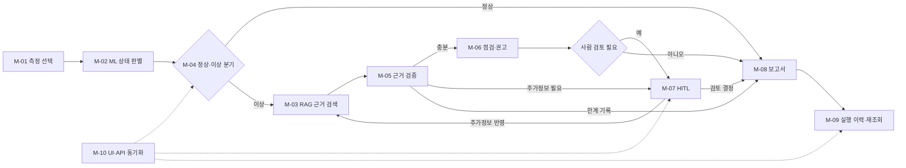
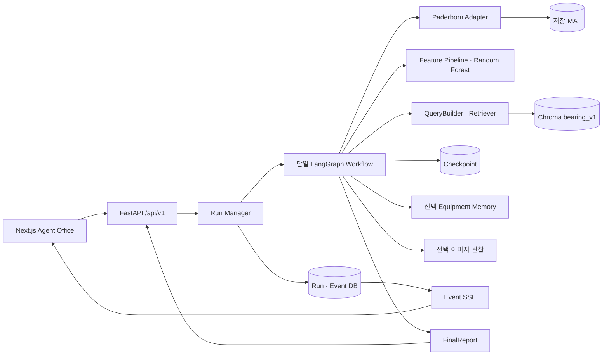

# AI Smart Factory Agent Office
## 기능 요구 명세서 (SRS)

## 1. 문서 목적과 판정 기준

이 문서는 저장된 Paderborn 베어링 측정 데이터를 선택해 ML로 상태를 판별하고, 필요할 때 기술문서 근거·Agent 판단·사람 검토를 거쳐 보고서와 실행 이력을 확인하는 MVP의 요구사항을 정의한다. 추진 배경과 일정은 [프로젝트 기획서](01_%E1%84%91%E1%85%B3%E1%84%85%E1%85%A9%E1%84%8C%E1%85%A6%E1%86%A8%E1%84%90%E1%85%B3_%E1%84%80%E1%85%B5%E1%84%92%E1%85%AC%E1%86%A8%E1%84%89%E1%85%A5.md)를 따른다.

이 명세서의 **Must 기능은 M-01~M-10, 총 10개**다. 사용자가 경험하는 하나의 진단 흐름을 기준으로 묶었다. 아래의 세부 처리 단계와 코드·테스트 파일 수는 Must 기능 수에 더하지 않는다. `Should`는 보조 기능, `PoC`는 독립 실험이다. 비기능 요구사항은 기능 개수와 별도로 적용되는 품질·안전 조건이다. 10개 내외는 평가 준비를 위한 권고이며, 기능 개수 자체가 합격을 보장하지 않는다.

`AC`는 인수 기준이다. **코드 존재**, **보관된 과거 실행 기록**, **현재 코드의 자동 시험 결과**, **제출 환경의 인수 시험 결과**를 구분한다. 2026-10-19 로컬 자동 시험과 배포 서비스 대표 흐름의 확인 결과는 7절에 기록했다. 종합 기능 인수 판정은 M-01~M-10 모두 `PASS`다. M-01의 비정상 입력 거부는 로컬 시험으로, 재시작 후 서비스 표시와 결과 복원은 공개 화면으로 확인했다. 과거 보고서도 해당 시점과 사례의 근거로만 사용한다. Must를 묶었다고 하위 동작의 결함이나 안전 조건이 평가에서 제외되는 것은 아니다.

| 용어 | 의미 |
|---|---|
| Measurement | 저장된 MAT 측정 기록. 실시간 센서 입력이 아니다. |
| ML 판정 | `normal`/`abnormal` 상태 분류. 실제 설비 고장 확정이 아니다. |
| RAG Evidence / Citation | 기술문서에서 찾은 근거 / 보고서의 출처 참조. 검색 결과 자체가 정답 보증은 아니다. |
| Run / AgentState | 한 번의 진단 실행 / LangGraph가 갱신하는 실행 상태. |
| HITL | 추가 정보 또는 조치 검토를 위한 사람 입력. 승인도 실제 정비 실행을 뜻하지 않는다. |
| Checkpoint / Event | 중단·재개를 위한 상태 / 실행 순서를 기록하는 사건. |
| SSE | 저장된 Agent Event의 웹 전달 방식. 원시 센서 Streaming이 아니다. |

## 2. 대상 사용자와 범위

설비보전·생산기술 담당자는 저장된 측정 데이터와 진단 결과를 확인하고, 검토자는 필요 시 HITL 요청에 답한다. Data/ML·Knowledge 담당자는 모델과 기술문서 색인을 오프라인에서 준비한다. 이 명칭은 업무 역할이며, 현재 서비스에 로그인이나 사용자별 접근 권한이 구현되었다는 뜻은 아니다.

| 구분 | 범위 |
|---|---|
| Must | 측정 데이터 선택, ML 판정, 이상 경로의 기술문서 검색, 상태형 Agent 진단, 근거 확인, 점검·조치 권고, 조건부 HITL, 보고서, 저장된 실행 이력, UI/API 연결 |
| Should | 오프라인 모델 학습·평가, 기술문서 수집·색인 운영, 설비별 Memory·정비 기록, 관리 정보 조회, 선택 이미지 품질 관찰 |
| PoC | KAMP CNC Observation 변환과 독립 Guidebook 검색. Bearing 제품과 별도 범위 |
| 제외·향후 확장 | 실제 센서 실시간 수집, PLC 직접 제어, 자동 설비 정지·정비, 새 Bearing 일반화, CNC 전체 Agent 통합, 계정·권한 관리 |

현재 구현의 진단 reasoner·verifier·planner는 결정론적 Python 로직이다. 외부 LLM을 사용한다고 표기하지 않는다. UI의 역할 표현은 독립 LLM Agent 수를 뜻하지 않는다.

## 3. Must 기능 10개

| ID | 평가 단위 | 핵심 결과 | 기존 세부 요구사항 연결 |
|---|---|---|---|
| M-01 | 저장 측정 데이터 선택·미리보기 | 선택한 Measurement와 표시 데이터의 일치 | FR-DATA-001~004 |
| M-02 | ML 상태 판별 | 전체 측정 신호 기반 정상/이상 결과 | FR-ML-001~003 |
| M-03 | 이상 경로의 기술문서 근거 검색 | 출처가 있는 Evidence 또는 근거 부족 상태 | FR-RAG-002~005 |
| M-04 | 진단 Run의 조건부 실행 | 정상·이상·실패 경로가 구분된 실행 상태 | FR-AGENT-001~003, FR-AGENT-008 |
| M-05 | 근거 검증과 유한 재탐색 | 충분·부족·충돌 상태와 한계 표시 | FR-AGENT-004~005 |
| M-06 | 점검 계획·조치 권고 | 근거와 사람 검토 조건을 가진 권고 | FR-AGENT-006 |
| M-07 | 필요 시 사람 검토·재개 | 같은 Run의 WAITING·응답·후속 처리 | FR-HITL-001~004 |
| M-08 | 최종 진단 보고서 | 판정·근거·권고·사람 결정·한계의 연결 | FR-AGENT-007 |
| M-09 | 실행 이력·저장 결과 재조회 | Run·Event·준비된 보고서 복원 | FR-MEM-001~002, FR-UI-004 |
| M-10 | 화면과 API 상태 동기화 | 사용자가 진행·결과·오류를 이해하고 탐색 | FR-UI-001~003, FR-API-001~003 |

M-04가 전체 Run을 조정하고 M-10이 각 상태를 화면에 전달한다. M-03·M-05·M-06은 이상 경로에서, M-07은 사람 검토가 필요한 경우에만 실행된다.

### M-01. 저장 측정 데이터 선택·미리보기

- **입력·처리:** UI의 대표 Paderborn Measurement를 선택한다. Adapter는 식별자·운전조건·시간축을 보존하고, 미리보기는 저장 신호의 표시용 일부를 반환한다. 표시용 Replay를 전체 추론 입력으로 바꾸지 않는다.
- **출력:** 선택 ID와 대응하는 요약·Preview 및 화면 표시.
- **AC1:** 같은 MAT 입력은 같은 Measurement ID로 식별되고 UI 선택 대상과 일치한다.
- **AC2:** Preview는 해당 측정의 시간축·신호를 표시하며 목록 응답에 원시 신호 배열을 포함하지 않는다.
- **AC3:** 누락·미등록 ID 또는 유효하지 않은 신호·시간축은 명시적 오류로 처리한다.
- **근거:** [Paderborn Adapter](../backend/app/data/adapters/paderborn.py), [분석 API](../backend/app/api/v1/analysis.py), [화면](../frontend/src/app/page.tsx), [Adapter 시험](../backend/tests/test_paderborn_discovery.py).

### M-02. ML 상태 판별

- **입력·처리:** 저장 측정의 진동 1채널·전류 2채널에서 1초 비중첩 Window와 채널별 시간 8개·주파수 4개, 총 36개 Feature를 고정 순서로 만든다. 활성 Random Forest의 Window별 `damaged` 확률 평균을 0.5 기준으로 분류한다.
- **출력:** `AnalysisResult`의 `normal` 또는 `abnormal`, 모델 식별자와 confidence. Confidence는 보정된 고장 확률이 아니다.
- **AC1:** 유효한 대표 측정에서 활성 입력 사양에 맞는 36개 Feature가 생성된다.
- **AC2:** 모델 결과가 정상/이상 상태·confidence·모델 정보로 연결되고, 정답 metadata는 Feature에 주입되지 않는다.
- **AC3:** 채널·Feature·모델 오류를 정상 판정으로 대체하지 않고 식별 가능한 실패로 전달한다.
- **근거:** [Feature Pipeline](../backend/app/ml/features/pipeline.py), [추론 서비스](../backend/app/ml/inference/service.py), [입력 사양](../artifacts/ml/baseline_v1/input_spec.json), [ML 평가](../artifacts/ml/baseline_v1/BASELINE_REPORT.md).

### M-03. 이상 경로의 기술문서 근거 검색

- **입력·처리:** 이상 판정과 허용된 운전 문맥에서 진단·점검 목적의 질의를 만든다. 오프라인에 준비된 `bearing_v1` 색인을 검색하고 문서 출처와 Chunk 참조를 유지한다. 정상 경로에 동일한 검색을 의무화하지 않는다.
- **출력:** 출처를 추적할 수 있는 Evidence와 검색 통계, 또는 근거 부족·검색 실패의 구분.
- **AC1:** 검색 질의가 측정 정답 고장 라벨을 사용자의 판정 근거처럼 누출하지 않는다.
- **AC2:** 반환 Evidence에 문서·Chunk·출처 식별자가 있고 이후 Citation과 연결된다.
- **AC3:** 빈 결과와 검색 실행 실패를 구분하여 Agent가 확신 없는 결론을 만들지 않게 한다.
- **근거:** [질의 구성](../backend/app/rag/retrieval/query_builder.py), [Retriever](../backend/app/rag/retrieval/service.py), [근거 매핑 시험](../backend/tests/test_evidence_mapping.py), [검색 평가](../artifacts/rag/bearing_v1/retrieval/RETRIEVAL_REPORT.md).

### M-04. 진단 Run의 조건부 실행

- **입력·처리:** Run ID로 분석·검색·보고를 연결한다. 정상 판정은 단축 보고 경로로, 이상 판정은 근거 검증과 권고 경로로 분기한다. 필수 처리 실패는 별도의 실패 상태다. 선택 이미지는 첨부된 경우에만 보조 관찰 경로를 거친다.
- **출력:** `RUNNING`·`WAITING`·`COMPLETED`·`FAILED` 등의 Run 상태와 순서 있는 Event.
- **AC1:** 정상·이상 대표 입력이 각기 정의된 Graph 경로로 이동한다.
- **AC2:** 이미지가 없어도 핵심 센서 진단이 진행되며, 이미지 관찰을 고장 확정으로 사용하지 않는다.
- **AC3:** 필수 Tool·Workflow 오류는 `COMPLETED`로 위장하지 않고 실패 상태·오류 Event로 남긴다.
- **근거:** [Graph](../backend/app/agent/graph.py), [Run Manager](../backend/app/agent/run_manager.py), [경로 기록](../artifacts/e2e/route_validation.json), [실패 시험](../backend/tests/test_workflow_error.py).

### M-05. 근거 검증과 유한 재탐색

- **입력·처리:** 이상 경로의 Evidence로 진단 후보를 만들고 `SUFFICIENT`·`PARTIAL`·`INSUFFICIENT`·`CONFLICTING`을 구분한다. 부족·충돌 시 재검색 또는 추가정보 요청은 설정된 한도 내에서만 수행한다.
- **출력:** 검증 상태·후보·불확실성과 후속 경로.
- **AC1:** 진단 후보가 실제 Evidence ID를 참조하며 부족한 근거를 충분한 근거로 표기하지 않는다.
- **AC2:** 재검색·추가정보 반복이 설정된 한도를 넘지 않는다.
- **AC3:** 근거가 끝내 부족하면 한계를 담은 후속 보고 또는 사람 검토 경로로 이동한다.
- **근거:** [Reasoner·Verifier](../backend/app/agent/reasoning.py), [분기](../backend/app/agent/routing.py), [반복 한도 시험](../backend/tests/test_retry_limit.py).

### M-06. 점검 계획·조치 권고

- **입력·처리:** 검증된 후보와 근거에서 순서·이유가 있는 점검 단계 및 제한된 유형의 조치 권고를 만든다. 중요 조치 또는 높은 우선순위는 사람 검토 조건으로 전달한다.
- **출력:** 점검 계획, 권고, 관련 Evidence ID, 승인 필요 여부.
- **AC1:** 점검 단계와 권고가 후보·근거·이유에 연결된다.
- **AC2:** 정책상 검토가 필요한 조치는 승인 없이 실행 완료로 처리하지 않는다.
- **AC3:** 권고는 설비 제어 명령을 실행하지 않으며 안전 Interlock 우회를 요구하지 않는다.
- **근거:** [조치 계획](../backend/app/agent/actions.py), [정책](../backend/app/agent/policies/action_policy.py), [안전 시험](../backend/tests/test_safety_guardrails.py).

### M-07. 필요 시 사람 검토·재개

- **입력·처리:** Workflow가 추가정보 또는 승인 검토를 요청할 때 `WAITING` 상태와 `HumanRequest`를 저장한다. 유효한 `request_id`의 응답을 같은 Run에 적용한다. 모든 Run에 HITL을 강제로 발생시키지는 않는다.
- **출력:** 사람 응답·의견이 반영된 후속 상태와 보고서. 승인·거절·수정 요청은 서로 다른 결정이다.
- **AC1:** 검토가 필요한 Run에서 요청 내용과 `WAITING` 상태를 조회할 수 있다.
- **AC2:** 유효한 응답은 같은 Run을 재개하고 결정 또는 추가정보를 후속 문맥에 연결한다.
- **AC3:** 이미 처리한 요청을 중복 적용하지 않으며 승인·Workflow 완료를 실제 정비 완료로 표시하지 않는다.
- **근거:** [사람 요청·응답 Schema](../backend/app/agent/schemas.py), [응답 API](../backend/app/api/v1/agent.py), [재개 시험](../backend/tests/test_human_resume.py), [API 시험](../backend/tests/test_human_input_api.py).

### M-08. 최종 진단 보고서

- **입력·처리:** 정상 경로 또는 이상 경로에서 분석 결과, 검증 상태, 권고, 사람 상호작용, 출처, 버전과 한계를 구조화한다. 보고 준비 전 조회는 준비되지 않았음을 반환한다.
- **출력:** Run ID에 연결된 `FinalReport`.
- **AC1:** 완료된 대표 Run의 보고서가 판정·점검/권고·한계를 포함하고 해당 Run ID와 일치한다.
- **AC2:** 인용한 기술문서가 반환된 Evidence의 문서·Chunk 식별자와 대응한다.
- **AC3:** 사람의 승인·거절과 Agent 진단 완료를 실제 설비 조치 완료로 혼동하지 않게 기록한다.
- **근거:** [보고서 Schema](../backend/app/agent/schemas.py), [보고서 생성 노드](../backend/app/agent/nodes.py), [Citation 시험](../backend/tests/test_report_citations.py), [E2E 보고서](../artifacts/e2e/E2E_INTEGRATION_REPORT.md).

### M-09. 실행 이력·저장 결과 재조회

- **입력·처리:** 저장 Run 목록에서 선택한 Run의 상태·Event·준비된 보고서를 다시 조회한다. Checkpoint와 Run DB는 Run ID로 논리 연결한다. 저장 결과의 재조회와 강제 종료 후 자동 재실행은 다른 요구다.
- **출력:** 페이지가 있는 실행 목록, Run 상세, 순서 있는 Event, 저장 보고서.
- **AC1:** 목록에서 고른 Run ID로 해당 상세·Event·보고서에 접근할 수 있다.
- **AC2:** 동일한 저장소를 다시 연 뒤 완료 Run의 결과를 재조회할 수 있다.
- **AC3:** 미등록 Run이나 아직 준비되지 않은 보고서는 다른 Run의 결과를 반환하지 않는다.
- **근거:** [Run Manager](../backend/app/agent/run_manager.py), [실행 API](../backend/app/api/v1/agent.py), [이력 목록 시험](../backend/tests/test_agent_run_list.py), [복원 기록](../artifacts/e2e/refresh_reconnect.json).

### M-10. 화면과 API 상태 동기화

- **입력·처리:** UI는 REST로 Run을 시작·조회하고 저장 Event를 SSE로 받아 Agent Office·상세 결과·오류 상태에 반영한다. 연결이 끊기면 마지막 sequence 이후 재연결하거나 저장 상태를 재조회한다.
- **출력:** PC·모바일에서 핵심 판정·진행·근거·사람 요청·보고서로 이어지는 화면.
- **AC1:** 시작 요청의 Run ID, 이후 상태와 화면 표시가 일치한다.
- **AC2:** Event 순서와 중복 제거가 유지되고 일시 연결 오류를 새 진단 완료로 오해하지 않는다.
- **AC3:** 정상·이상·WAITING·FAILED를 구분해 보여 주고 상세 결과와 보고서로 이동할 수 있다.
- **근거:** [UI](../frontend/src/app/page.tsx), [실행 Hook](../frontend/src/features/agent-run/hooks/use-agent-run.ts), [Reducer 시험](../frontend/src/features/agent-run/reducer.test.ts), [SSE API](../backend/app/api/v1/agent.py).

## 4. 보조 기능과 독립 PoC

다음은 기존 명세의 기능을 삭제한 목록이 아니다. Must 진단 흐름의 준비·운영 또는 선택 확장으로 관리한다. 선택 기능을 사용한 경우에는 해당 경로의 안전·오류 처리를 별도로 검증한다.

| 구분 | 기능 | 기존 ID | 현재 경계 |
|---|---|---|---|
| Should | 오프라인 모델 학습·분리·평가 | FR-ML-004 | 추론 요청 중 자동 재학습하지 않는다. 보관 성능은 해당 데이터 분리 범위의 결과다. |
| Should | 기술문서 원문 수집·색인 | FR-RAG-001 | 사용자 문서 업로드 API가 아니라 오프라인 준비 절차다. |
| Should | 설비별 Memory·명시적 정비 기록 | FR-MEM-003~004 | 기술문서 Chroma와 분리한다. 추론된 이력과 사람이 입력한 정비를 구분한다. |
| Should | Knowledge·Model·System 정보 조회 | FR-UI-005 | 현재 제공 API의 범위로 제한한다. |
| Should | 선택 이미지 업로드·품질 관찰 | FR-VISION-001~002 | 사진은 보조 관찰이며 내부 고장 판독이나 필수 입력이 아니다. |
| PoC | KAMP CNC Observation 변환·독립 검색 | FR-POC-001~002 | Bearing 모델·전체 Agent Workflow에 통합되었다고 표시하지 않는다. |

## 5. 비기능·안전 조건

비기능 조건은 Must 기능 10개에 추가해 세는 독립 사용자 기능이 아니다. **평가 대상에서 숨기거나 면제하는 조건도 아니다.** 관련 Must의 인수 시험과 함께 확인한다.

| ID | 조건 | 확인 범위 |
|---|---|---|
| NFR-PERF-001 | 단계별 처리 시간 측정 | 입력·환경·측정 구간을 함께 기록하고 단일 로컬 수치를 운영 성능으로 일반화하지 않는다. |
| NFR-RELIABILITY-001 | 실패 식별과 반복 한도 | 필수 처리 실패, 근거 부족, 선택 이미지 사용 불가를 구분한다. M-04·M-05와 연결한다. |
| NFR-SECURITY-001 | 입력·공개 데이터 경계 | Schema·파일 검증, 오류 응답, 이미지 내부 경로 비노출을 확인한다. 인증·사용자별 실행 이력 권한이 구현되었다고 주장하지 않는다. |
| NFR-AVAILABILITY-001 | 준비 상태·외부 접속 | `health`와 `ready`를 분리하고 배포 시 관측 시각·환경을 기록한다. |
| NFR-RECOVERY-001 | 저장 결과 복원 | 정상 재조회와 진행 중 작업의 강제 종료 복구를 구분한다. 후자의 자동 재실행은 현재 보장하지 않는다. |
| NFR-MAINTAINABILITY-001 | 모듈 계약 | Adapter·ML·Retriever·Workflow 경계를 유지하고 새 설비 호환성을 별도 검증한다. |
| NFR-OBSERVABILITY-001 | Run·Event 추적 | Run ID·Event sequence·시간·오류를 연결해 기록한다. |
| NFR-TRACEABILITY-001 | 근거·버전 추적 | Evidence–Citation, 모델·지식팩·Workflow 버전을 보고서와 연결한다. |
| NFR-PORTABILITY-001 | 실행 자산 준비 | 데이터·모델·색인·Runtime DB가 Git 저장소에 모두 포함되어 있다고 가정하지 않는다. |
| NFR-USABILITY-001 | 과업 기반 사용성 | 사용자 시험은 기능 자동화와 구분한다. [피드백 기록](03_%E1%84%89%E1%85%A1%E1%84%8B%E1%85%AD%E1%86%BC%E1%84%8C%E1%85%A1_%E1%84%91%E1%85%B5%E1%84%83%E1%85%B3%E1%84%87%E1%85%A2%E1%86%A8_%E1%84%80%E1%85%B5%E1%84%85%E1%85%A9%E1%86%A8.md)의 익명 유효 응답은 6건이며 고유 참여자 수는 별도 확인 대상이다. |

현재 FastAPI 실행 목록·상세·보고서 경로에는 앱 내부의 사용자 인증·소유권 검사가 없다. `actor`와 HITL 자유 입력은 보고서에 포함될 수 있으므로, 개인정보가 포함된 실행 이력을 공개 서비스에서 다룰 때는 접근 통제·응답 범위·보관 정책을 별도로 검증하고 보완해야 한다. 이를 해결된 기능으로 표시하지 않는다. 근거: [실행 API](../backend/app/api/v1/agent.py), [입력·보고서 Schema](../backend/app/agent/schemas.py), [앱 Middleware](../backend/app/main.py).

AI 결과와 권고는 사람 판단을 보조한다. 정상/이상 판정, Workflow 완료, HITL 승인, 실제 정비 완료는 서로 다른 상태다. PLC 직접 명령·안전 Interlock 우회·자동 설비 정지·정비는 현재 범위에 없다.

## 6. 구현 경계와 데이터 흐름

| 계약·저장 경계 | 핵심 내용 |
|---|---|
| Measurement / AnalysisResult | 측정 ID와 운전조건을 보존하고 ML 판정과 정답 metadata를 분리한다. |
| AgentState / Checkpoint | Run ID를 기준으로 분기·카운터·근거·사람 요청·보고서 상태를 저장한다. |
| Run DB / Event DB | `agent_runs`, `agent_events`, `resolved_human_requests`를 사용한다. Event는 순서와 Run ID를 갖는다. |
| FinalReport | 판정·후보·계획·권고·사람 상호작용·한계·Citation·버전을 포함한다. |
| 별도 저장소 | Memory SQLite, 이미지 파일·SQLite, Chroma 색인은 Run DB와 하나의 원자적 트랜잭션이 아니다. |

대표 API는 `POST /api/v1/agent/runs`, `GET /api/v1/agent/runs`, `GET /api/v1/agent/runs/{run_id}`, `GET /api/v1/agent/runs/{run_id}/events/stream`, `POST /api/v1/agent/runs/{run_id}/human-input`, `GET /api/v1/agent/runs/{run_id}/report`다. 분석 미리보기는 `GET /api/v1/measurements/{measurement_id}/preview`다. 생성 요청의 HTTP 202는 Workflow 완료를 뜻하지 않는다. 실제 경로·응답은 [API Router](../backend/app/api/v1/router.py), [Agent API](../backend/app/api/v1/agent.py), [Analysis API](../backend/app/api/v1/analysis.py)를 따른다.

정상 경로는 불필요한 기술문서 검색을 건너뛴다. 이상 경로는 Evidence 검증 후 권고·필요한 사람 검토를 수행한다. 근거 부족은 제한된 재검색·추가정보 또는 한계가 명시된 보고로 이어진다. HITL의 시연용 통제 조건은 실제 위험 발생 빈도·현장 성능의 증거로 사용하지 않는다. 서비스 재시작 후 저장 결과 재조회와 `RUNNING` 작업의 자동 재큐잉도 구분한다.

### 6.1 AI 구성과 해석 범위

| 요소 | 현재 구성 | 결과 해석의 경계 |
|---|---|---|
| ML | 저장 Paderborn 입력의 36개 Feature와 `bearing_rf_binary_v1` Random Forest | 측정 데이터의 상태 판별이다. 신규 Bearing·현장 데이터의 일반화나 실제 고장 확정을 보장하지 않는다. |
| RAG | 출처 Manifest로 준비한 `bearing_v1` 색인과 384차원 HashingVectorizer 기반 검색 | Transformer 의미 검색이나 검색 결과의 물리적 정답 보증이 아니다. Evidence ID와 Citation을 대조한다. |
| Agent | 단일 LangGraph와 결정론적 reasoner·verifier·planner | 외부 LLM의 자율 판단으로 설명하지 않는다. 검증 상태·반복 한도·사람 검토 조건을 따른다. |
| 선택 이미지 | 사진의 품질·관찰 정보를 보조 문맥으로 사용 | 내부 고장 판독이나 필수 센서 입력을 대체하지 않는다. |

모델 학습·평가의 자료 범위는 [ML 기준선 보고서](../artifacts/ml/baseline_v1/BASELINE_REPORT.md), 검색 품질과 한계는 [RAG 검색 평가](../artifacts/rag/bearing_v1/retrieval/RETRIEVAL_REPORT.md)를 참조한다. 두 자료의 과거 결과를 현재 제출 환경의 통과 판정으로 환산하지 않는다.

## 7. 인수 검증 계획과 추적성

2026-10-19 23:21 KST, 로컬 `main` HEAD `974b900`의 코드와 현재 작업 트리에서 자동 시험을 재실행했다. 백엔드 `./.venv/bin/pytest -q --disable-warnings --maxfail=1`은 **162개 통과**, 프런트엔드 `npm test`는 **33개 통과**했다. `npm run lint`와 `npm run build`도 통과했다. 백엔드 시험에는 로컬 데이터·모델·검색 자산을 이용한 정상·이상·통제 HITL 경로의 통합 시험이 포함된다. 이 실행은 로컬 코드 검증이며, 배포 서비스의 PC·모바일 화면, 운영 환경, 모든 AC를 대상으로 한 인수 시험은 아니다.

2026-10-19 23:23~23:26 KST, [배포 서비스](https://factory.aipath.kr/)에서 새 진단 3건을 실행했다. [A · 정상](https://factory.aipath.kr/history/run_4dd605ef8c4b482fb1b392b7da08630a)은 정상 판정·검색 생략·정상 보고서, [B · 이상](https://factory.aipath.kr/history/run_66727767156b41dc80b7c8d26e865bcf)은 이상 판정·기술 근거 9건·진단 후보·점검 계획·권고·보고서, [C · HITL](https://factory.aipath.kr/history/run_41687edf8b4e4eb6b92b6b5da221ac0e)는 `WAITING`에서 가상 의견 `SYNTHETIC_TEST_ONLY`와 거절 결정을 적용한 뒤 동일 진단이 완료되고 그 결정이 보고서와 이력에 남는 것을 확인했다. 세 결과는 이력 목록에서 다시 열 수 있었고 A 상세는 새로고침 뒤에도 복원됐다. 미등록 Run은 다른 진단 대신 찾을 수 없다는 오류를 표시했다. 모바일 390px 화면에서 결과 요약·보고서 바로가기와 가로 넘침 없음을 확인했다. 시스템 화면에는 Backend API·모델·데이터·Knowledge Base·Vector DB의 준비 상태가 표시됐다. 화면에 표시된 앱 버전 `0.1.0`만으로 배포 커밋과 로컬 HEAD의 일치를 확인할 수는 없다.

배포 서비스의 Frontend·Backend 프로세스 작업 디렉터리는 이 저장소로 확인했다. 실행 중인 서비스가 어느 Git 커밋으로 빌드·시작됐는지는 노출된 상태 API·실행 스크립트·로그에서 확인할 수 없었다. 따라서 아래 로컬·격리 시험을 배포 바이너리의 동일 버전 증빙으로 사용하지 않는다.

2026-10-19 23:43 KST 재시작 후에는 상황이 달라졌다. GitHub `main`과 일치하는 로컬 HEAD `d36f5b4`가 23:41에 반영된 뒤 Frontend 빌드가 23:43에 생성됐고, Frontend·Backend 프로세스가 이 저장소에서 새로 시작됐다. 당시 작업 트리는 깨끗하며 로컬 자동 시험 시점의 `974b900`부터 `d36f5b4`까지 `backend/`와 `frontend/`의 변경은 없었다. 재시작된 공개 화면에서 Backend 응답과 기존 HITL Run의 완료 상태·Event 46건·보고서 복원을 확인했다. 이 근거는 당시 소스와 실행 빌드의 대응을 뒷받침하지만, 서비스가 Git SHA를 직접 표시하는 방식의 독립적인 버전 증빙은 아니다. 이후 M-01 코드 수정과 재시작은 아래에 별도로 기록했다.

2026-10-19 23:30~23:36 KST, M-10 예외 상황을 운영 DB와 분리해 재실행했다. 백엔드의 [SSE 재연결 시험](../backend/tests/test_agent_event_stream.py)과 [실패 Event 시험](../backend/tests/test_workflow_error.py)을 포함한 관련 pytest **4개**, 프런트엔드 [복구·Reducer 시험](../frontend/src/features/agent-run/active-run-recovery.test.ts) **11개**가 통과했다. 별도 임시 프런트엔드와 `127.0.0.1` 가상 API로 화면도 확인했다. 첫 SSE를 끊자 `재연결 중`으로 표시된 뒤 `after_sequence=1`부터 두 번째 연결을 받아 Event 2건의 완료 상태가 되었고, 가상 `workflow_error`는 `실패`·`진단 실패`·실행 알림으로 표시되며 보고서 완료로 표시되지 않았다. 임시 API의 측정·Run·오류 문구는 모두 합성 데이터다. 이 시험은 배포 서비스에 장애를 주입한 결과가 아니다.

Must 10개 각각에 대해 대표 입력·기대 결과·실제 결과·실행 시각·코드 버전·환경·증빙을 한 기록에 연결한다. 정상/이상/HITL 대표 흐름은 서로 다른 테스트다. `PASS`는 배포 대표 흐름과 동일 소스의 로컬·격리 시험을 함께 대조한 종합 기능 판정이며, 모든 예외를 공개 서비스에 주입했다는 뜻은 아니다. `PARTIAL`은 일부 AC의 처리 경로가 남았다는 뜻이다. 과거 자료를 현재 제출 커밋의 시험으로 소급하지 않는다.

2026-10-19 23:45~23:47 KST, M-01·M-03의 누락 경계를 운영 DB와 분리한 임시 입력으로 확인했다. M-01은 신호·시간축 길이 불일치를 `InvalidMeasurementError`로 거부하고 NaN 시간축은 `validate()`에서 오류로 보고했지만, 같은 NaN 시간축을 `load_measurement()`가 직접 읽을 때는 거부하지 않았다. M-03은 빈 검색 결과가 근거 없는 후보 없이 `INSUFFICIENT/WAITING`으로, 검색 예외가 `RAG_ERROR/FAILED`와 오류 Event로 이어졌다. 이 합성 입력 시험은 배포 서비스 데이터 변경 없이 수행했다.

2026-10-19 23:54 KST, M-01의 직접 로드에도 비수치·유한하지 않은 신호와 시간축을 거부하는 검사를 추가했다. 새 경계 시험 2개를 포함한 백엔드 전체 **164개 시험**, Ruff 검사·형식 검사, 실제 Paderborn **240개 측정 데이터 검증**이 통과했다. 수정 커밋 `de5383f`가 로컬·공개 `main`에 반영된 뒤 23:56 KST에 서비스가 재시작됐다. 백엔드·프런트엔드가 이 저장소에서 실행 중이고 공개 화면에서 백엔드 응답과 기존 진단 결과의 복원을 확인했다. 합성 NaN 입력은 운영 서비스에 주입하지 않았으며, 그 거부 동작은 동일 소스의 격리 시험 근거다. 이를 종합해 M-01 기능 인수 판정을 `PASS`로 갱신한다.

| Must | 대표 인수 흐름 | 관련 기존 테스트·보관 자료 | 로컬 자동 시험 | 종합 인수 판정 |
|---|---|---|---|---|
| M-01 | 대표 측정 선택·Preview·잘못된 ID | [Adapter 시험](../backend/tests/test_paderborn_discovery.py), [NaN 입력 시험](../backend/tests/test_paderborn_load.py) | 관련 시험 통과 | PASS · 배포 측정 표시·결과 복원, 로컬 비정상 입력 거부 시험 통과 |
| M-02 | 정상·이상 ML 판정 및 입력 오류 | [추론 시험](../backend/tests/test_ml_inference.py), [입력 오류 시험](../backend/tests/test_analysis_errors.py) | 관련 시험 통과 | PASS · 배포 정상·이상 판정, 36개 Feature·정답 분리·모델/Feature 오류 시험 |
| M-03 | 이상 질의·Citation·빈 검색 | [Retriever 시험](../backend/tests/test_retriever.py), [Citation 시험](../backend/tests/test_report_citations.py) | 관련 시험 통과 | PASS · 배포 근거 9건, 격리 입력의 빈 검색·검색 오류 구분 |
| M-04 | 정상·이상·실패 Graph 경로 | [경로 시험](../backend/tests/test_graph_routing.py), [실패 시험](../backend/tests/test_workflow_error.py) | 관련 시험 통과 | PASS · 배포 A/B/C 분기, 격리 실패·이미지 없는 경로 확인 |
| M-05 | 충분·부족·충돌 근거와 한도 | [검증 분기 시험](../backend/tests/test_verification_routing.py), [재검색 시험](../backend/tests/test_retry_limit.py) | 관련 시험 통과 | PASS · 배포 충분 경로, 격리 부족·충돌·반복 한도와 한계 보고 확인 |
| M-06 | 점검 계획·중요 조치 검토 | [계획 연결 시험](../backend/tests/test_inspection_plan_schema.py), [안전 시험](../backend/tests/test_safety_guardrails.py) | 관련 시험 통과 | PASS · 배포 계획·권고·검토, 격리 근거 연결·무단 제어 금지 확인 |
| M-07 | WAITING·승인/거절·중복 응답 | [HITL 시험](../backend/tests/test_human_resume.py), [API 시험](../backend/tests/test_report_api.py) | 관련 시험 통과 | PASS · 배포 대기·거절·재개, 격리 승인·중복 응답 거부 확인 |
| M-08 | 정상·이상 보고서와 Citation | [보고서 시험](../backend/tests/test_report_api.py), [Citation 시험](../backend/tests/test_report_citations.py) | 관련 시험 통과 | PASS · 배포 A/B/C 보고서, 격리 Citation·보고 준비 전 오류 확인 |
| M-09 | 목록·상세·저장 결과 재조회 | [목록 시험](../backend/tests/test_agent_run_list.py), [보고서 API 시험](../backend/tests/test_report_api.py) | 관련 시험 통과 | PASS · 배포 이력·재시작 후 복원, 격리 페이지·미등록/미준비 오류 확인 |
| M-10 | 진행 Event·상태·화면 동기화 | [Reducer 시험](../frontend/src/features/agent-run/reducer.test.ts), [SSE 기록](../artifacts/api/agent_sse/AGENT_API_SSE_REPORT.md) | 관련 시험 통과 | PASS · 배포 대표 흐름·재시작 후 복원 확인, 동일 소스 격리 환경에서 재연결·FAILED 확인 |

M-10의 AC1은 배포 A/B/C에서 Run 상태·Event·화면 표시가 맞는 대표 사례와 재시작 후 저장 결과 복원을 확인했다. AC2는 동일 소스의 격리 환경에서 SSE 끊김, 마지막 sequence 이후 재연결, 중복 없는 완료 표시를 확인했다. AC3은 배포 화면의 정상·이상·`WAITING`과 격리 화면의 `FAILED`를 확인했다. 세 AC의 기대 결과와 관측 결과가 일치해 M-10의 **종합 기능 인수 판정은 `PASS`**다. 배포 서비스 자체에 연결 장애나 실패를 인위적으로 주입한 결과는 아니다.

검증 결과는 `PASS`(해당 AC의 기대·관측 일치), `PARTIAL`(일부 처리 경로 보완 또는 확인 필요), `FAIL`(실행했으나 불일치), `BLOCKED`(실행을 시도했으나 판정 불가), `NOT RUN`(해당 환경에서 실행 기록 없음)으로 구분한다. 테스트 코드가 존재한다는 사실만으로 PASS를 부여하지 않는다. 현재 확인한 기능 인수 범위에서 Must 10개는 모두 `PASS`이며, 비기능 조건과 공식 평가 결과는 별도로 판정한다.

기존 41개 FR·10개 NFR·153개 AC의 세부 기준과 이전 검토 내용은 이 문서의 Git 이력에서 확인할 수 있다. 이 문서에서는 41개 세부 FR을 Must 10개 묶음, Should 5개 묶음, PoC 1개 묶음에 대응시켰다. 요구사항을 합쳤다는 이유로 이전에 확인된 결함이나 미검증 범위를 해결된 것으로 처리하지 않는다.
